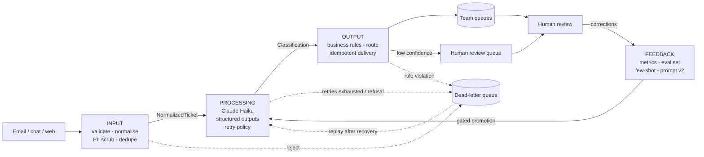

# D1.2 - End-to-End Architecture and Feedback Loops

> **Exam objective:** "Design end-to-end architectures (input → processing → output → feedback loops)"

## Why it matters

The model call is usually less than 10% of the code in a production Claude system. What makes it reliable is
everything around it: inputs that are validated, minimised and de-duplicated before they reach the model;
outputs that are validated before they reach a customer; failures that are retried or parked instead of
silently dropped; and a **feedback loop** that turns human corrections into measurable improvement.
Architects are expected to draw these boundaries explicitly and say what crosses each one.

## Key concepts

### 1. Stages with typed contracts

| Stage | Input -> Output contract | Owns | Typical failure | Action |
|---|---|---|---|---|
| **Input** | `RawTicket -> NormalizedTicket` | validation, normalisation, PII scrub, dedupe | empty/malformed record | DLQ (needs a human, never retry) |
| **Processing** | `NormalizedTicket -> Classification` | prompt, model, structured output, retry policy | transient API error, truncation, refusal | retry with backoff / bigger budget; refusal -> human |
| **Output** | `Classification -> RoutedTicket` | business rules, routing, idempotent delivery | PII leak, low confidence, rule violation | DLQ or human-review queue |
| **Feedback** | corrections -> metrics -> examples/eval set -> new prompt version | quality over time | regressions | eval gate blocks promotion |

Typed contracts make each stage independently testable, scalable and replaceable (swap the model without
touching routing; swap the queue without touching the prompt), and make it obvious which stage owns a failure.

### 2. Input stage - protect the model and the business

- **Validate** before spending tokens (empty body, missing reply address, unknown channel).
- **Normalise** (strip quoted email history, collapse whitespace) - cheaper prompts, stable fingerprints.
- **Minimise data**: redact PII (Luhn-checked card numbers, emails, phones) and send only what the task
  needs. The customer's email address never reaches the model in this lab.
- **Dedupe** with a content fingerprint so re-sent tickets are processed once.

### 3. Processing stage - structured outputs are a contract, not a guarantee of truth

- `output_config.format` (JSON schema) constrains the *shape*: valid JSON, required fields, enums.
- It does **not** enforce numeric ranges or string lengths (unsupported schema keywords) and it cannot make
  the *content* right. Validate in code (Pydantic / Zod) and apply business rules.
- **Always check `stop_reason` before parsing**:

| `stop_reason` | Meaning | Pipeline action |
|---|---|---|
| `end_turn` | complete | validate and continue |
| `max_tokens` | output truncated - JSON is incomplete | do not parse; retry with a larger (bounded) budget or shrink the input |
| `refusal` | model declined | do not retry blindly; route to a human queue |
| `tool_use` / `pause_turn` | agentic turns | not expected in a single-call classifier |

- **Retry policy**: transient = connection errors, 408/409/429, 5xx (including 529 overloaded) -> exponential
  backoff with jitter. Non-transient = 400/401/403/404/413 -> DLQ immediately. The SDKs already retry
  transient errors (`max_retries`, default 2); add pipeline-level retries for *semantic* failures
  (truncation, contract violations) and a DLQ when retries are exhausted.

### 4. Output stage

- Re-validate against business rules (no PII in summaries, priority/queue consistency).
- **Confidence floor** routes uncertain items to humans - but self-reported confidence is weakly calibrated
  (the lab's wrong answers averaged 0.82 vs 0.85 for right ones). Set thresholds from eval data, and combine
  confidence with deterministic checks.
- **Idempotent delivery** (idempotency key = ticket id) makes at-least-once processing safe: a replay or
  worker restart cannot create a second downstream ticket.

### 5. Dead-letter queue (DLQ)

A DLQ isolates "poison" items so the batch keeps flowing. Each letter records stage, reason and attempts.
Letters caused by *transient* conditions (an upstream outage) are **replayed** once the dependency
recovers; letters caused by *bad input* go to a human. Watch the DLQ rate as an operational KPI.

### 6. The feedback loop

```
human review --> corrections (field, predicted, corrected, reason)
     |                  |
     |                  +--> metrics: accuracy, override rate, DLQ rate, retries, calibration
     |                  +--> eval set (every verified item becomes a regression case)
     |                  +--> few-shot examples (representative corrections, with the reason)
     v
prompt v(n+1) --> offline eval vs v(n) on the SAME eval set --> gate (no regressions) --> promote
```

Rules of thumb: version prompts like code; evaluation runs are side-effect free (never deliver); add the
correction to the eval set *before* changing the prompt so you can prove the fix; promote only through a
gate. A/B testing in production is D4.3; dataset design is D4.2; HITL design is D5.3.

## Architecture



## What the code demonstrates

| Section | Code | What to notice |
|---|---|---|
| 0 | `RawTicket`, `NormalizedTicket`, `Classification`, `RoutedTicket`, `DeadLetter` | One contract per boundary; the JSON schema is hand-written because it *is* the contract |
| 1 | `validate_raw`, `normalize`, `scrub_pii`, `luhn_ok` | T-1003 collapses into T-1001 by fingerprint; T-1004 goes to the DLQ; card/phone redacted |
| 2 | `process()` | T-1008 truncates (`max_tokens`) and is retried with a doubled budget; T-1009 has a transient `APIConnectionError` and backs off; T-1010 exhausts retries and is dead-lettered |
| 3 | `route()`, `Outbox` | Low-confidence T-1011 goes to human review; re-delivering T-1001 is suppressed |
| 4 | DLQ replay | The outage letter is replayed successfully; the bad-input letter stays for a human |
| 5-6 | `Correction`, `compute_metrics()` | Field-level corrections with reasons; override rate; confidence calibration |
| 7 | `build_prompt()` | Corrections become few-shot examples; verified tickets become the eval set; prompt v1 -> v2 |
| 8 | Eval + gate | v1 vs v2 on the same eval set, zero regressions required before promotion |

## Run it

From the repository root:

```bash
.venv/Scripts/python "D1.2 - End-to-End Architecture and Feedback Loops/python/main.py"
node "D1.2 - End-to-End Architecture and Feedback Loops/typescript/main.ts"
```

Offline by default; failures (network blip, outage, truncation) are simulated deterministically by the
lab's responder. Live mode runs the same pipeline against the real API.

## Exam tips & traps

- **Structured outputs ≠ correct outputs.** They guarantee schema-valid JSON (when `stop_reason` is
  `end_turn`); business validation, range checks and HITL are still your job.
- **Check `stop_reason` before parsing.** `max_tokens` means truncated JSON; `refusal` means do not retry
  blindly. A common distractor is "add 'respond in valid JSON' to the prompt".
- **Retry only what is transient.** 429/5xx/529/connection errors: backoff with jitter. 400-class errors:
  fix the request or dead-letter it. Unbounded retries are an outage amplifier.
- **Self-reported confidence is a weak signal.** Calibrate thresholds on an eval set; never make it the
  only gate for a consequential action.
- **Minimise data at the input boundary** (redact PII, drop fields the task does not need) and check
  outputs for leaks - privacy by design, not by policy document (D5.4).
- **Feedback loops need a gate.** Corrections -> eval set + few-shot examples -> new prompt version ->
  offline eval with no regressions -> promote. Changing prompts straight from complaints causes regressions.
- **Idempotency + DLQ** are what make at-least-once processing safe and keep one bad item from blocking a batch.

### Practice questions

**Q1.** A document-extraction pipeline uses structured outputs. For very long documents, JSON parsing
intermittently fails. Logs show `stop_reason: "max_tokens"` on the failing calls. What is the best fix?

- A. Add "always return complete, valid JSON" to the system prompt
- B. Check `stop_reason`; on `max_tokens` do not parse - retry with a larger bounded `max_tokens` or split the document, and dead-letter after the retry budget
- C. Set `tool_choice` to force the extraction tool so the output is always complete
- D. Lower the effort setting so the model writes less

**Answer: B.** Truncation is a budget problem, detected by `stop_reason`, not a formatting problem. A does
not change the token limit; C returns a 400 on Opus 5.5 / Sonnet 5.5 and would not fix truncation anyway; D
might hide the symptom on some inputs but is not a reliable control.

**Q2.** Two weeks after launch, human reviewers override 30% of ticket priorities. The team wants to
improve quality without breaking categories that already work. Which approach is best?

- A. Switch to the largest model and redeploy immediately
- B. Capture field-level corrections with reasons, add verified tickets to an eval set, add representative corrections as few-shot examples in a new prompt version, compare against the current version on the eval set, and promote only with no regressions
- C. Raise the confidence floor to 0.95 so most tickets go to humans
- D. Ask reviewers to edit the production prompt directly when they see an error

**Answer: B.** It closes the loop with measurement and a promotion gate. A may help but is unmeasured and
costly; C hides the problem by shifting work back to humans; D causes untested regressions.

## Further reading

- Claude docs: "Structured outputs" (JSON outputs, strict tool use, schema limitations)
- Claude docs: "Handling stop reasons"
- Claude docs: "Errors" (HTTP error codes, 429 and 529 handling) and SDK retry configuration
- Claude docs prompt-engineering guide: "Use examples (multishot prompting)"
- Claude docs: "Create strong empirical evaluations"
- Anthropic engineering blog: "Building effective agents" (augmented LLM, guardrails)
- Related labs: D4.2 (eval datasets), D4.3 (A/B testing), D4.6 (logging), D5.3 (human-in-the-loop), D5.4 (privacy)
