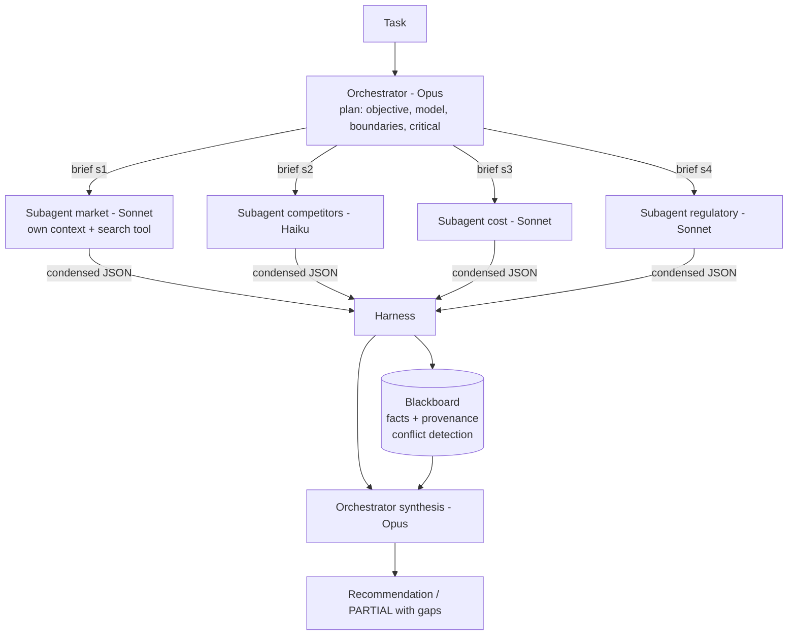

# D1.4 - Multi-Agent Systems and Orchestration

> **Exam objective:** "Design multi-agent systems and orchestration strategies"

## Why it matters

Multi-agent systems let several Claude instances work in parallel, each with a clean context window, on
parts of a problem too broad for one agent. They also multiply token spend, add coordination failure modes,
and make behaviour harder to predict. An architect has to know **which topology** fits the work, **how to
brief** subagents so they neither overlap nor leave gaps, **how state is shared**, **how failures are
contained**, and - most often tested - **when not to use multiple agents at all**.

## Key concepts

### Topologies

| Topology | Control | Use when | Watch out for |
|---|---|---|---|
| **Hierarchical** (orchestrator + subagents / orchestrator-workers) | Lead agent plans, delegates, synthesises | Broad, parallelisable research or analysis | Token multiplier; lead's context budget; vague briefs |
| **Sequential pipeline** | Code passes stage N output to stage N+1 | Fixed stage order (extract -> analyse -> write) | Latency = sum of stages; early errors propagate |
| **Peer handoff** | Conversation ownership moves agent to agent | Specialists in a conversation (triage -> billing) | Losing context at handoff; ping-pong loops |
| **Blackboard / shared state** | Agents read/write a shared store (harness-mediated) | Several agents contribute facts to one picture | Conflicts, stale data, missing provenance |

### The orchestrator's job

1. **Decompose** the task and scale effort to complexity (one agent for simple questions, several for
   broad ones).
2. **Brief** each subagent with an **objective, output format, tool/source guidance and explicit
   boundaries**. Vague briefs cause duplicated searches and gaps.
3. **Pick models per role**: a frontier model (Opus) as lead, cheaper models (Sonnet/Haiku) for workers.
   Anthropic reported that an Opus-led system with Sonnet subagents substantially outperformed a single
   Opus agent on its internal research evaluation.
4. **Synthesise** condensed results, surface conflicts and gaps, never silently fill them.

### Context isolation = compression

Each subagent explores in its own context (search results, dead ends) and returns only a condensed
result. In the lab each subagent consumes ~700+ tokens and returns ~90 (about 8x compression). That is
the main architectural benefit besides parallelism: the lead agent's context stays small and on-topic.
Corollary: never pipe full subagent transcripts back to the lead. Note also that each subagent starts a
fresh prompt prefix - prompt caches are not shared with the parent.

### Parallelism and latency

Run independent subagents concurrently with the async client (`AsyncAnthropic` + `asyncio.gather`, or
`Promise.all` / `Promise.allSettled`). Wall-clock becomes roughly the *slowest* subagent instead of the
*sum* (3-4x faster in the lab). In production, cap concurrency (semaphore / worker pool) to stay within
rate limits.

### Token and cost multiplier

Anthropic's multi-agent research write-up reports agents using roughly **4x** the tokens of a chat
interaction and multi-agent systems roughly **15x**. The lab computes its own multiplier from `usage`:
about 9x tokens but only about 7x cost, because workers run on cheaper models. The economics only work
when the task's value justifies the spend (see D1.6) and the work is genuinely parallelisable.

### Shared state

Prefer **harness-mediated** shared state (a blackboard the code owns) over agents reading each other's
transcripts. Store **provenance** (author, confidence, source) with every entry, detect **conflicts**
(the lab finds 120,000 vs 95,000 retailers) and apply an explicit resolution policy (highest confidence,
then surface the range to the decision maker).

### Failure isolation

| Mechanism | Lab implementation |
|---|---|
| Siblings survive a failure | `asyncio.gather(..., return_exceptions=True)` / `Promise.allSettled` |
| Bounded time per subagent | `asyncio.wait_for` / `Promise.race` deadline |
| Bounded work per subagent | Per-subagent step limit in its tool loop |
| Criticality-aware policy | `critical` flag in the plan -> status COMPLETE / DEGRADED / PARTIAL |
| Honest synthesis | Missing inputs are listed; the lead says "not decision-ready" rather than guessing |
| Resilience testing | Fault injection (chaos test) on one subagent's upstream |

For long-running systems also add checkpoints so work can resume rather than restart, and idempotent tools.

### When NOT to use multi-agent

| Situation | Better choice | Why |
|---|---|---|
| Tightly coupled work (e.g. one module refactor) | Single agent | Workers need shared context; parallel edits conflict |
| Latency-critical interaction | Single agent / workflow | Plan + synthesis round trips add seconds |
| Fixed, known stages | Pipeline / workflow (D1.3) | No need for an LLM planner |
| Small or low-value tasks | Single agent | Cannot pay for the token multiplier |
| Specialist takeover in a conversation | Peer handoff | Ownership transfer, not fan-out |

## Architecture



## What the code demonstrates

| Section | Code | What to notice |
|---|---|---|
| 1 | `Plan` / `Subtask` + `messages.parse` | Structured plan with per-subtask model, boundaries and criticality |
| 2 | `run_subagent`, `run_all_parallel` | Each subagent has its own system prompt, history and tool loop; compression ratio; sequential vs parallel wall-clock via `elapsed_ms` |
| 3 | `Blackboard` | Provenance, conflict detection, resolution policy |
| 4 | `synthesize` | Lead reads condensed results + blackboard only |
| 5 | Ledger | Multi-agent vs single-agent tokens and cost, computed from `usage` |
| 6 | `with_fault` chaos test | One subagent fails, siblings finish, status = PARTIAL because the failed subtask is critical |
| 7 | Pipeline + handoff | Pipeline latency is the sum of stages; handoff passes a short note and transfers ownership |
| 8 | `recommend_topology` | Deterministic "is multi-agent justified?" check |

## Run it

From the repository root:

```bash
.venv/Scripts/python "D1.4 - Multi-Agent Systems and Orchestration/python/main.py"
node "D1.4 - Multi-Agent Systems and Orchestration/typescript/main.ts"
```

Offline latencies are simulated per model and scaled; wall-clock numbers vary slightly between runs.

## Exam tips & traps

- **Justify the multiplier.** Multi-agent costs many times the tokens of a single agent; the right answer
  mentions breadth, parallelisable subtasks and high task value, not "more agents = better".
- **Briefs need objective, output format, tool guidance and boundaries.** Missing boundaries -> duplicated
  work; missing format -> unusable results.
- **Return condensed results, not transcripts.** Context isolation is a core benefit; piping raw subagent
  output into the lead defeats it.
- **Parallel latency is the max, not the sum** - but only if you actually use the async client or
  concurrent requests; respect rate limits with a concurrency cap.
- **Isolate failures.** `gather(return_exceptions=True)` / `allSettled`, deadlines, step limits, and an
  explicit partial-result policy. "Have the orchestrator infer the missing part" is a trap.
- **Hierarchical vs peer handoff**: in hierarchical, the lead keeps control and synthesises; in a handoff,
  the receiving agent owns the conversation from then on.
- **Coupled tasks stay single-agent.** Most single-codebase coding changes and latency-sensitive chats are
  poor fits for multi-agent designs.

### Practice questions

**Q1.** A due-diligence assistant must answer broad questions that need roughly 40 sources across five
independent areas. A single agent is slow and runs into context-window pressure. What is the best design?

- A. Keep a single agent and raise `max_tokens`
- B. An orchestrator that briefs parallel subagents (one per area) with isolated contexts and condensed, structured outputs, then synthesises
- C. A five-stage sequential pipeline where each agent receives the full transcript of the previous one
- D. A chain of peer handoffs between five specialist agents

**Answer: B.** The work is broad, independent and valuable, which is exactly the hierarchical pattern's
sweet spot; isolation solves the context pressure and parallelism the latency. A does not address input
context; C is slow (sum of stages) and floods context; D transfers ownership instead of fanning out.

**Q2.** One of five research subagents intermittently times out and the whole job fails. Which change most
improves resilience without hiding problems?

- A. Raise every subagent's timeout to 10 minutes
- B. Run the subagents sequentially so failures are easier to see
- C. Collect results with `allSettled` / `return_exceptions=True`, add per-subagent deadlines, mark subtasks critical or optional, and let the orchestrator retry or report a partial result with explicit gaps
- D. Let the orchestrator infer the missing subagent's findings from the others

**Answer: C.** It contains the failure and keeps the output honest. A only delays failures; B gives up
parallelism; D fabricates content.

## Further reading

- Anthropic engineering blog: "How we built our multi-agent research system"
- Anthropic engineering blog: "Building effective agents" (orchestrator-workers)
- Anthropic engineering blog: "Effective context engineering for AI agents"
- Claude Agent SDK docs: subagents
- Claude docs: "Rate limits"; Python/TypeScript SDK async usage
- Related labs: D1.3 (patterns), D1.5 (decomposition), D1.6 (value), D3.7 (agent-to-agent protocols), D4.5 (cost)
