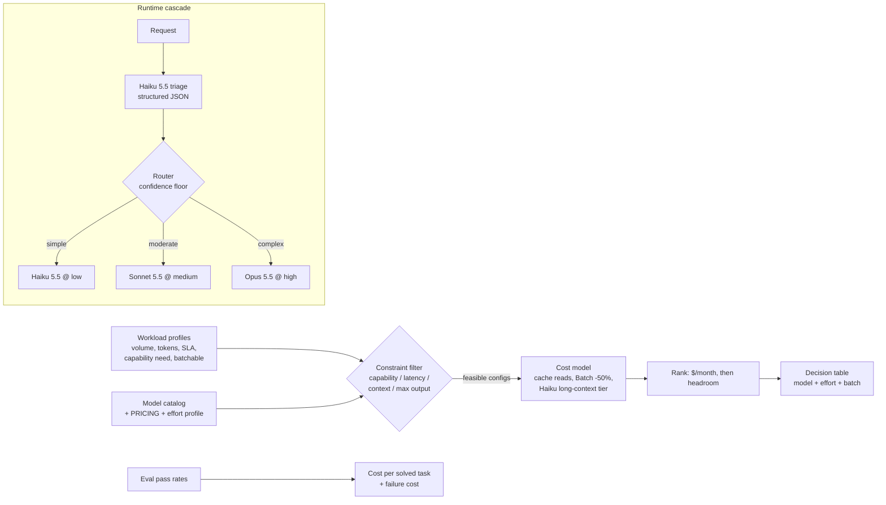

# D2.1 - Model Selection and Trade-offs

> **Exam objective:** "Select appropriate Claude models based on trade-offs"

## Why it matters

Model choice sets the **intelligence ceiling, the latency floor and the unit cost** of every request a
system will ever make. An architect rarely picks "one model": a production portfolio usually runs a cheap
fast model for triage and extraction, a mid-tier model for volume work, and a frontier model for the hard
tail. Getting it wrong either burns budget (Opus-for-everything) or silently fails quality and SLAs
(Haiku-for-everything). The exam tests whether you choose by **constraints first, then cost per solved task**,
and whether you know the levers inside a single model (effort, batching, caching) before switching models.

## Key concepts

### The current lineup (cached Oct 2026; confirm via the Models API)

| Model | ID | $ in / out per 1M | Cache read | Context / max out | Default effort | Typical role |
|---|---|---|---|---|---|---|
| Claude Fable 5.1 | `claude-fable-5-1` | $10 / $50 | $0.25 (0.025x) | 1M / 128K | `high` | hardest reasoning, long-horizon agents |
| Claude Opus 5.5 | `claude-opus-5-5` | $4 / $20 | $0.20 (0.05x) | 1M / 128K | `medium` | default: complex reasoning, coding, orchestrators |
| Claude Sonnet 5.5 | `claude-sonnet-5-5` | $2 / $10 | $0.20 | 1M / 128K | `high` | high-volume production, sub-agents |
| Claude Haiku 5.5 | `claude-haiku-5-5` | $0.10 / $0.50 (≤100K prompt) | ~$0.01 | 1M / 128K | `medium` | routing, classification, extraction |

* **Haiku 5.5 has a long-context price tier:** prompts over 100K tokens bill at $0.50 / $2.50. It's still
  cheap, but five times its headline rate. The lab's transcript workload shows this.
* **Batch API:** 50% off input and output for asynchronous work (results within 24 h). Use it whenever nobody
  is waiting on the answer.
* All four current models have a **1M-token window**, so context size seldom rules a model out any more. It
  still drives cost, latency and the Haiku price tier.

### The selection method (what the engine in this lab implements)

1. **Hard constraints are filters, not weights.** Capability bar, latency SLA (TTFT × turns + generation
   time), context need and max output. A model that misses one of them is ruled out, not scored lower.
2. **Price every surviving (model × effort) configuration at volume.** Use tokens × price × requests/month,
   with cache reads on the stable prefix, the Batch discount, and any long-context tier.
3. **Rank by cost per *solved* task, not per token.** Then add the cost of a failure (human rework, SLA
   penalty) when it's material.
4. **Validate with your own eval sweep.** Treat the heuristics as a screen. Measured pass rates decide.

### Effort: the first dial, before changing model

`output_config={"effort": "low"|"medium"|"high"|"xhigh"|"max"}` controls thinking depth and how many tool
calls the model makes. **Thinking tokens bill as output tokens**, so effort moves output cost and latency.

| Situation | First move |
|---|---|
| Quality fine, cost/latency too high | Lower effort on the same model |
| Quality short by a little | Raise effort one notch, measure |
| Lowest effort on model N still passes the eval | Step down a tier, reset to that tier's default effort, re-sweep |
| Max effort on the cheaper model still misses the bar | Use the stronger model, often at **low or medium** effort |

On Opus 5.5 thinking is always on: `{"type": "disabled"}` returns a 400 and `budget_tokens` is gone, so effort
is the only control. Changing **top-level** effort between requests invalidates the messages cache. Pin effort
per route.

### Stronger model at lower effort vs cheaper model at max effort

A frontier model often reaches the bar with **fewer thinking tokens** than a cheaper model pushed to `max`. In
the lab's research-agent example, Fable 5.1 @ low is cheaper per solved task than Sonnet 5.5 @ max and
Opus 5.5 @ max, even though Sonnet's per-token price is 5× lower. Price lists don't rank models. Eval results do.

### Latency trade-offs

| Component | Driver | Lever |
|---|---|---|
| Time to first token (TTFT) | model size, prompt length, cache hit | smaller model, prompt caching, streaming for perceived latency |
| Generation time | output tokens × per-token speed | lower effort, tighter output format, smaller model |
| Agent wall-clock | turns × (TTFT + generation) | fewer, consolidated tool calls (lower effort), parallel tools |

### Routing and cascades

A cheap classifier (Haiku) labels each request's difficulty, and a router sends it to the right-sized model.
Design rules:

* **Bias upward on uncertainty.** Sending an easy request to a bigger model costs cents. Sending a hard
  request to a small model costs quality. Escalate when confidence is low.
* **Route between conversations, not inside one.** Prompt caches are **model-scoped**, so switching model
  mid-conversation re-processes the whole prefix uncached, and newer models can't read each other's thinking
  blocks. For sub-tasks, spawn a sub-agent on the cheaper model instead.
* Count the classifier's own cost in the comparison (the lab does).

### Discovering capabilities at runtime: the Models API

`client.models.list()` / `client.models.retrieve(id)` return `max_input_tokens`, `max_tokens` and a typed
`capabilities` tree (effort levels, adaptive thinking, batch, structured outputs, context-management
strategies). Gate features on capabilities instead of hard-coding model names, so the system survives model
upgrades.

## Architecture



## What the code demonstrates

| Step | Section in `main.py` / `main.ts` | What to look for |
|---|---|---|
| 1 | `CATALOG`, `EFFORT_*` constants | Facts vs illustrative assumptions are labelled separately |
| 2 | `models_api_lookup` / `modelsApiLookup` | Live-only Models API code; offline prints the request shape |
| 3 | `evaluate`, `select`, `cost_per_request` | Constraint filter → volume pricing → cheapest feasible config, runner-up, "stronger model at lower effort" note |
| 4 | Portfolio table | Right-sized portfolio vs Opus-for-everything: cheaper, and the single model breaks the SLA or capability bar on 3 workloads |
| 5 | `research_agent_eval` | $/attempt vs $/solved vs $/task with a human-fallback cost. Each metric picks a different winner |
| 6 | `triage`, `route`, `answer` | Haiku triage with structured outputs (`output_config.format`), confidence-floor escalation, real cost/latency vs an all-Opus baseline |
| 7 | Probe loop | The same prompt on all four models through the shared client, giving measured `elapsed_ms` and `cost_usd` |

## Run it

```bash
.venv/Scripts/python "D2.1 - Model Selection and Trade-offs/python/main.py"
node "D2.1 - Model Selection and Trade-offs/typescript/main.ts"
```

Offline numbers come from the shared mock's latency/token simulation. Set `ANTHROPIC_API_KEY` to measure for
real and to run the Models API lookup.

## Exam tips & traps

* **Constraints before cost.** If an option is "cheapest" but misses the SLA or the quality bar, it's wrong.
  Look for the answer that filters first.
* **"Use the most capable model everywhere" is almost never right** for high-volume, low-complexity traffic
  (classification, extraction). **"Use the cheapest model everywhere" is wrong** for long-horizon agents.
* **Lower effort before switching model**, and remember a stronger model at low effort can beat a cheaper one
  at max effort on cost per solved task.
* **Latency-critical + simple → Haiku.** **Asynchronous + high volume → Batch API (50% off)**, whatever the
  model.
* **Don't switch models mid-conversation to save money.** Caches are model-scoped. Use a sub-agent or route
  at conversation start.
* On Opus 5.5 / Sonnet 5.5, `temperature`/`top_p`, assistant prefill, `budget_tokens` and forced
  `tool_choice` all return 400. Answers that "tune temperature for determinism" are distractors.
* Use the **Models API** (`capabilities`, `max_input_tokens`) to check feature support programmatically. Don't
  rely on a hard-coded list.

### Practice questions

**Q1.** A retailer classifies 4 million chat messages a month into 15 intents. The router must respond in
under 600 ms, and a 1.5K-token instruction block is identical on every call. Which design best fits?

- A. Opus 5.5 at `max` effort, to minimize misroutes
- B. Haiku 5.5 at low effort, with the instruction block cached and structured outputs for the label
- C. Sonnet 5.5 via the Message Batches API, to halve cost
- D. Fable 5.1 with a 1-hour cache TTL

**Answer: B.** The task is simple, high-volume and latency-bound, which is Haiku's sweet spot. Caching the
static prefix and using a schema for the label cut cost and parsing errors. A breaks latency and cost. C:
batches are asynchronous, so they can't meet a 600 ms interactive SLA. D is the most expensive and slowest
option for a trivial task.

**Q2.** Your eval for a research agent shows Sonnet 5.5 @ `max` passing 52% of tasks at $1.24 per attempt, and
Fable 5.1 @ `low` passing 80% at $1.44 per attempt. A failed task costs $40 of analyst time. What should the
architect recommend?

- A. Sonnet 5.5, because it's cheapest per attempt
- B. Fable 5.1 @ low, because it's cheaper per solved task and far cheaper once failure cost is included
- C. Sonnet 5.5 with a higher `temperature` to explore more solutions
- D. Alternate models turn by turn inside each conversation to average the cost

**Answer: B.** $1.44 / 0.80 = $1.80 per solved task, against $1.24 / 0.52 = $2.38. With failure cost included
it's $9.44 against $20.44. C: sampling parameters aren't supported on these models. D breaks prompt caching and
thinking continuity.

## Further reading

* Claude docs: *Models overview* and *Choosing a model*
* Claude docs: *Models API* (`/v1/models`, model capabilities)
* Claude docs: *Pricing* (Batch API discount, prompt-caching multipliers, long-context pricing)
* Claude docs: *Effort* and *Adaptive thinking*
* Claude docs: *Message Batches API*
* Claude docs: *Reducing latency*
* Anthropic engineering: *Building effective agents* (routing workflow pattern)
* Related labs: D3.3 (accuracy vs latency), D4.5 (token/latency/cost-performance optimization), D2.5 (caching)
