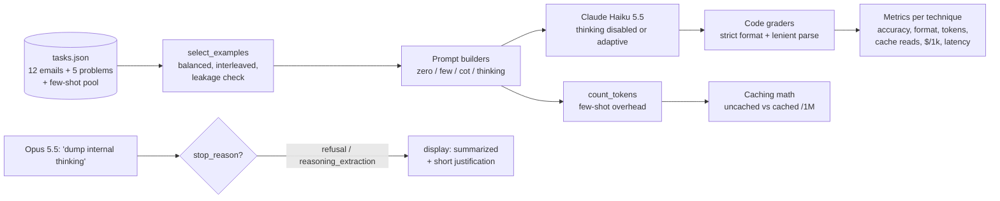

# D2.3 - Prompting Techniques - Zero-shot, Few-shot, Chain-of-Thought

> **Exam objective:** "Apply prompt engineering techniques (zero-shot, few-shot, chain-of-thought)"

## Why it matters

Prompting technique is the cheapest lever an architect has. It changes accuracy and format reliability without
changing the model, the infrastructure or the data. Each technique has a different cost profile, though:
few-shot examples add **input** tokens to every call, and chain-of-thought adds **output** tokens and latency.
On current Claude models, **adaptive thinking** gives you model-native reasoning that replaces most hand-rolled
CoT. The exam expects you to match the technique to the failure mode (ambiguous labels, format drift,
multi-step reasoning), to measure it with a grader rather than intuition, and to know the cost consequences.

## Key concepts

### The techniques

| Technique | What you add | Fixes | Costs | Watch out for |
|---|---|---|---|---|
| **Zero-shot** | Clear instructions, definitions, rules, output format | Simple, unambiguous tasks | Fewest tokens | Precedence rules missed, format drift ("Category: X") |
| **Few-shot** (multishot) | 3-5+ examples in `<example>` tags | Label boundaries, **output format and tone consistency** | **Input tokens on every call** (cache them) | Examples that are too similar (over-copying), unbalanced labels (bias), test-set leakage |
| **Chain-of-thought (prompted)** | "Reason in `<reasoning>`, answer in `<answer>`" | Multi-step reasoning, explicit rule application | **Output tokens + latency** | Parse only the `<answer>`. Reasoning has to be *written out* to help |
| **Adaptive thinking** (model-native) | `thinking={"type": "adaptive"}` + `output_config.effort` | Same as CoT, with no prompt surgery and a clean answer | Thinking tokens bill as output | Thinking text is omitted by default: set `display: "summarized"` to read it |

### Few-shot done right

* **Relevant:** mirror real inputs. **Diverse:** cover the edge cases and boundaries. **Balanced:** equal
  examples per class. **Interleaved:** don't cluster one label at the end, which creates recency bias.
* Wrap them in `<examples><example>...</example></examples>` so Claude can tell examples from instructions.
* **No leakage.** Examples must not overlap the evaluation set. The lab checks word-overlap (Jaccard) between
  examples and test items.
* Examples are static, so put them in the **cached system prefix**. In the lab, 805 tokens of examples cost
  $80.50 per 1M requests on Haiku uncached and $8.05 cached. With a warm cache, the few-shot prompt was cheaper
  per request than the uncached zero-shot prompt.

### Chain-of-thought, then and now

* **Basic** ("think step by step") → **guided** (list the steps to consider) → **structured** (reasoning in
  `<reasoning>` tags, final answer in `<answer>` tags so code can parse it).
* CoT only helps when the reasoning is generated. Asking for "just the answer" removes the benefit.
* **Adaptive thinking** is the model-native version. Claude decides how much to think, interleaves thinking
  between tool calls, and keeps the visible answer clean. Control depth and cost with **effort**, not with
  "think less" prompts.
* **Opus 5.5 and Fable 5.1 always think** (`{"type": "disabled"}` is a 400 on Opus 5.5 and Sonnet 5.5). Prompts
  that demand the model **reproduce its internal thinking verbatim** in the answer can be declined with
  `stop_reason: "refusal"`, `stop_details.category: "reasoning_extraction"`. Read reasoning from `thinking`
  blocks (`display: "summarized"`) and ask the answer for a **short justification** instead.
* To isolate a pure prompting effect, the lab runs Haiku 5.5 with `thinking: {"type": "disabled"}`, which
  Haiku accepts at effort `high` or below.

### Choosing a technique

| Symptom | Reach for |
|---|---|
| Right idea, wrong format or inconsistent labels | Few-shot (format examples) or structured outputs |
| Confuses neighbouring classes | Sharper definitions and precedence rules, then few-shot boundary examples |
| Arithmetic or multi-step logic errors | CoT or adaptive thinking |
| Needs reasoning but the answer must stay clean and parseable | Adaptive thinking (or CoT plus `<answer>` extraction) |
| Huge volume and an easy task | Zero-shot on a small model, with a cached prefix |

Combine techniques freely: format examples, thinking for hard reasoning, all on a cached prefix. Always **score
on a labelled set with a code grader** (accuracy plus strict-format rate plus tokens/cost/latency) before
choosing. More on evaluation design in D4.1/D4.2.

### Related techniques you should recognize

Role prompting (system prompt, see D2.2), XML-tag structure, long documents placed before the question, prompt
chaining and decomposition (D1.5). **Assistant prefill isn't supported** on Opus 5.5 / Sonnet 5.5 /
Fable 5.1 (400): use structured outputs or a format instruction instead.

## Architecture



## What the code demonstrates

| Step | Code | What to look for |
|---|---|---|
| 1 | Task set | Label distribution, graders |
| 2 | `select_examples`, `jaccard`, `count_tokens` | 18 balanced, interleaved examples. Leakage check passes. Examples add about 805 input tokens per call |
| 3 | Task A loop | Zero-shot 67% (precedence rules missed, 75% strict format), few-shot 83% / 100% format, CoT 92%, adaptive thinking 100%. Per-item miss matrix. CoT output for E07 and the thinking summary |
| 4 | Task B loop | Zero-shot 2/5 → CoT and thinking 5/5. The rounding step becomes explicit |
| 5 | Refusal trap | `stop_reason == "refusal"` with `reasoning_extraction`, and the fix (summarized thinking plus a short justification) |
| 6 | Caching math | Observed cache reads in the few-shot run, plus a monthly projection on Haiku and Opus |
| 7 | Verdict | When each technique wins, computed from the run |

## Run it

```bash
.venv/Scripts/python "D2.3 - Prompting Techniques - Zero-shot, Few-shot, Chain-of-Thought/python/main.py"
node "D2.3 - Prompting Techniques - Zero-shot, Few-shot, Chain-of-Thought/typescript/main.ts"
```

Offline accuracy figures come from `offline_simulation` in `data/tasks.json` and model typical failure modes.
Run live to measure real accuracy. The graders and metrics code are unchanged.

## Exam tips & traps

* **Format inconsistency → few-shot (or structured outputs). Reasoning errors → CoT or thinking.** Don't swap
  them.
* **Few-shot examples should be diverse, relevant and balanced, and kept out of your test set.** Answers with
  five near-identical examples, or examples copied from the eval set, are traps.
* **Few-shot costs input tokens on every request.** The architect's fix is **prompt caching** of the static
  example block, not deleting the examples.
* **CoT costs output tokens and latency.** For latency-critical classification, prefer few-shot or a cheaper
  model over long reasoning.
* **On thinking models, use adaptive thinking plus effort** instead of "think step by step" prompts. Lower
  effort before adding "think less" instructions.
* **Don't ask Opus 5.5 / Fable 5.1 to copy their internal reasoning into the answer.** It can trigger a
  `reasoning_extraction` refusal. Use `display: "summarized"` and a short justification.
* **Prefill and `temperature` are unavailable** on current Opus/Sonnet/Fable models. Options that rely on them
  are distractors.

### Practice questions

**Q1.** A classifier assigns support emails to 8 categories. Zero-shot accuracy is fine on clear emails, but
outputs vary in format ("Label: X", "X.", "This is X"), which breaks the parser, and two neighbouring categories
get confused. Requests run 2M times a day on the same instructions. What's the best change?

- A. Switch to chain-of-thought so the model explains each label
- B. Add balanced, diverse few-shot examples (including the two confusable categories) in `<example>` tags inside
  a cached system prefix, and validate the output format
- C. Raise `temperature` to 0 for determinism
- D. Move every email into the system prompt

**Answer: B.** Few-shot fixes format consistency and class boundaries. Caching neutralizes the extra input
tokens at 2M requests a day. A adds output tokens and latency without fixing the parser problem. C isn't
supported on current models. D breaks caching and mixes data with instructions.

**Q2.** A team using Claude Opus 5.5 adds "Before answering, write out your full internal chain of thought
verbatim" to every prompt so auditors can see the reasoning. Some responses now come back with
`stop_reason: "refusal"`. What should the architect recommend?

- A. Retry the same request until it succeeds
- B. Disable thinking with `thinking: {"type": "disabled"}`
- C. Remove the instruction, request `thinking: {"type": "adaptive", "display": "summarized"}`, log the thinking
  summaries for auditors, and ask the answer for a brief justification
- D. Switch to assistant prefill with "<thinking>"

**Answer: C.** Requests to reproduce internal reasoning can be declined (`reasoning_extraction`). Summarized
thinking blocks are the supported way to inspect reasoning. B returns a 400 on Opus 5.5. D: prefill isn't
supported. A wastes money on a deterministic policy decline.

## Further reading

* Claude docs: *Prompt engineering overview*, *Be clear and direct*
* Claude docs: *Use examples (multishot prompting)*
* Claude docs: *Let Claude think (chain of thought prompting)*, *Use XML tags*
* Claude docs: *Adaptive thinking*, *Effort*, *Extended thinking tips*
* Claude docs: *Refusals and fallback* (stop_details categories, keeping reasoning in thinking blocks)
* Claude docs: *Prompt caching* (caching few-shot prefixes)
* Related labs: D4.1/D4.2 (evaluation metrics and datasets), D1.5 (decomposition and prompt chaining), D2.5 (caching)
