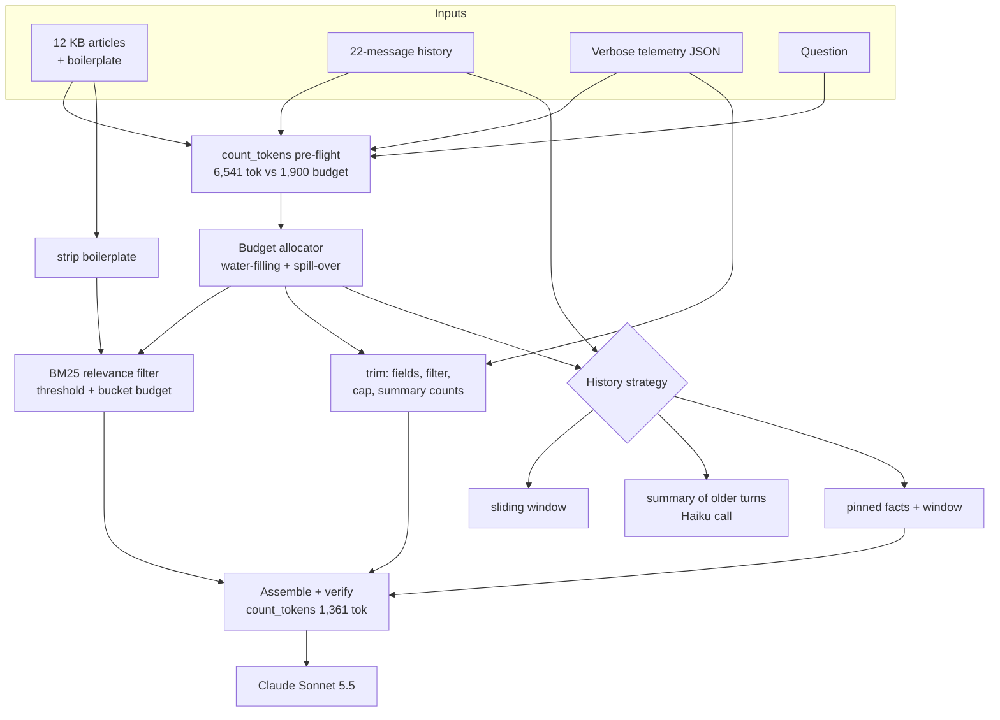

# D2.4 - Context Window Optimization and Token Management

> **Exam objective:** "Optimize context windows and manage token usage"

## Why it matters

Current Claude models accept up to **1M tokens**, but a bigger window isn't a free pass. Every input token is
billed on every request, adds prefill latency, and competes for the model's attention. Irrelevant context
degrades answers, and long histories bury critical facts. Context engineering means deciding **what earns a
place in the window on each turn**: measure first (`count_tokens`), budget deliberately, clean and filter
inputs, compress history without losing what matters, and use the platform's server-side tools (context
editing, compaction, memory) for long-running agents.

## Key concepts

### Measure first: `count_tokens`

* `client.messages.count_tokens(model=..., system=..., messages=..., tools=...)` returns the exact
  `input_tokens` for that model's tokenizer. Counts are **model-specific**, and newer models count the same text
  as more tokens than older ones. **Never use tiktoken** for Claude. It undercounts.
* Use it as a **pre-flight gate**: count, then trim, summarize, route, or reject oversized payloads before
  sending. It's free but rate-limited, so use a local chars/4 estimate inside packing loops and verify the final
  request once.
* **Reserve output up front.** `max_tokens` (including thinking tokens) has to fit alongside the input. If you
  don't reserve it, the answer is what gets squeezed (`stop_reason: "max_tokens"`).

### A context budget allocator

```
input budget = route budget - output reserve
available    = input budget - system prompt - question - framing
split available across buckets by weight (docs 0.5 / history 0.3 / tool results 0.2),
cap each at its demand, and spill unused share over to the others (water-filling)
```

Clean inputs **before** deciding what to drop. In the lab, trimming the tool result frees its share for docs and
history.

### Optimization techniques (lab numbers)

| Technique | Lab effect | Notes |
|---|---|---|
| Strip boilerplate (headers, footers, legal text) | KB 2,119 → 1,255 tok | Close to lossless. Do it at ingestion |
| Trim tool results (project fields, filter, cap, summarize) | 3,527 → 303 tok | Tell the model the data is partial (`total_events`, `returned`) |
| Relevance filtering (BM25 / embeddings + threshold + budget) | 12 → 3 articles, 449 tok | Retrieve less but better. See D3.5/D3.6 for retrieval design |
| History: sliding window | 486 tok, 4/6 facts | Simple, but forgets the oldest turns, which is often where identifiers were given |
| History: summarize older turns | 246 tok, 5/6 facts, extra Haiku call | Summaries silently drop details. Instruct them to keep identifiers |
| History: **pinned facts** + window | 486 tok, **6/6 facts** | Deterministic extraction of critical facts (IDs, versions, deadlines) |
| Whole request | 6,541 → 1,361 tok (-79%) | Better answer than window-only (no duplicate ticket) |

**Measure recall, not just tokens.** A strategy that saves tokens but drops the ticket ID causes a real failure:
a duplicate ticket.

### Placement and caching interplay

* Put long documents **before** the question. Keep stable content (system, tools) first so it can be cached.
* Sliding windows and summaries **rewrite the prefix**, so cache reads drop at the edit point. Trim in **batches**
  (for example, server-side `clear_at_least`) rather than one turn at a time, so the cache can be reused between
  trims.

### Server-side context management (beta)

| Mechanism | Request shape | What it does | Use when |
|---|---|---|---|
| **Context editing** | `betas=["context-management-2025-06-27"]`, `context_management={"edits":[{"type":"clear_tool_uses_20250919", "trigger":..., "keep":..., "clear_at_least":..., "exclude_tools":[...]}]}` | Clears old `tool_use`/`tool_result` content in place (no summary). `clear_thinking_20251015` clears old thinking | Long tool loops where old results are stale |
| **Compaction** | `betas=["compact-2026-01-12"]`, `context_management={"edits":[{"type":"compact_20260112", "trigger": {"type":"input_tokens","value":150000}, "instructions": "..."}]}` | Summarizes earlier context into a **compaction block** server-side | Conversations approaching the window limit |
| **Memory tool** | `tools=[{"type":"memory_20250818","name":"memory"}]` | The model reads and writes files in a `/memories` directory **you** store | Facts that must survive **across sessions** |

Critical rule for compaction: **append the full `response.content`** (including the compaction block) to your
history, not just the text. Editing and compaction work *within* a session, while memory works *across*
sessions. Long-running agents often use all three. Check model support via the Models API
(`capabilities.context_management.*`).

## Architecture



## What the code demonstrates

| Step | Code | What to look for |
|---|---|---|
| 1 | `TokenCounter`, pre-flight | Per-part token breakdown measured with `count_tokens`. Naive request is 3.4× over budget |
| 2 | `allocate` (raw) | All three buckets are squeezed |
| 3 | `strip_boilerplate`, `trim_tool_result`, re-allocate | Tools now fit, and the unused share spills over to docs and history |
| 4 | `bm25`, packing loop | Ranked articles, with keep/drop reasons (low relevance vs over budget) |
| 5 | `sliding_window`, `summarize_older`, `extract_facts` | Tokens vs fact recall per strategy. The summarizer drops "already tried reinstalling". The window drops the asset tag and ticket |
| 6 | Final calls | Naive vs window-only vs optimized: tokens, cost and facts in the answer. Window-only offers a duplicate ticket |
| 7 | Snippets | Context-editing and compaction request code (live-only), plus the comparison table |

## Run it

```bash
.venv/Scripts/python "D2.4 - Context Window Optimization and Token Management/python/main.py"
node "D2.4 - Context Window Optimization and Token Management/typescript/main.ts"
```

## Exam tips & traps

* **"Just use the 1M window" isn't optimization.** Cost and latency scale with input tokens, and irrelevant
  context hurts quality. Look for answers that filter and budget.
* **Count with `count_tokens` (model-specific), not tiktoken or character math,** before sending large or
  user-supplied inputs. Reserve `max_tokens` for the output, including thinking.
* **Tool results are the usual bloat.** Project to the needed fields, filter, cap, and summarize, or let context
  editing clear stale results server-side.
* **Compaction ≠ context editing ≠ memory.** Compaction summarizes near the limit. Context editing clears old
  tool results or thinking. Memory persists across sessions. Know which fits the scenario.
* **When compacting, pass the compaction block back** (append `response.content`). Dropping it loses the summary.
* **Summaries lose details.** Pin critical identifiers deterministically, or instruct the summarizer to keep
  them, and test recall.
* History trimming changes the prompt prefix. Batch the trims to protect prompt-cache hit rates.

### Practice questions

**Q1.** A long-running coding agent's context fills with stale file-listing and test-output tool results after
~40 turns, but the user's goals and recent edits must stay intact. What's the most targeted fix?

- A. Enable compaction with a 50K trigger so the whole conversation is summarized often
- B. Use context editing with `clear_tool_uses_20250919` (keep the last few tool uses, clear in batches with
  `clear_at_least`, exclude tools whose results must persist)
- C. Switch to a model with a larger window
- D. Delete the system prompt to save tokens

**Answer: B.** The bloat is stale tool results. Context editing clears exactly those in place, without
summarizing the user's goals. A summarizes everything (lossy) far more often than needed. C: current models
already have 1M windows, and cost still scales with tokens. D removes essential instructions.

**Q2.** A support copilot sometimes forgets the customer's account ID given early in long chats after the team
added a sliding window to cut costs. What should the architect change?

- A. Increase `max_tokens`
- B. Extract critical facts (account ID, order numbers, deadlines) into a pinned block that's always included,
  keep the sliding window for the rest, and add a recall test to the eval suite
- C. Turn off prompt caching
- D. Move the conversation history into the system prompt

**Answer: B.** Pinned facts keep critical identifiers while the window controls tokens, and a recall test
catches regressions. A affects output length, not input context. C raises cost and does nothing for recall. D
breaks caching and doesn't solve the forgetting.

## Further reading

* Claude docs: *Context windows*, *Token counting*
* Claude docs: *Context editing* (`clear_tool_uses_20250919`, `clear_thinking_20251015`)
* Claude docs: *Compaction* (`compact_20260112`)
* Claude docs: *Memory tool*
* Claude docs: *Long context prompting tips* (document placement, quoting relevant passages)
* Anthropic engineering: *Effective context engineering for AI agents*
* Related labs: D3.5/D3.6 (retrieval design), D3.8 (progressive discovery), D4.5 (token and cost optimization), D2.5 (caching)
