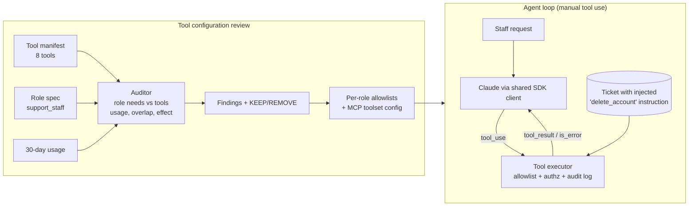

# D3.1 - Tool Configuration and Capability Bloat

> **Exam objective (Domain 3 · Integration):** "Evaluate tool/agent configuration for capability bloat"

## Why it matters

Every tool you hand Claude is a capability that can be triggered by anything that reaches the
context window: the user, a retrieved document, a ticket body, a web page, another agent's output.
An architect reviewing an agent asks two questions per tool: **does this role need it?** and
**what is the worst thing it can do if the model is manipulated?** Surplus tools add attack
surface, cost schema tokens on every call, and make it more likely the model picks the wrong tool.
They add no value. The cheapest and strongest control is usually to delete the tool.

## Key concepts

### Capability bloat = "excessive agency"

OWASP's *Top 10 for LLM Applications* (2025) lists this as **LLM06 Excessive Agency** and splits it
into three root causes. Each maps to a different fix:

| Dimension | Symptom in an agent config | Fix |
|---|---|---|
| Excessive **functionality** | Tools the role never needs (`delete_account` on a tier-1 support agent), generic "escape hatch" tools (`run_sql`, `bash`, `http_request`) | Remove the tool; replace generic tools with narrow, typed ones |
| Excessive **permissions** | A needed tool runs with a credential that can do more than the tool's purpose (read tool using a read/write DB user) | Scope the downstream credential; authorize per call in the executor (see D3.2) |
| Excessive **autonomy** | Irreversible actions run with no human checkpoint | Human approval for high-impact actions; rate limits; spend limits |

### Least privilege applied to agents

- Start from the **role's job-to-be-done**. List the capabilities it needs (`tickets.read`,
  `replies.draft`) and build a **per-role manifest** that contains exactly those tools.
- The `tools` array you send is the agent's entire action surface. Claude cannot call a tool that
  is not in the request. If the model invents a tool name anyway, a well-built harness rejects it.
- **Assume the model can be fooled.** Claude is resistant to prompt injection, but no model is
  immune. Indirect injection arrives through *tool results*: ticket bodies, emails, documents and
  web pages. A system-prompt rule ("never delete accounts") is guidance. It is not a control.

### Control hierarchy (the exam's favourite ranking)

| Rank | Control | Type | Why |
|---|---|---|---|
| 1 | **Remove** the tool / capability | Preventive - eliminates the hazard | Nothing to exploit. Fewer tokens, fewer mis-selections |
| 2 | **Authorize in code** (tool executor checks role/scope, scoped credentials) | Preventive - deterministic | Enforced outside the model. Residual risk = misconfiguration |
| 3 | **Human confirmation** for irreversible actions | Preventive - human-dependent | Approval fatigue turns it into a rubber stamp at volume |
| 4 | **Logging / audit / alerting** | Detective | Tells you *after* the account is gone. Necessary but never sufficient |
| - | Bigger / smarter model, stronger prompt wording | Not a control | Does not change what the agent *can* do |

Use the layers together (defense in depth). Remove what is not needed. Authorize and gate what
is needed. Log everything.

### Audit checklist (what the lab's auditor implements)

| Check | Signal | Typical action |
|---|---|---|
| Not in role spec + irreversible (financial, destructive) | `issue_refund`, `delete_account` on a read/draft role | **Remove** (CRITICAL) |
| Escape-hatch tool | `run_sql`, `bash`, `fetch_url` covering many capabilities | Remove; promote the needed actions to dedicated tools the harness can gate and audit |
| Unused | 0 calls in 30 days | Remove |
| Undeclared use | Used, but not in the role spec | Review with the process owner. Update the spec or remove |
| Overlap | Two tools with near-identical descriptions or the same capability | Consolidate into one tool with a prescriptive description |
| Schema overhead | Tool definitions dominate input tokens | Trim; for genuinely large libraries use tool search with `defer_loading` |

### Bloat is also a cost, latency and accuracy problem

- **Tokens:** tool definitions are rendered into every request (render order is
  `tools` -> `system` -> `messages`). Measure them with `client.messages.count_tokens` and multiply
  by request volume. Requests with tools also carry a small fixed tool-use system prompt.
- **Accuracy:** more tools, and especially *overlapping* tools, make wrong-tool selection more
  likely. Descriptions should say *when* to call a tool, not only what it does.
- **Caching:** tools sit at the very front of the cached prefix. Keep each role's manifest stable
  and deterministically ordered. Building the tool list per request in random order silently
  breaks prompt caching.

### Claude platform mechanisms for scoping tools

| Mechanism | What it does | Exam nuance |
|---|---|---|
| Per-request `tools` array | Defines what Claude can call on this request | The primary least-privilege lever. Build it per role/task |
| Tool executor / harness | Your code runs every client tool | Put authorization, validation and confirmation gates here |
| `strict: true` on tools | Guarantees schema-valid tool *inputs* | Validation, **not authorization** |
| `tool_choice` | `auto` (default), `none`; `any`/`tool` force a call | Forced `any`/`tool` returns 400 on Opus 5.5, Sonnet 5.5 and Fable 5.1. Use `auto` plus instructions |
| Tool search + `defer_loading` | Loads schemas on demand for large libraries | Cuts context tokens. **Not access control**: a deferred tool can still be discovered and called |
| Mid-conversation tool changes (beta) | `tool_removal` / `tool_addition` blocks in a `role: "system"` message | Revoke a capability mid-session without breaking the cache |
| MCP connector `mcp_toolset` | `default_config: {"enabled": false}` + per-tool `configs` | Allowlist mode. Never expose a whole MCP server by default |
| Subagents | Each subagent gets only its sub-task's tools | Least privilege across multi-agent systems |
| Claude Code / Agent SDK | Permission allow/deny rules, allowed/disallowed tool lists | Same principle for developer agents |

## Architecture



```
Run A  bloated tools, no controls    -> delete_account executes  -> account DELETED
Run B  bloated tools + executor authz -> PermissionDenied (is_error) -> account active, model still tried
Run C  trimmed tools                 -> capability absent          -> account active, injection flagged
```

## What the code demonstrates

| Step | Code section | What to notice |
|---|---|---|
| 1 | `support_agent.json` + section 1 | The manifest mixes read, draft, financial, destructive and generic tools |
| 2 | `audit_manifest()` | Severity follows the tool's effect and reversibility, not its usage. Jaccard overlap finds near-duplicate tools |
| 3 | `count_tokens` section | Schema tokens: bloated vs trimmed, per tool, and the cost at volume |
| 4 | `run_agent()` Run A | Manual tool loop: check `stop_reason`, return parallel `tool_result`s in **one** user message. The simulated injection succeeds |
| 5 | `ToolExecutor(enforce_authz=True)` Run B | The model still attempts the call. Code denies it with `is_error: true` and Claude recovers |
| 6 | Run C (trimmed) | The capability simply does not exist. The model flags the injection instead |
| 7 | `rank_controls()` | Seeded Monte Carlo (common random numbers) gives residual deletions per control |
| 8 | `build_allowlist()` / `mcp_toolset_allowlist()` | One canonical tool per capability, gated modes, and the MCP connector allowlist shape (live-only call shown) |

## Run it

From the repo root:

```bash
.venv/Scripts/python "D3.1 - Tool Configuration and Capability Bloat/python/main.py"
node "D3.1 - Tool Configuration and Capability Bloat/typescript/main.ts"
```

Offline by default (deterministic, no API key). With `ANTHROPIC_API_KEY` set the same code calls the
real API. Set `D31_MCP_URL` as well to exercise the MCP connector allowlist against a real server.

## Exam tips & traps

- **"Users only need X and Y" -> remove everything else.** Least privilege beats every
  compensating control. Confirmation dialogs, logging and "a more capable model" are distractors
  when the capability itself is unnecessary.
- **Logging is detective, not preventive.** It never stops the first incident. Choose it only
  when the question asks how to *detect* or *investigate*.
- **A system-prompt prohibition is not an access control.** If the tool is in the manifest, an
  injected instruction in a tool result can trigger it.
- **`strict: true` validates shape, not permission.** A perfectly valid `delete_account` call is
  still a deletion.
- **`defer_loading` / tool search reduce tokens, not capability.** Deferred tools can be
  discovered and called.
- **Generic tools re-grant what you removed.** A `run_sql` or `bash` tool next to a trimmed
  manifest defeats the trim. Prefer dedicated tools the harness can gate, audit and parallelize.
- **Overlapping tools hurt accuracy.** Two tools that "look up a customer" cause mis-selection.
  Consolidate, and write prescriptive *when-to-call* descriptions.
- Changing the tool list per request **invalidates prompt caching**. Use stable per-role manifests
  (or `tool_removal` mid-conversation) instead.

### Practice questions

**Q1.** A claims-intake agent has six tools: `read_claim`, `summarize_policy`, `draft_letter`,
`approve_payout`, `update_bank_details`, and `http_request` (a generic HTTP client used once last
quarter by a developer). Intake staff only read claims and prepare letters for adjusters. A
security review must reduce the risk that a malicious claim attachment causes an unauthorized
payout. What should the architect do **first**?

- A. Add a system-prompt rule forbidding payouts unless an adjuster asks
- B. Remove `approve_payout`, `update_bank_details` and `http_request` from the intake agent's manifest
- C. Keep all tools but require a confirmation dialog before `approve_payout`
- D. Move the agent to a larger model that is more resistant to prompt injection

**Answer: B.** The role does not need those capabilities, and `http_request` is an escape hatch
that could reach the payout API directly. Removing them eliminates the hazard. C is a weaker,
human-dependent control for a capability that should not exist. A and D do not change what the
agent can do.

**Q2.** An internal IT agent exposes 140 tools from three MCP servers. Requests are slow and
expensive, and the agent sometimes calls `reset_password` when users ask to *unlock* accounts.
Every tool is legitimately needed by some IT role. Which combination best addresses cost,
accuracy **and** risk? *(Choose two.)*

- A. Enable tool search with `defer_loading` on rarely used tools
- B. Build per-role manifests (MCP toolsets in allowlist mode) so each role only receives its tools
- C. Rely on tool search alone, since deferred tools cannot be called
- D. Add more detailed logging of `reset_password` calls

**Answer: A and B.** Per-role allowlists remove capabilities a role does not need (risk) and
reduce overlap (accuracy). Tool search trims the schemas loaded for a request (cost and latency).
C is false: deferred tools are still callable once discovered. D only detects.

## Further reading

- Anthropic docs: *Tool use overview*, *Implement tool use* (tool definitions, `tool_choice`,
  parallel tool use, `strict` tools), *Tool search tool*, *MCP connector*
- Anthropic docs: *Mid-conversation tool changes* and *Token counting*
- Anthropic engineering: *Building effective agents*, *Writing effective tools for agents*
- Claude Code docs: *Identity and Access Management / permissions* (allow/deny rules) and *Subagents*
- OWASP *Top 10 for LLM Applications 2025*: LLM06 Excessive Agency, LLM01 Prompt Injection
