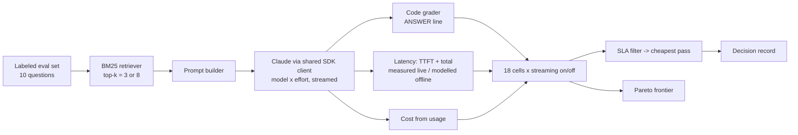

# D3.3 - Accuracy vs Latency Trade-offs

> **Exam objective (Domain 3 · Integration):** "Evaluate accuracy-latency trade-offs and justify configuration decisions"

## Why it matters

Every Claude integration fixes a point in a three-way space: **accuracy, latency, cost**. The
model tier, the `effort` level, how much context you retrieve, and whether you stream each move
that point. An architect is not asked for the "best model". They are asked for the **cheapest
configuration that provably meets the SLA**, with a written justification. Getting this wrong
cuts both ways. A frontier model at maximum effort behind a 2-second API SLA fails in
production. A fast small model that is wrong 30% of the time fails just as surely.

## Key concepts

### Anatomy of latency

```
TTFT  = network/queue + prefill(uncached input tokens) + thinking tokens (generated before visible text)
Total = TTFT + decode time x visible output tokens
Agent = sum over turns (each tool round trip adds a full model call + tool time)
```

- **Prefill** grows with *uncached* input tokens. Retrieval top-k, long system prompts and tool
  schemas all add to it. Prompt-cache reads skip most of this work.
- **Thinking tokens** are output tokens produced *before* the first visible token. They often
  dominate both latency and cost, and `effort` is the knob that scales them.
- **Decode** speed differs by model tier: Haiku > Sonnet > Opus > Fable in tokens per second.

### The levers and what they trade

| Lever | Accuracy | Latency | Cost | Notes |
|---|---|---|---|---|
| Model tier (Haiku / Sonnet / Opus / Fable) | up with tier | down with smaller tiers | down with smaller tiers | Price list does not predict cost per *task* |
| `output_config.effort` (`low`..`max`) | up on hard items | up (more thinking) | up | Opus 5.5 default is `medium`. Sweep before changing model |
| Retrieval top-k / context size | up for multi-hop, **down** with distractors | up (prefill) | up (input tokens) | Small models are more easily misled by superseded or near-duplicate docs |
| Streaming | none | **perceived only** (TTFT) | none | Helps human readers. Machine consumers still wait for the full output |
| Parallel tool calls | none | fewer round trips | slightly lower | Return all results in **one** user message. `disable_parallel_tool_use` forces one at a time |
| Prompt caching | none | lower TTFT on long, stable prefixes | ~0.1x on cached reads | Byte-stable prefix, minimum cacheable length, 5-min or 1-h TTL |
| Prompt trimming | none (if relevant content kept) | less prefill | fewer input tokens | Remove boilerplate, stuffed documents and tool recaps |
| Routing / cascade | depends on router | fast path for easy queries | lower | Classify cheaply, escalate hard queries |
| Message Batches API | none | async (results within 24 h) | 50% off | Only when nobody is waiting |
| `max_tokens` | none (truncation is failure) | none unless hit | none | A backstop, not a tuning knob |

Platform facts the exam expects. On Opus 5.5, thinking is always on: `thinking: {type: "disabled"}`
and `budget_tokens` return 400, so control depth with `effort`. Sampling parameters
(`temperature`, `top_p`, `top_k`) are not accepted on current Opus models, so "lower the
temperature to improve accuracy" is not an available lever.

### Decision method (what the lab automates)

1. **Write the SLA first.** Set an accuracy floor, the latency *metric* (total vs TTFT), a
   percentile (p95/p99, never the mean) and a cost ceiling. Do this per consumer (API vs chat UI vs batch).
2. **Sweep** the configuration grid on a labeled eval set with a code grader. Record accuracy,
   latency percentiles, TTFT and cost per request.
3. **Filter** to the configurations that pass every gate, then **pick the cheapest**.
4. **Plot the Pareto frontier**. Anything dominated on all three axes is never the answer.
5. **Write a decision record**: context, options with evidence, decision, accepted trade-offs,
   mitigations and revisit triggers.

### Results worth remembering (reproduced by the lab)

- **A larger model at lower effort can beat a smaller model at higher effort** on latency *and*
  cost at equal accuracy, because thinking tokens dominate (Opus/low/k8 vs Sonnet/high/k8).
- **More context is not monotonically better**: k=3 misses the second hop of multi-hop questions,
  while k=8 pulls in a superseded rate sheet that misleads the smallest model.
- **Streaming changes which configuration is viable**, but only for human-facing SLAs. The same
  100%-accurate config fails a 2.8 s total-latency gate and passes a 2.8 s TTFT gate.
- **Small eval sets give unstable tails.** With n=10, nearest-rank p95 is simply the slowest
  request. Production SLOs need hundreds or thousands of samples.

## Architecture



## What the code demonstrates

| Step | Code | What to notice |
|---|---|---|
| 1 | `BM25.search` | Which questions lose a needed document at k=3, and where a superseded document enters at k=8 |
| 2 | `run_sweep()` / `run_one()` | 180 streamed calls with bounded concurrency. Each yields accuracy, TTFT, total latency and cost. `output_config.effort` and `thinking: {type: "adaptive"}` per request |
| 2 | `modelled_latency()` | Offline latency = base TTFT + prefill x uncached input + decode x (thinking, visible) from the real `usage` (including `output_tokens_details.thinking_tokens`). Live mode measures wall clock instead |
| 3 | `pick()` + `SCENARIOS` | Five consumers produce different winners. S2 vs S2b shows streaming changing the answer |
| 4 | `pareto()` | Non-dominated configurations only |
| 5a | streaming | First visible chunk vs complete answer |
| 5b | `tool_agent()` | 4 vs 2 model round trips, plus concurrent tool execution (`asyncio.gather` / `Promise.all`) |
| 5c | prompt caching | `cache_creation_input_tokens` then `cache_read_input_tokens`: lower TTFT and ~85% lower cost on request 2 |
| 5d | `count_tokens` | Whole-policy stuffing vs retrieved-only context |
| 6 | decision record | Justification tied to evidence, accepted failure (Q10), mitigation, revisit triggers |

## Run it

From the repo root:

```bash
.venv/Scripts/python "D3.3 - Accuracy vs Latency Trade-offs/python/main.py"
node "D3.3 - Accuracy vs Latency Trade-offs/typescript/main.ts"
```

Offline numbers are illustrative but deterministic. With `ANTHROPIC_API_KEY` set, the same sweep
runs against the real API (180 small requests) and latency is measured, not modelled.

## Exam tips & traps

- **"The chat feels slow"** -> stream first. It cuts *perceived* latency (TTFT) without touching
  accuracy or cost. **"A downstream service needs the full JSON within 2 s"** -> streaming does
  not help. Lower effort, a different tier, caching or trimming do.
- **Judge SLAs on p95/p99, not averages.** A config with a great mean can still breach p95 on the
  hard tail.
- **Sweep `effort` before switching models.** A bigger model at `low` effort can be faster,
  cheaper *and* more accurate than a smaller model at `high`.
- **Top-k is an accuracy and a latency knob.** Too small breaks multi-hop. Too large adds prefill
  and distractors (especially for small models). Evaluate it like any other parameter.
- **Accuracy-neutral levers come first:** streaming, parallel tool calls, prompt caching, prompt
  trimming, batching for offline work. Model and effort changes are trade-offs and need an eval.
- **Batch API = 50% cheaper but asynchronous** (results within 24 h). Never put it behind a user-facing SLA.
- **Justify with evidence:** the SLA, the options measured, why the winner passes, which failures
  you accept and when you will revisit. "Use the most capable model" is not a justification.

### Practice questions

**Q1.** An employee help chat must show the first token within **1.5 s at p95** and be at least
**92% accurate**. An eval sweep produced:

| Config | Accuracy | p95 TTFT | p95 total |
|---|---|---|---|
| Opus 5.5, effort high | 97% | 2.9 s | 6.1 s |
| Opus 5.5, effort medium | 95% | 1.3 s | 3.4 s |
| Sonnet 5.5, effort high | 93% | 2.1 s | 3.0 s |
| Haiku 5.5, effort medium | 81% | 0.5 s | 0.9 s |

Which configuration should the architect choose?

- A. Sonnet 5.5 at high effort, non-streaming, because it has the lowest total latency among accurate options
- B. Opus 5.5 at medium effort, with streaming enabled
- C. Opus 5.5 at high effort, with streaming enabled
- D. Haiku 5.5 with streaming, adding few-shot examples later to recover accuracy

**Answer: B.** With streaming the user-facing metric is TTFT. Opus/medium is the only option that
meets both the 1.5 s TTFT and the 92% accuracy gates. A fails TTFT (2.1 s, and non-streaming
users wait the full 3.0 s). C fails TTFT because its thinking runs before the first visible token.
D fails accuracy.

**Q2.** *(Choose two.)* A nightly job classifies 2 million documents with Sonnet 5.5 at medium
effort and meets its accuracy target. No user waits on the results. Which changes reduce cost
**without risking accuracy**?

- A. Submit the work through the Message Batches API
- B. Cache the shared instructions and few-shot examples prefix with `cache_control`
- C. Switch to Haiku 5.5
- D. Lower effort to `low`
- E. Enable streaming

**Answer: A and B.** Both are accuracy-neutral: batching halves the price, and caching reprices
the repeated prefix. C and D are trade-offs that need an eval first. E changes nothing for an
unattended job.

## Further reading

- Anthropic docs: *Reducing latency*, *Streaming messages*, *Effort*, *Adaptive thinking / Extended thinking*
- Anthropic docs: *Prompt caching*, *Parallel tool use* (`disable_parallel_tool_use`), *Message Batches*, *Token counting*
- Anthropic docs: *Optimizing for cost and intelligence* (cost-optimization guide), *Models overview* and pricing
- Anthropic docs: *Define success criteria* and *Develop test cases* (building eval sets and graders)
- Google SRE Workbook: *Implementing SLOs* (percentile-based SLIs)
