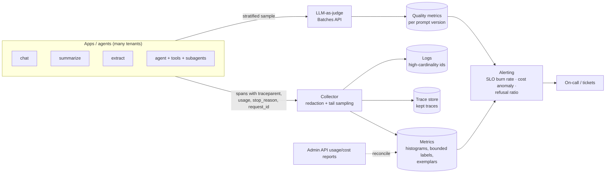

# D3.4 - Observability and Monitoring at Scale

> **Exam objective (Domain 3 · Integration):** "Analyze observability challenges and select monitoring strategies at scale"

## Why it matters

At ten requests a day you can read every transcript. At ten million you cannot, and LLM traffic
breaks the usual dashboards in specific ways. Cost per request varies by three orders of
magnitude. Agents fan out into dozens of model and tool calls per user request. "Success" (HTTP
200) says nothing about whether the answer was right, safe or refused. The architect's job is to
**pick strategies**: what to aggregate, what to sample, which dimensions to keep, and which
alerts page a human. This is a different question from *how* to instrument one service, which is
D4.6's scope (logging and tracing tooling for a single app).

## Key concepts

### What makes LLM observability different

| Property | Consequence | Strategy |
|---|---|---|
| Heavy-tailed latency (thinking, long outputs, multi-step agents) | Averages lie | Histograms and percentile SLIs (p95/p99) |
| Cost varies per request (tokens x price; agent loops grow quadratically) | Spend can explode in hours | Per-tenant/feature attribution from `usage`, budgets, anomaly alerts, step caps |
| Many dimensions (tenant, feature, model, prompt version, user) | Metric cardinality explosion | Bounded labels; high-cardinality ids in logs/traces, linked by exemplars |
| Multi-step agents, tools, subagents | One request = a tree of calls | Distributed tracing with W3C trace context propagated through tools and subagents |
| "200 OK" can be a refusal, a truncation or a wrong answer | Availability SLOs miss quality and safety issues | `stop_reason` monitors, sampled LLM-as-judge, user feedback |
| Rare but critical failures | Random sampling throws them away | Tail-based sampling |
| Prompts and outputs contain PII | Logging everything is a liability | Redact at the collector, minimize retention, sample |

### Per-call signals the Claude API gives you

- `usage`: `input_tokens`, `output_tokens`, `cache_creation_input_tokens`,
  `cache_read_input_tokens`, `output_tokens_details.thinking_tokens`. Price these per tenant and feature.
- `stop_reason` (`end_turn`, `tool_use`, `max_tokens`, `refusal`, `pause_turn`) plus `stop_details` on refusals.
- The **`request-id`** response header (`message._request_id` in the SDKs). Store it on the span
  so you can correlate with Anthropic support.
- Rate-limit response headers (`anthropic-ratelimit-*`, `retry-after` on 429) and error types
  (429 rate limit, 529 overloaded, 5xx).
- Your own latency and TTFT measurements (stream events), model, effort and prompt version.
- Org level: the **Usage & Cost Admin API** reports (group by model, workspace, API key) to
  reconcile in-app attribution, and **workspaces** with their own keys, spend limits and rate
  limits for native isolation. Claude Code can export usage metrics and events via
  **OpenTelemetry** for developer-tooling monitoring.

### Strategy selection guide

| Challenge | Options | Choose |
|---|---|---|
| Latency at volume | Averages · per-host percentiles · **histograms** | Histograms: fixed memory, *mergeable* across hosts and windows, accurate enough percentiles. Never average percentiles |
| Cardinality | Label everything · **bounded labels + exemplars** | Labels for bounded dimensions (tenant tier, feature, model, status). `user_id`, `trace_id` and `request_id` go to logs and traces. Exemplars link a histogram bucket to a trace |
| Trace volume | **Head sampling** (decide at start, e.g. 5%) · **tail sampling** (decide after completion) | Tail when failures are rare and important (keep 100% of errors, refusals, slow, expensive and long traces plus a small baseline). Needs a buffering collector. Head is cheap and stateless but discards the traces you need |
| Agent visibility | Per-call logs · **distributed traces** | Propagate `traceparent` (`00-<trace-id>-<span-id>-01`) into tool calls and subagents. One span per LLM call and tool. Detect loops (same tool + args repeated) and step explosions |
| Alerting | **Static thresholds** · **SLO burn-rate** | Multi-window, multi-burn-rate alerts (e.g. page at 14.4x over 1 h AND 5 m; ticket at 6x over 6 h AND 30 m for a 30-day 99.5% SLO). Static thresholds on noisy ratios cause alert fatigue |
| Cost | Monthly invoice · **per-request attribution** | Tag every call with tenant and feature, price the `usage`, alert on anomalies vs a trailing baseline, and cap agent steps and token budgets |
| Refusals / truncation | Global rate · **per-segment ratio monitors** | Segment by tenant x feature with minimum volume and a confidence bound (Wilson). Global rates hide a single tenant's spike |
| Answer quality | Wait for complaints · **sampled LLM-as-judge** + user feedback | Stratified samples (per hour, feature, prompt version). Calibrate the judge against human labels, run it through the Batches API (50% cheaper), compare before and after each deploy |

### Statistics that keep alerts honest

- Small samples are noisy. 9/12 judged passes is consistent with a 93% true pass rate.
  Alert when even the **optimistic** bound (Wilson upper) is below target, or the pessimistic
  bound is above a ceiling for bad events.
- **Minimum volume** gates prevent 1-of-3 blips from paging anyone.
- Burn-rate windows pair a long window (significance) with a short one (the problem is still happening).

## Architecture



## What the code demonstrates

| Step | Code | What to notice |
|---|---|---|
| 1 | `simulate()` | Seeded 10k-request day (identical in Python and TS) with 4 incidents of different *kinds* |
| 2 | `histogram()` / `pct_hist()` | Mean vs p50/p95/p99. Histogram percentiles track exact ones in 14 counters (wide buckets add error in the far tail) |
| 3 | cardinality | ~85 series with bounded labels vs ~9k with `user_id` (and >100M at production user counts). Exemplar trace_id for the slowest bucket |
| 4 | head vs tail sampling | Similar kept volume (~5%), but coverage of errors, refusals, slow and loop traces goes from ~5% to 100% |
| 5 | `build_agent_trace()` | Span tree for a looping agent run, a `traceparent` header and per-span `request_id`. The loop detector finds 34 identical tool calls |
| 6 | cost attribution | initech's share jumps to ~54%. The trailing-median anomaly alert fires within the hour |
| 7 | static vs burn-rate | Static rule: many episodes all day. Burn rate: one page for INC1. A segment refusal monitor catches INC3 while the global refusal rate barely moves |
| 8 | LLM-as-judge | 144 **real shared-client calls** (structured output via `output_config.format`, effort `low`), Wilson CIs per 2 h window, alert after the deploy. Batches submission is live-only |
| 9 | detection matrix | Each incident type needs a different detector. That matrix is the answer to "select monitoring strategies" |

## Run it

From the repo root:

```bash
.venv/Scripts/python "D3.4 - Observability and Monitoring at Scale/python/main.py"
node "D3.4 - Observability and Monitoring at Scale/typescript/main.ts"
```

Offline by default and fully deterministic. With `ANTHROPIC_API_KEY` set, the judge calls go to
the real API (144 short Sonnet calls) and the judge batch is actually submitted.

## Exam tips & traps

- **Never put `user_id`, `request_id` or free text in metric labels.** That causes a cardinality
  explosion. Use logs and traces for high-cardinality data and exemplars to link them.
- **Head sampling at a low rate loses the rare failures you need.** For "engineers can't find
  traces of failed requests", the answer is **tail-based sampling** (keep all errors, slow,
  refused and expensive traces plus a baseline), not "raise the sampling rate".
- **Averages hide tails, and averaging percentiles is mathematically wrong.** Aggregate
  histograms, then compute p95/p99.
- **Static thresholds on noisy ratios produce alert fatigue.** Prefer multi-window SLO
  burn-rate alerts that page on symptoms.
- **Availability/latency SLOs do not catch cost runaways, refusal spikes or quality
  regressions.** These need per-tenant cost attribution with anomaly alerts, `stop_reason`
  monitors, and sampled LLM-as-judge plus user feedback.
- **Agents need distributed tracing**: propagate trace context through tool calls and subagents,
  and watch steps per run and repeated tool fingerprints to catch loops early (then cap steps).
- **Global dashboards hide segment problems.** Monitor per tenant and feature with
  minimum-volume and confidence gates.
- Record the API **`request-id`** on every LLM span. It is the key Anthropic support asks for.

### Practice questions

**Q1.** A multi-tenant assistant serves 20M requests per day. To control cost, the team records
1% of traces, chosen when each request starts. During incidents, engineers rarely find a trace
for the failing requests. What should the architect recommend?

- A. Raise head sampling to 10% during business hours
- B. Switch to tail-based sampling that keeps every error, refusal, slow and expensive trace plus a small random baseline
- C. Drop tracing and add `user_id` and `request_id` as metric labels instead
- D. Sample 100% of traces for the largest tenant only

**Answer: B.** Failures are rare, so any head-sampling rate keeps proportionally few of them.
Tail sampling decides after the outcome is known, at similar storage volume. C causes a
cardinality explosion. A and D raise cost without targeting failures.

**Q2.** *(Choose two.)* After a prompt update, customers report inaccurate summaries. Latency,
error rate and token usage dashboards look normal. Which monitoring strategies would have
detected the regression promptly?

- A. Multi-window burn-rate alerting on the availability SLO
- B. Stratified, sampled LLM-as-judge scoring compared across prompt versions
- C. Adding `user_id` as a label on the latency histogram
- D. Capturing explicit user feedback tied to the prompt version and trace id
- E. A static alert on p99 latency above 10 seconds

**Answer: B and D.** Quality regressions do not move availability, latency or cost signals. You
need quality signals: automated judge sampling, and user feedback correlated with the deployed
prompt version. A and E watch the wrong symptom. C adds cardinality without measuring quality.

## Further reading

- Anthropic docs: *Errors* (`request-id`), *Rate limits* (response headers), *Handling stop reasons*, *Message Batches*
- Anthropic docs: *Usage and Cost Admin API*, *Workspaces*, *Claude Code monitoring (OpenTelemetry)*
- Anthropic docs: *Develop test cases / LLM-based grading* (calibrating model graders)
- Google SRE Workbook: *Alerting on SLOs* (multi-window, multi-burn-rate)
- OpenTelemetry: *Tail Sampling Processor*, *Semantic conventions for generative AI*, *Exemplars*; W3C *Trace Context*
