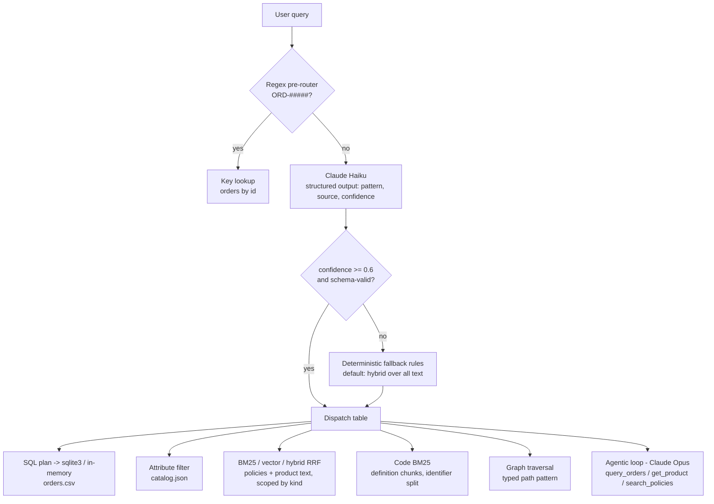

# D3.6 - Retrieval Strategies by Data Shape and Query Pattern

> **Exam objective:** Apply retrieval strategies matched to data shape and query pattern

## Why it matters

"Just put everything in a vector database" is the most common retrieval anti-pattern. A total
revenue question needs **every** matching row, not the top 5 most similar ones. A SKU lookup needs
an exact key, and embeddings blur IDs and numbers. "Which customers bought from Vietnamese
suppliers?" needs relationships to be followed, not text to be matched. Enterprise assistants sit
on top of tables, JSON documents, prose, code, and graphs at once. The architect's job is to
classify each request by **data shape x query pattern** and send it to the retriever that can
actually answer it, using an expensive agentic loop only when the question really spans systems.

## Key concepts

### Data shapes

| Shape | Examples | Native retrieval |
|---|---|---|
| Structured | Orders table, ledger, CRM rows | SQL: keys, predicates, GROUP BY, joins |
| Semi-structured | Product catalog JSON, tickets with fields | Field filters + BM25/vectors over text fields |
| Unstructured | Policies, wikis, PDFs, transcripts | BM25, vectors, hybrid (D3.5 chunking rules apply) |
| Code | Repositories, configs, SQL | Definition-level chunks, identifier-aware BM25, symbol indexes, agentic grep/glob |
| Graph | Supplier networks, org charts, entity links | Typed traversal (k-hop, path patterns) |

### Query patterns and the matching strategy

| Pattern | Example | Strategy | What breaks if you use plain vector RAG |
|---|---|---|---|
| Exact lookup / ID | "Status of ORD-10447?" | Primary-key lookup (regex pre-router, no LLM) | Embeddings blur IDs and return a *similar* order |
| Aggregation / analytics | "Revenue by region in Q3?" | SQL over the source of truth (validated plan, bound parameters) | Top-k holds a handful of rows, so any total is wrong |
| Filtered attribute search | "Wireless headphones < $150, 30h+ battery" | Metadata / attribute predicates, then rank | Numeric constraints are ignored; violating items returned |
| Keyword / named term | "What is the restocking fee?" | BM25 | Rare terms diluted by semantic neighbours |
| Conceptual / paraphrase | "Can I send back opened headphones?" | Vector (semantic) | (works) |
| Mixed (concept + key terms) | "Warranty claims if they stopped charging?" | Hybrid BM25 + vector with RRF | Either half alone misses some queries |
| Multi-hop relational | "Customers of suppliers in Vietnam?" | Graph traversal over typed edges | No single chunk contains the chain |
| Multi-hop across systems | "Is Dana's latest headphone order under warranty?" | Agentic loop: Claude calls tools step by step | Fixed one-shot retrieval cannot plan intermediate lookups |
| Code search | "Where is international shipping cost computed?" | Code-aware BM25 / symbol index / agentic grep | Prose tokenizers miss `calculateShippingCost` |

### Router design (cheap to expensive)

1. **Deterministic pre-router.** Use regex or rules for unambiguous signals (order IDs, SKUs,
   slash-commands). This is free and instant, and never wrong for those inputs.
2. **Small-model classifier.** Claude **Haiku** with **structured outputs** (`messages.parse` +
   pydantic/zod, i.e. `output_config.format`). The SDK validates the result against an enum
   schema, which gives typed output with no free-text parsing.
3. **Confidence gate and fallback.** Low confidence, a validation error or an API error goes to
   deterministic rules, a safe default (hybrid over everything), or a clarifying question.
4. **Dispatch table.** Map (pattern, source) to a strategy in code, not in the prompt, so it is
   auditable and testable.
5. **Evaluate the router on its own.** Track routing accuracy on a labeled set and watch the
   fallback rate. Misroutes look like "bad answers" downstream.

Platform notes: Claude Opus 5.5, Sonnet 5.5 and Fable 5.1 **reject forced tool use**
(`tool_choice` `any` or `tool` returns a 400), and assistant **prefill returns a 400** on current
models. For classification, use structured outputs rather than a forced "classify" tool call. Haiku
keeps routing at a fraction of a cent and adds very little latency.

### Structured data: text-to-plan, not text-to-SQL

Have the model (or a parser) emit a **plan** (group-by column, date range, filters) that is
validated against an allowlist. The application then compiles it into **parameterized** SQL and
runs it with a read-only role and row limits. Free-form LLM-written SQL invites injection,
hallucinated columns and runaway scans. Money is summed in integer cents.

### Graph retrieval

Build typed edges from the systems of record (catalog `supplier_id` gives `SUPPLIED_BY`; orders give
`PURCHASED`). Answer with **path patterns** such as
`(country)<-LOCATED_IN-(supplier)<-SUPPLIED_BY-(product)<-PURCHASED-(customer)`. Keep the
paths: they are the explanation and the citation. Graph-based summarization approaches extend this
to "global" questions about a whole corpus.

### Agentic retrieval

Give Claude one tool per system (`query_orders`, `get_product`, `search_policies`) and let it
decide the next lookup from what it has learned so far. Engineering rules:
- Check `stop_reason` every turn. Bound the loop with max turns.
- Return **all** tool results from a turn in **one** user message. Parallel `get_product` calls are
  normal.
- Report failures as `tool_result` with `is_error: true` (the discontinued SKU in the lab). Never
  throw inside the loop.
- Tool descriptions say **when** to call each tool.
- Agentic loops cost more round trips and latency. Route to them only when a question really
  spans systems, and answer everything else in one hop.

Claude Code is an example of agentic search over code: it navigates repositories with tools like
glob, grep and read rather than relying on a pre-built vector index.

### Why embeddings fail at lookups and filters

Dense embeddings encode meaning, not exact values. Numbers, dates, IDs and negations get blurred.
The lab's stand-in embedder makes this explicit by collapsing every digit-bearing token into one
`<num>` feature. That is why the anti-pattern section returns the wrong order and ignores price
limits.

## Architecture



```
query ─► regex? ─yes─► key lookup
           │no
           ▼
     Haiku classifier (JSON schema) ─► conf<0.6 / invalid ─► fallback rules
           │                                                     │
           └────────────────► dispatch(pattern, source) ◄────────┘
                                   │
   ┌───────────┬───────────┬───────┴───────┬────────────┬─────────────┬──────────────┐
  SQL agg   attr filter   BM25/vec/hybrid   code BM25    graph walk   agentic loop (tools)
```

## What the code demonstrates

| Step | Printed section | Code (`python/main.py`; camelCase twins in `typescript/main.ts`) |
|---|---|---|
| 1 | Data shapes | `load_orders` (CSV to integer cents), catalog JSON, `load_text_docs`, `chunk_code`, `build_graph` |
| 2 | Decision matrix | `print_matrix`: data shape x query pattern to strategy |
| 3 | Route and retrieve (10 queries) | `Router.route` (regex, then `messages.parse` with `RouteDecision`, then `fallback`), `pick_strategy`, `run_query` |
| 3a | Aggregation | `plan_aggregation`, `plan_to_sql` (allowlist + bound params), `run_aggregation` (sqlite3 in Python, same plan in memory in TS) |
| 3b | Attribute filter | `plan_filter`, `run_filter` |
| 3c | Text strategies | `BM25`, `Embedder` (stand-in, digits collapsed), `VectorIndex`, `rrf`, `scope` (metadata pre-filter) |
| 3d | Code search | `code_tokenize` (camelCase/snake_case split) + definition-level chunks |
| 3e | Graph | `Graph.traverse` with a typed path pattern; per-customer explanation |
| 3f | Agentic loop | `agentic_loop`: manual tool loop, parallel calls, `is_error` for the discontinued SKU, `stop_reason` checks |
| 4 | Anti-pattern | Everything serialized into one vector index: wrong ID, partial rows, violated constraints |
| 5 | Router report | Accuracy vs. labels, LLM calls, regex short-circuits, fallbacks |

The offline responder plays both Haiku (the router) and Opus (the agent). The agent's final answer
is **computed from the tool results it received** (date math on the warranty), so the trace is
realistic. Python executes the aggregation plan with stdlib `sqlite3`; TypeScript runs the identical
validated plan in memory. Both print the same SQL and the same results.

## Run it

From the repository root:

```bash
.venv/Scripts/python "D3.6 - Retrieval Strategies by Data Shape and Query Pattern/python/main.py"
node "D3.6 - Retrieval Strategies by Data Shape and Query Pattern/typescript/main.ts"
```

## Exam tips & traps

- **Counts, sums, averages, top-N over records** belong to SQL/analytics on the source of truth.
  "Increase top-k and let Claude add it up" is a trap: answers are wrong and expensive.
- **IDs, SKUs, error codes:** use an exact lookup or BM25. Embeddings are not designed for exact
  matching.
- **Numeric or boolean constraints** ("under $150", "waterproof") are **filters**. Similarity search
  ignores them.
- **Relationship chains** call for a graph traversal. **Questions across several systems that need
  reasoning** call for an agentic tool loop. Do not send every query through the agent: it costs
  more latency and tokens.
- **Routing:** rules for the unambiguous cases, Haiku with structured outputs for fuzzy intent,
  deterministic fallback on low confidence. Forced `tool_choice` is rejected on Opus 5.5 / Sonnet
  5.5 / Fable 5.1, and prefill is rejected on current models.
- **Never execute free-form model-written SQL.** Use validated plans, allowlisted columns,
  parameters, and read-only credentials.
- **Scope with metadata** (doc kind, tenant, ACL) *before* ranking. Post-filtering can empty the
  result set.

### Practice questions

**Q1.** A retail assistant indexes product descriptions, policy pages and one text line per order
in a single vector store. Users report wrong answers to "How many orders shipped to Germany last
month?" and "Find waterproof speakers under $80". What is the BEST redesign?

- A. Switch to a larger embedding model and re-embed everything
- B. Raise top-k to 200 so Claude sees enough rows to count and filter
- C. Add a query router: aggregations go to SQL over the orders database, attribute constraints go to structured filters on the catalog, and vector/hybrid search stays for policy prose
- D. Fine-tune Claude on the order history

**Answer: C.** Aggregation and attribute filtering are database operations on structured data. A
better embedding (A) still cannot sum or enforce numeric predicates. A huge top-k (B) is costly and
still incomplete. Fine-tuning (D) does not track live data.

**Q2.** A team classifies incoming queries with Claude Opus 5.5 using
`tool_choice: {"type": "tool", "name": "classify"}` and gets HTTP 400 errors. They also want the
lowest routing latency and cost. What should they do?

- A. Switch to `tool_choice: {"type": "any"}` on Opus 5.5
- B. Prefill the assistant turn with `{"pattern":` to force JSON
- C. Route with Claude Haiku 5.5 using structured outputs (a JSON schema with enum fields), with deterministic fallback rules when confidence is low
- D. Add retries with exponential backoff around the forced tool call

**Answer: C.** Forced tool use (`any` or `tool`) is rejected on Opus 5.5 (A, D), and prefill is
rejected on current models (B). Structured outputs give schema-valid classifications, and Haiku is
the right cost/latency tier for routing.

## Further reading

- Claude docs: *Structured outputs* (JSON outputs, strict tool use, SDK `parse` helpers)
- Claude docs: *Tool use* overview, *Implement tool use*, *Handling stop reasons*
- Claude docs: *Choosing a model* (Haiku for routing and classification)
- Anthropic engineering blog: *Building effective agents* (routing workflow, augmented LLM)
- Anthropic engineering blog: *Introducing Contextual Retrieval* (hybrid BM25 + embeddings)
- Related labs: D3.5 (chunking and indexing), D3.1 (tool bloat), D1.3 (workflow vs. agentic patterns), D3.3 (accuracy vs. latency)
