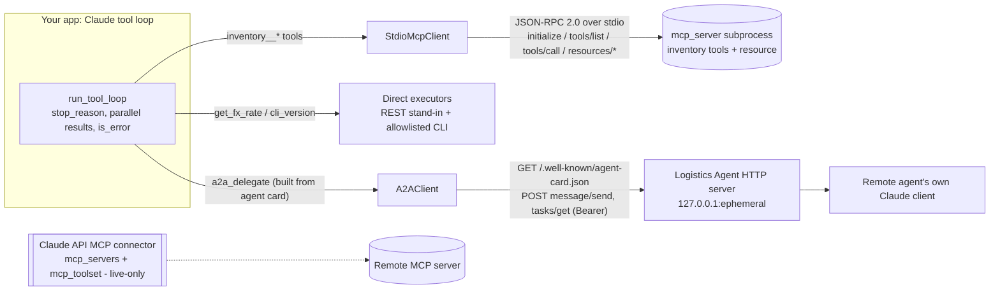

# D3.7 - Integration Protocols - MCP, API-CLI, Agent-to-Agent

> **Exam objective:** Evaluate connection protocols and select the appropriate integration mechanism (MCP, API/CLI, agent-to-agent)

## Why it matters

Every Claude solution eventually has to reach systems Claude does not own. The integration
mechanism decides who maintains the connector, how many products can reuse it, how capabilities
are discovered, where credentials live, and how much latency and context each call costs. Choosing
MCP for a single app's two endpoints adds operational weight with no payoff. Hand-coding the same
function tools into five products creates five drifting copies. Treating a partner's autonomous
agent as "just another tool" ignores its multi-turn task lifecycle. Architects are expected to pick
deliberately, and to be able to defend the choice.

## Key concepts

### The three mechanisms

| | **Direct API / CLI (tool use)** | **MCP (Model Context Protocol)** | **Agent-to-agent (A2A)** |
|---|---|---|---|
| What you connect | A function in *your* code (REST call, SDK call, CLI) | A server exposing **tools, resources, prompts** to any MCP host | Another **autonomous agent** with its own model, tools and memory |
| Contract | Your tool JSON schema | Open protocol: JSON-RPC 2.0, lifecycle, capabilities | Open protocol: agent card + task API (JSON-RPC over HTTP) |
| Discovery | Static (in code) | Runtime: `tools/list`, `resources/list`, `prompts/list` | Agent card at `/.well-known/agent-card.json` (skills, modes, auth) |
| Granularity | One function call | One tool call (stateless request/response) | A **task** with states: submitted, working, input-required, completed / failed / rejected / canceled |
| Auth | Your service credentials | stdio: the process's environment; remote HTTP: OAuth 2.1 per the spec | Schemes declared in the card (bearer, OAuth2, API key, ...) |
| Overhead | Lowest (in-process call or one HTTP hop) | Extra process or network hop + JSON-RPC; tool schemas in context | Network + multi-turn exchange; often long-running/async |
| Owner | The app team | The capability owner ships the server; hosts just connect | The remote team owns the whole agent; callers see only its contract |

### MCP essentials

- **Primitives.** *Tools* are model-controlled (Claude decides to call them). *Resources* are
  application-controlled context, addressed by URI. *Prompts* are user-controlled templates. On the
  client side, hosts can offer *sampling*, *roots* and *elicitation*.
- **Lifecycle.** `initialize` (client proposes `protocolVersion` and its capabilities; the server
  answers with the version it supports, its capabilities and `serverInfo`), then the
  `notifications/initialized` notification, then normal requests. A notification has no `id` and
  gets no reply.
- **Transports.** **stdio** for a local subprocess: newline-delimited JSON on stdin/stdout, and the
  server must never log to stdout. **Streamable HTTP** for remote servers; it replaced the older
  HTTP+SSE transport.
- **Two kinds of errors.** Protocol problems (unknown method, bad params, not initialized) come back
  as a JSON-RPC `error`. Tool execution failures come back as a normal result with
  `isError: true`, so the model can read the message and recover. Map MCP `isError` to the
  Claude `tool_result` field `is_error: true`.
- **Tool annotations** (`readOnlyHint`, `destructiveHint`, `idempotentHint`, `openWorldHint`) are
  hints for the host's UX and approval policy. They are not security guarantees, especially from
  untrusted servers.
- **Schema conversion.** MCP `inputSchema` (camelCase) becomes Claude `input_schema`. Namespace tool
  names per server (`inventory__get_stock`) so servers cannot collide.

### Where MCP plugs into Claude

| Surface | How | Notes |
|---|---|---|
| Claude Code / Claude Desktop | Configure stdio or remote servers | Reuse the same server across developers and teams |
| Claude API **MCP connector** (beta) | `client.beta.messages.create(..., betas=["mcp-client-2025-11-20"], mcp_servers=[{type:"url", url, name, authorization_token}], tools=[{type:"mcp_toolset", mcp_server_name}])` | **Remote URL servers only.** Anthropic runs the MCP client, so there is no client tool loop. Every server needs exactly one `mcp_toolset`. `default_config`/`configs` give allow-/deny-lists |
| SDK helpers / Agent SDK | Python `anthropic.lib.tools.mcp` converts MCP tools for the tool runner; the Agent SDK connects MCP servers | Use these for local stdio servers, resources and prompts |
| Your own client (this lab) | Spawn, handshake, list, convert, forward | Full control; you own the loop |

### Agent-to-agent (A2A) essentials

- **Opaque agents.** The caller never sees the remote agent's prompts, tools or model (the lab's
  Logistics Agent uses its own Sonnet client). The contract is the **agent card** plus the **task
  API**.
- **Discovery.** `GET /.well-known/agent-card.json` returns name, version, `protocolVersion`,
  transport, capabilities (streaming, push notifications, state history), input/output modes,
  **skills**, and security schemes.
- **Interaction.** `message/send` (or `message/stream` over SSE) creates or continues a **task**.
  `tasks/get` polls. Push notifications cover long-running work. Results arrive as **artifacts**
  (text, data or file parts).
- **input-required** is a first-class state: the remote agent asks for missing information, and the
  caller continues *the same task* with its `taskId`.
- **MCP and A2A are complementary.** MCP connects an agent *down* to tools and data. A2A connects
  agents *across* to peer agents. A remote A2A agent often uses MCP internally.

### Choosing

| Situation | Pick | Why |
|---|---|---|
| One application, a few stable internal endpoints, tight latency | **Direct tool use** | No extra process or protocol; schemas live with the code |
| Existing mature CLI (git, kubectl, gh) for developer workflows | **CLI tool / bash** | Reuse the CLI. Allowlist commands, no shell interpolation, timeouts, sandbox |
| Same capability needed in Claude Code, Desktop, the API and custom agents across teams | **MCP server** | Build once and connect everywhere; the owner team maintains it; runtime discovery |
| Remote SaaS already publishes an MCP server and you don't want a client loop | **MCP connector** (API) | Server-side MCP client; remote only |
| Hand a goal to a partner's or another team's autonomous agent | **A2A** | Task lifecycle, opaque internals, the partner keeps ownership |
| Deterministic multi-step business process | Workflow code calling APIs | Don't add an agent or protocol where a function chain suffices (D1.3) |

**Cross-cutting risks.** A third-party MCP server is code and instructions you are choosing to
trust: watch for tool-description poisoning and supply-chain risk. Pin versions, review, and apply
least privilege (D3.2). Tool results are untrusted input (prompt injection). Many MCP tools inflate
context (D3.1, D3.8). Put human approval in front of destructive tools.

## Architecture



```
          ┌─────────── run_tool_loop (Claude Opus) ───────────┐
          │                 │                                  │
   inventory__*        get_fx_rate / cli_version          a2a_delegate
          │                 │                                  │
   StdioMcpClient     in-process fn / subprocess(git)     A2AClient ──HTTP──► Logistics Agent
     │ JSON-RPC                                            card, message/send,     (own model,
     ▼ stdio                                               tasks/get, Bearer        own tools)
   mcp_server (python | node)
```

## What the code demonstrates

| Step | Printed section | Code (`python/main.py` + `python/mcp_server.py`; `typescript/main.ts` + `typescript/mcpServer.ts`) |
|---|---|---|
| 1 | (a) MCP lifecycle and discovery | `StdioMcpClient`: request before initialize gives -32600; `initialize` with version negotiation; `notifications/initialized`; `tools/list` with annotations; `resources/list`/`read`; unknown method gives -32601 |
| 2 | (a) MCP tools to Claude tools | `mcp_to_claude_tools`, `mcp_execute` (`isError` to `is_error`); the loop does parallel `get_stock`, the reservation fails, then Claude splits it across warehouses |
| 3 | Session stats | JSON-RPC message count and bytes on the wire (identical in both languages); stdio shutdown by closing stdin; server logs only on stderr |
| 4 | (b) Direct API + CLI | `pricing_api` REST stand-in, `run_cli` (allowlist, no shell, timeout; `curl` blocked), same `run_tool_loop` |
| 5 | (c) A2A | `LogisticsAgent` (card, JSON-RPC, task store, `input-required`, its own Claude client), HTTP server on an ephemeral port, 401 without a token, `A2AClient.delegate_tool` turns the card's skills into a Claude tool, lifecycle submitted -> input-required -> working -> completed, `tasks/get` errors, clean shutdown |
| 6 | MCP connector (live-only) | The exact `client.beta.messages.create` request with `mcp_servers` + `mcp_toolset` (allowlist mode); runs only with `LABS_MODE=live` and `MCP_SERVER_URL` |
| 7 | Decision matrix | Reuse, standardization, discovery, auth, latency, ownership, when to pick |

The key design point is that `run_tool_loop` is identical for all three mechanisms. Only the
executor behind the tool boundary changes. Claude sees tools either way, and the protocol is an
architecture decision about ownership, reuse and operations.

## Run it

From the repository root:

```bash
.venv/Scripts/python "D3.7 - Integration Protocols - MCP, API-CLI, Agent-to-Agent/python/main.py"
node "D3.7 - Integration Protocols - MCP, API-CLI, Agent-to-Agent/typescript/main.ts"
```

The Python client spawns `python mcp_server.py`, and the TypeScript client spawns
`node mcpServer.ts`. Both servers produce byte-identical wire traffic. The A2A server binds
`127.0.0.1` on an ephemeral port and is shut down at the end. `cli_version` runs `git --version`
if git is on PATH; otherwise the tool returns `is_error`.

## Exam tips & traps

- **A single app with a few stable internal APIs and a latency budget** points to **direct tool
  use**. An MCP server adds a process or hop and an ops burden without any reuse benefit.
- **The same capability in several Claude surfaces or for several teams** points to an **MCP
  server** owned by the capability team. Copy-pasted function definitions drift.
- **The MCP connector works with remote (URL) servers only** and needs `mcp_servers` **and** a
  matching `mcp_toolset`, plus the beta header. Local stdio servers need a client-side bridge
  (SDK helpers, Agent SDK, Claude Code, or your own client).
- **MCP tool failures** return `isError: true` in a *result*. Forward them as `is_error: true`
  tool results so Claude can recover. Do not throw, and do not hide them.
- **stdio servers must log to stderr.** Anything else on stdout corrupts the protocol stream.
- **A2A is for delegating tasks to opaque agents** (skills, a task lifecycle, `input-required`,
  artifacts). It is not a replacement for MCP tools, and the two are often used together.
- **Discovery differs:** `tools/list` (MCP) vs. agent card (A2A) vs. static code (direct). Auth
  differs too: process env or OAuth 2.1 (MCP over HTTP) vs. card-declared schemes (A2A) vs. service
  credentials (direct).
- **Third-party MCP servers are a trust decision.** Review tool descriptions, pin versions, use
  least-privilege tokens, and gate destructive tools with human approval.

### Practice questions

**Q1.** An enterprise wants engineers in Claude Code, support staff in Claude Desktop, and a custom
Agent SDK service to all create and query tickets in the internal ticketing system. The ticketing
team owns the API and wants a single place to enforce auth and evolve the integration. Which
approach fits BEST?

- A. Each consuming team defines its own function-calling tools for the ticketing REST API
- B. The ticketing team publishes a remote MCP server (Streamable HTTP with OAuth) that all three hosts connect to
- C. Expose the ticketing system as an A2A agent that the other agents delegate tasks to
- D. Give every agent a bash tool and document the right `curl` commands

**Answer: B.** MCP is the standard that lets one owner-maintained server plug into many Claude
surfaces, with runtime discovery and centralized auth. A duplicates and drifts. C is overkill: these
are tool-level operations, not delegated autonomous tasks. D is insecure and unmaintainable.

**Q2.** A checkout service makes one Claude call per cart to apply promotions. It needs two
internal pricing endpoints, owned by the same team, and has a 300 ms latency budget. An engineer
proposes wrapping the endpoints in a new MCP server. What should the architect recommend?

- A. Build the MCP server, because MCP is the standard for all tool integrations
- B. Use A2A so the pricing team's agent can compute promotions
- C. Define two direct tools in the checkout service that call the endpoints, and revisit MCP if other hosts need them later
- D. Use the MCP connector so Anthropic calls the endpoints server-side

**Answer: C.** With a single consumer, a single owner and tight latency, direct tool use is the
simplest correct choice. MCP's value is reuse and discovery across hosts (A). A2A (B) adds an agent
and a task lifecycle. The connector (D) would still require standing up and exposing a remote MCP
server.

## Further reading

- Model Context Protocol specification: *Lifecycle*, *Transports* (stdio, Streamable HTTP), *Tools*, *Resources*, *Authorization*
- Claude docs: *MCP connector* (beta `mcp-client-2025-11-20`, `mcp_servers`, `mcp_toolset`)
- Claude Code docs: *Connect Claude Code to tools via MCP*
- Anthropic announcement: *Introducing the Model Context Protocol*
- Anthropic engineering blog: *Writing effective tools for agents* and *Code execution with MCP*
- Agent2Agent (A2A) protocol specification: agent card, task lifecycle, `message/send`, `tasks/get`
- Related labs: D3.1 (capability bloat), D3.2 (authn/authz gaps), D3.8 (progressive discovery), D1.4 (multi-agent orchestration)
