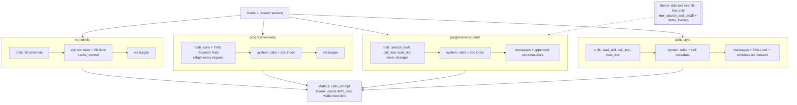

# D3.8 - Progressive Discovery vs Monolithic Context

> **Exam objective:** Evaluate progressive discovery vs. monolithic context strategy

## Why it matters

Every tool schema, instruction and document you put in the prompt is paid for on **every call**. It
takes window space away from the conversation and retrieved data, and it gives the model more
look-alike options to confuse. Loading everything ("monolithic") is simple, has few round trips and
caches well. Revealing capabilities just in time ("progressive discovery") keeps each call small and
focused, but adds discovery steps and depends on good search and good descriptions. Neither choice
is universally right. The architect has to choose from the size of the catalog, the latency budget,
cache behaviour and selection accuracy, and has to know the platform features that make each
approach work well.

## Key concepts

### The two strategies

| | **Monolithic context** | **Progressive discovery** |
|---|---|---|
| What is in every request | All tool schemas + all instructions + all reference docs | A small core (meta-tools, essentials) + an index or metadata |
| How detail arrives | Already there | Just in time: tool search, `load_doc`/RAG, Skills (`SKILL.md` on demand) |
| Tokens per call | High, and grows with the catalog | Low, roughly flat as the catalog grows |
| Round trips | Fewest (no discovery step) | +1 or more per request that needs discovery |
| Prompt caching | Excellent: big, stable prefix | Excellent **if the prefix stays stable** (append, never swap) |
| Selection accuracy | Degrades with many look-alike tools | Bounded choice set; depends on search recall |
| Main failure modes | Context crowding, attention dilution, wrong tool, expensive cache misses | Search misses the right tool, vague descriptions, extra latency, history growth |

### Platform mechanisms

- **Prompt caching** is monolithic's best friend. Render order is `tools` -> `system` ->
  `messages`, and a breakpoint on the last system block caches tools and system together. Cache
  reads are a fraction of the input price. Caching lowers **cost** but not **context size**,
  attention dilution or selection errors. A miss (TTL expiry, any byte change in the prefix)
  re-bills the whole prefix. See D2.5.
- **Server-side tool search.** Add `{"type": "tool_search_tool_bm25_20251119", "name":
  "tool_search_tool_bm25"}` (or the `..._regex_20251119` variant) and mark most tools
  `defer_loading: true`. Deferred tools are known to the API but not loaded into context. Claude
  searches, and the matching definitions are **appended inline**, so the cached prefix survives.
  Keep a small core of frequently used tools non-deferred; never defer everything. Guidance in
  Anthropic's cost material: it pays off once tool schemas pass roughly **10K tokens** (MCP
  servers get there fast). Below that, the search step is overhead. MCP toolsets can set
  `defer_loading` through `default_config`/`configs`.
- **Client-side discovery** (this lab). A `search_tools` meta-tool backed by your own index. How
  you surface results matters:
  - **swap**: rebuild `tools` per request. Every new tool set is a new prefix, so you get cache
    writes, and history can refer to tools that no longer exist.
  - **append**: keep `tools` stable, add discovered schemas to the conversation, and invoke them
    through a validating `call_tool`. The prefix stays cached. The trade-offs are that schemas
    accumulate in history and you validate arguments yourself.
  - **Mid-conversation tool changes** (beta `mid-conversation-tool-changes-2026-07-01`): declare
    tools up front with `defer_loading`, then send `tool_addition`/`tool_removal` blocks. This is
    for *application-controlled* changes; tool search is for *model-driven* discovery.
- **Agent Skills** use three levels of progressive disclosure. (1) The name + description is
  always loaded (about 50 tokens per skill). (2) `SKILL.md` is loaded when the description matches
  the task. (3) Bundled files and scripts are loaded only when needed. On the Messages API, Skills
  run in the code-execution container (`container.skills`), covered in D2.5. The description
  decides *when* a skill loads, so write it like a tool description.
- **Knowledge.** Use a document index plus `load_doc`, or RAG (D3.5), instead of stuffing every
  doc. Pin small, always-relevant facts in the system prompt.
- **History growth.** Progressive approaches move detail into the conversation. Plan for context
  editing or compaction in long sessions (D2.4).

### What the lab measures (offline mock, illustrative)

| Strategy | Calls | Avg prompt tokens / call | Cache writes | Cost (cached) | Cost (no cache) |
|---|---:|---:|---:|---:|---:|
| monolithic (60 tools + 20 docs) | 12 | ~8,850 | ~8,350 | lowest | ~2x the others |
| progressive-swap | 17 | ~2,630 | ~7,900 | middle | low |
| progressive-append (stable prefix) | 16 | ~3,000 | ~1,430 | middle | low |
| skills-style | 17 | ~3,400 | ~1,150 | middle | low |

How to read it:
- At **60 tools (~5K schema tokens)**, monolithic + caching is *cost-competitive*. That matches the
  "~10K tokens before tool search pays" guidance. Monolithic still uses about 3x the context per
  call, and the scale check projects about 30K tokens per call with 300 tools, while progressive
  stays roughly flat.
- **Swap vs append**: almost the same tokens, but swap writes the cache about 5x more, because
  every rebuilt tool set is a new prefix.
- Progressive costs **4-5 extra round trips** over 6 requests, which matters for latency SLOs.
- Monolithic R1 picked a look-alike tool first (`payroll_get_leave_accrual` instead of
  `hr_get_pto_balance`): 60 definitions in view vs. 5 to 18.

### Choosing

| Situation | Prefer |
|---|---|
| Fewer than about 15 tools, small stable docs, one domain | **Monolithic + prompt caching** |
| Strict latency budget, 1-2 model calls per request | Monolithic, or a preloaded core set |
| Dozens to hundreds of tools, several MCP servers | **Server-side tool search** with `defer_loading` (small core non-deferred) |
| Large task-specific playbooks and procedures | **Skills** (metadata first, `SKILL.md` on demand) |
| Large or frequently changing knowledge | Index + `load_doc` / **RAG** (D3.5) |
| Tool set changes during a session | **Append-only** (tool search, `tool_addition`). Never swap the `tools` array |
| Mixed | Hybrid: always-loaded core of high-frequency tools + discovery for the long tail |

Design rules: keep the core small but sufficient. Write descriptions with the words users actually
use (they are the search corpus). Keep tool order and serialization deterministic. Cap the number
of discovered results. **Evaluate discovery recall** (does search return the right tool for real
requests?) alongside answer quality.

## Architecture



```
monolithic   [ 60 tools | rules + 20 docs ]#cache  + messages            -> 1 hop, big prefix
swap         [ core + finds(req) | rules + index ]  + messages            -> prefix changes per request
append       [ core (stable)     | rules + index ]#cache + msgs(+schemas) -> prefix stable
skills       [ core (stable)     | rules + skill metadata ]#cache + msgs(+SKILL.md)
```

## What the code demonstrates

| Step | Printed section | Code (`python/main.py`; same structure in `typescript/main.ts`) |
|---|---|---|
| 1 | What could go into context | `count_tokens` on each component: 60 schemas, docs, index, skill metadata/bodies, core tools |
| 2 | Session x 4 strategies | `Runner.run_request` (manual tool loop, one shared conversation per strategy), `Runner.execute` (search, load_doc, load_skill, validating `call_tool`), fake `backend` |
| 3 | Totals | Calls, prompt tokens, cached share, cache writes, cost with/without caching, 300-tool scale check |
| 4 | Cache behaviour per call | W/R timeline: swap writes whenever its tool set changes; append and monolithic read |
| 5 | Selection pressure | Tool definitions visible per request; BM25 `ToolSearch` top-3; the look-alike pick in monolithic R1 |
| 6 | Skills levels | Metadata always, `SKILL.md` loaded 5x, level-3 file never loaded |
| 7 | Server-side tool search | Exact request with `tool_search_tool_bm25_20251119` + `defer_loading` (runs only live) |
| 8 | Recommendation | When monolithic is fine vs. when progressive wins |

Data: `data/tool_catalog.json` (60 tools, 9 domains), `data/knowledge_docs.json` (20 docs),
`data/skills/*/SKILL.md` (5 skills, one bundled file), `data/session.json` (6 requests with
expected tools, arguments, fake results and answer templates). The responder plays the assistant
and infers the strategy from the tools it is offered. The **token and cache numbers come from the
shared mock's usage simulation of the actual request bodies**, and they are identical in both
languages.

## Run it

From the repository root:

```bash
.venv/Scripts/python "D3.8 - Progressive Discovery vs Monolithic Context/python/main.py"
node "D3.8 - Progressive Discovery vs Monolithic Context/typescript/main.ts"
```

Offline caveat: the mock caches only the `tools + system` prefix and uses a simplified 1,024-token
minimum. Live, you would also cache the conversation tail. Per-call context size and
cache-write counts are the robust signals.

## Exam tips & traps

- **Hundreds of tools across several MCP servers, high cost, wrong tool picks** points to
  **tool search with `defer_loading`**, keeping a few high-frequency tools loaded. Caching alone
  fixes cost, not context size or selection.
- **A small, fixed tool set with a tight latency budget** points to **monolithic + caching**. Tool
  search adds a step and helps little below about 10K schema tokens.
- **Rebuilding the `tools` array every turn** breaks the cache (tools render first in the prefix).
  Use tool search (definitions appended inline), `tool_addition` with `defer_loading` (beta), or
  keep `tools` stable.
- **Prompt caching is not a context strategy.** It makes the same tokens cheaper to re-read; they
  still fill the window, slow TTFT on misses, and dilute attention.
- **Skills load on their description.** Vague descriptions mean skills never load (or always
  load). Only metadata is resident; `SKILL.md` and files arrive on demand.
- **Progressive discovery has costs too**: extra round trips, search recall risk, schemas
  accumulating in history. Measure discovery recall and latency, not just tokens.
- **Never defer every tool.** Keep a minimal always-on core, and keep tool ordering deterministic.

### Practice questions

**Q1.** An IT-operations agent connects to five MCP servers that expose 240 tools (about 35K
tokens of schemas). Most requests need one to three tools. Users report slow first responses and
occasional calls to the wrong `restart_*` tool. Prompt caching is already on. What is the BEST
next step?

- A. Raise `max_tokens` and switch to a larger model
- B. Enable server-side tool search and mark most MCP tools `defer_loading: true`, keeping a few high-frequency tools loaded
- C. Add a second cache breakpoint on the tools array
- D. Concatenate all tool descriptions into the system prompt instead of using `tools`

**Answer: B.** The problem is context size and selection pressure from a large catalog. Tool search
reveals only relevant schemas, appended inline so caching survives. More caching (C) does not
shrink context or fix selection. A bigger model (A) does not address the cause. D still loads
everything and loses structured tool calling.

**Q2.** A team built client-side discovery: each turn they rebuild `tools` to contain only the
tools relevant to that turn. Their bill went up, and `cache_read_input_tokens` is near zero on most
turns. What explains this, and what should they do?

- A. Discovery always costs more than monolithic, so they should revert to loading all tools
- B. Changing the `tools` array changes the very start of the cached prefix and invalidates it; they should keep `tools` stable and append discovered definitions (server-side tool search or `tool_addition` with `defer_loading`)
- C. The cache TTL is too short; they should switch to the 1-hour TTL
- D. They should put `cache_control` on each tool individually

**Answer: B.** Tools render first, so swapping them rewrites the prefix on every turn. Append-only
discovery keeps the prefix byte-identical. A longer TTL (C) or per-tool markers (D) do not help when
the prefix itself changes. A ignores that stable-prefix discovery can be cheap and keeps context
small.

## Further reading

- Claude docs: *Tool search tool* (`tool_search_tool_bm25_20251119`, `tool_search_tool_regex_20251119`, `defer_loading`)
- Claude docs: *Prompt caching* (prefix order, invalidation hierarchy, minimum cacheable prefix)
- Claude docs: *Agent Skills* overview and the Messages API skills integration
- Claude docs: *Mid-conversation tool changes* (beta) and *Token counting*
- Anthropic engineering blog: *Effective context engineering for AI agents*
- Anthropic engineering blog: *Equipping agents for the real world with Agent Skills*
- Anthropic engineering blog: *Introducing advanced tool use* (tool search, programmatic tool calling)
- Related labs: D2.4 (context window and history trimming), D2.5 (caching and Skills basics), D3.1 (capability bloat), D3.5 (RAG), D3.7 (MCP)
