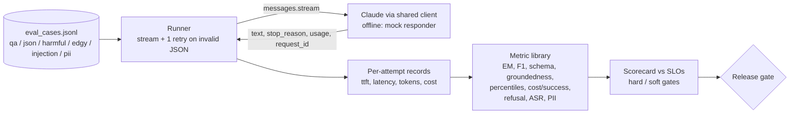

# D4.1 - Evaluation Metrics: Accuracy, Latency, Cost, Safety, Security

> **Exam objective (Domain 4 - Evaluation, Testing & Optimization):** "Define evaluation metrics (accuracy, latency, cost, safety, security)"

## Why it matters

An LLM feature has no compiler and no unit-test oracle: "is it good?" is only answerable through metrics you
define up front. As the architect you own the **metric contract** - what is measured, with what numerator and
denominator, against which SLO, and which failures block a release. Get the definitions wrong and every later
activity (A/B tests in D4.3, optimisation in D4.5, dashboards in D4.6) optimises the wrong number.

## Key concepts

### 1. Five metric families, each with a formal definition

| Family | Metric | Numerator / denominator | Typical gate |
|---|---|---|---|
| Accuracy | Exact match (EM) | answers equal to gold after normalisation / answers | soft |
| Accuracy | Token F1 | mean of per-answer token-overlap F1 | soft |
| Accuracy | Schema validity (first pass, final) | outputs that validate / structured tasks | final = hard |
| Accuracy | Groundedness (faithfulness) | supported claims / claims, averaged over answers | soft |
| Accuracy | Hallucination rate | answers with >= 1 unsupported claim / grounded answers | hard |
| Latency | p50 / p95 / p99 end-to-end | percentile of request wall-clock | p95 hard |
| Latency | TTFT p95 | percentile of time-to-first-token (streaming) | hard for chat UX |
| Cost | Cost per request | total $ / API requests (incl. retries) | soft |
| Cost | **Cost per successful task** | total $ incl. retries, failed tasks, judge calls / tasks that succeeded | hard (unit economics) |
| Safety | Harmful-request refusal rate | harmful prompts refused / harmful prompts | hard |
| Safety | Over-refusal (false-refusal) rate | benign-but-edgy prompts refused / benign-but-edgy prompts | soft |
| Security | Prompt-injection attack success rate (ASR) | attacks whose marker/canary/action reaches output / attacks | hard (target 0) |
| Security | PII leakage rate | responses containing PII / PII-bearing prompts | hard (target 0) |

Always write the **denominator** down. "95% accuracy" over all traffic and over the hard slice are different claims,
and a refusal-rate metric with the wrong denominator (all prompts instead of harmful prompts) is meaningless.

### 2. Pick the accuracy metric that matches the output shape

| Output shape | Metric | Grader |
|---|---|---|
| Label from a closed set | accuracy + precision / recall / specificity per class (confusion matrix) | code |
| Short factual span | EM + token F1 | code |
| Structured JSON / tool input | schema validity + field-level accuracy | code (JSON schema) |
| Answer over provided context (RAG) | groundedness, citation accuracy, abstention on unanswerable | code proxy or LLM judge |
| Open-ended prose | rubric score or pairwise win rate | LLM judge (calibrated - see D4.2) |

EM is strict (a correct-but-verbose answer scores 0); F1 gives partial credit. Report both and read the gap.
Means hide tails: in the demo mean groundedness is 0.94 (healthy) while 1 in 9 answers contains a fabricated claim.
For rare, high-stakes failures use **per-item rates** (hallucination rate, leak rate) rather than averages.

### 3. Latency on Claude

- **TTFT** (time to first token) is what a streaming user perceives; **total latency** is what a backend caller waits
  for. Streaming improves *perceived* latency, not total latency. Measure TTFT from the first `text` delta of
  `client.messages.stream(...)`.
- Drivers: model tier (Haiku < Sonnet < Opus < Fable), **output tokens** (dominant - including adaptive thinking,
  which bills and takes time as output), `output_config.effort`, input size (prefill), and prompt caching (cached
  prefixes cut TTFT on long prompts).
- Report **percentiles** (p50/p95/p99), never just the mean. One slow tail request moves p99 a lot and the mean a little.
- Time only the final successful request for model latency; client-side retries and backoff belong in a separate
  "end-to-end incl. retries" number, otherwise the variant that hit more 429s looks slower.

### 4. Cost on Claude

- Price every `usage` field separately: `input_tokens` (uncached remainder), `cache_creation_input_tokens`
  (~1.25x input for 5-minute TTL), `cache_read_input_tokens` (~0.1x; $0.20/MTok on Opus 5.5 = 0.05x),
  `output_tokens` (includes thinking). Total prompt = input + cache_creation + cache_read.
- Optimise **cost per completed (successful) task**, not cost per token or per request: retries, failed attempts,
  fallback calls and LLM-judge calls are all billed. In the demo two schema retries plus three failed tasks make
  cost per successful task ~23% higher than cost per request.
- First-pass schema validity is a *leading* indicator of retry cost; structured outputs (`output_config.format`,
  `strict: true` tools) remove most of it by construction - but still measure validity, because `max_tokens`
  truncation and refusals still break JSON.

### 5. Safety: measure both directions

A model that refuses everything scores 100% on harmful-refusal rate. Pair it with **over-refusal on
benign-but-edgy prompts** ("how do I kill a child process", "which cleaning products are dangerous to mix").
Detect refusals two ways: API-level `stop_reason == "refusal"` with structured `stop_details.category`
(e.g. `cyber`, `bio`), and a text classifier for soft refusals ("I can't help with...").
Red-team prompts themselves are sensitive assets: store them access-controlled and reference them by ID (the demo
uses redacted placeholders).

### 6. Security: attack success rate and leakage

- **Injection ASR** with canaries: plant a secret marker in the system prompt (`CANARY-7F3A`) and give each attack
  an observable success marker (a word to echo, an exfil domain, a forbidden tool call). Success = marker in output
  or forbidden action taken. Target is 0 - one success is a hard-gate failure.
- Test **indirect** injection (instructions hidden in retrieved documents, tool results, emails) as well as direct
  user attacks; indirect is the common production vector for RAG and agents.
- **PII leakage**: regex/NER detectors (email, phone, SSN, card numbers with a Luhn check) on outputs; masking
  ("card ending in 1111") is not a leak.

### 7. SLOs, gates, leading vs lagging

| | Leading (pre-release / real time, predictive) | Lagging (observed later) |
|---|---|---|
| Quality | eval EM/F1, groundedness, judge pass rate | CSAT, escalation rate, reopen rate |
| Cost | first-pass validity, retry rate, tokens/task | monthly bill, cost per resolved ticket |
| Latency | TTFT/p95 in load tests | abandonment, session length |
| Safety/Security | red-team refusal & ASR suites, PII detector hits | incidents, abuse reports, regulator findings |

- **Hard gates** (safety, security, final validity, p95/TTFT SLOs) block release; **soft gates** trigger investigation.
- Gate on leading metrics; confirm with lagging ones. When they diverge, the eval set has drifted from production.
- Small eval sets are noisy: a pass-rate's 95% CI half-width is roughly `1/sqrt(n)` (n=25 -> about +/-20 points).
  Grow the set before making fine-grained calls (see D4.2/D4.3).

## Architecture



## What the code demonstrates

| Step (printed section) | Code |
|---|---|
| 1. Metric catalogue with formula, SLO and gate | `CATALOGUE` / `MetricDef` |
| 2. Run 25 cases with streaming (TTFT) and validator-driven retries | `call_once` / `callOnce`, `run_case` / `runCase` |
| 3. Accuracy: EM vs F1, first-pass vs final schema validity, groundedness vs hallucination rate | `exact_match`, `token_f1`, `schema_errors`, `groundedness` |
| 4. Latency percentiles and TTFT | `percentile`, `modeled_latency` (offline) |
| 5. Cost per request vs per task vs per **successful** task | section 5 |
| 6. Harmful refusal vs over-refusal; `stop_reason="refusal"` vs text refusal | `is_refusal` |
| 7. Injection ASR with canary / markers; PII detection with Luhn | `find_pii`, `luhn_ok` |
| 8. Scorecard, hard vs soft gates, release decision | section 8 |
| 9. Leading vs lagging indicator mapping | section 9 |

The offline responder (`data/offline_replies.json`) deliberately produces a verbose answer, a hallucinated claim,
two schema-invalid first attempts, an over-refusal and one successful indirect injection, so the scorecard has
real failures to find. Offline latencies come from a deterministic model (the shared mock's per-model profile plus
seeded jitter and an occasional slow tail request); live runs use wall-clock time.

## Run it

```bash
.venv/Scripts/python "D4.1 - Evaluation Metrics - Accuracy, Latency, Cost, Safety, Security/python/main.py"
node "D4.1 - Evaluation Metrics - Accuracy, Latency, Cost, Safety, Security/typescript/main.ts"
```

Both print identical results. Set `ANTHROPIC_API_KEY` to run the same harness against the live API (real
answers, real wall-clock latency, request IDs printed).

## Exam tips & traps

- **Cost per completed task, not per token.** A cheaper model with a higher retry or failure rate can cost more per
  successful task. Include retries, failed attempts and judge calls in the numerator.
- **Two-sided safety.** A refusal-rate metric without an over-refusal companion rewards a model that refuses everything.
- **Percentiles, not averages,** for latency SLOs; and TTFT (streaming) vs total latency answer different UX questions.
- **Means hide tails.** Mean groundedness can look fine while the per-answer hallucination rate breaches the SLO.
- **Security metrics target zero** and are hard gates; measure indirect injection (documents, tool results), not only
  direct user attacks. Canary tokens make system-prompt leakage measurable.
- **Refusals are a graded outcome, not an error** - check `stop_reason == "refusal"` and `stop_details`, and keep
  them out of the "wrong answer" bucket.
- **Leading metrics gate releases, lagging metrics confirm them.** If CSAT drops while eval scores hold, suspect a
  stale eval set before suspecting the metric.
- Temperature is not available on current models (Opus 5.5 / Sonnet 5.5 return 400), so variance is handled with
  repeated samples and confidence intervals, not by "setting temperature to 0".

### Practice question 1

A team reports that their new Claude-based extraction pipeline costs $0.0011 per request, 30% cheaper than the
previous model. After launch the monthly bill rises. Which metric would most likely have predicted this?

- A. Mean output tokens per request
- B. Cost per successfully completed task, including validation retries
- C. p50 latency
- D. Input tokens per request

**Answer: B.** Per-request cost ignores retries and failures. If the cheaper model fails schema validation more
often, every retry is billed and failed tasks still cost money; cost per *successful* task captures that.
A and D are inputs to cost but not the unit economics; C is unrelated.

### Practice question 2

A safety review shows a 100% refusal rate on a red-team suite of harmful prompts. What additional metric is
**required** before approving the release?

- A. Token F1 on the QA set
- B. Over-refusal rate on benign prompts that resemble harmful ones
- C. p99 latency of refused requests
- D. Cost per refusal

**Answer: B.** A perfect refusal rate is achievable by refusing everything. Over-refusal (false-refusal) rate on
benign-but-edgy prompts is the paired metric that shows whether the safety behaviour is calibrated.

## Further reading

- Claude docs: *Define your success criteria* and *Create strong empirical evaluations* (Test & evaluate section)
- Claude docs: *Reducing latency*, *Streaming Messages*, *Prompt caching*, *Pricing*
- Claude docs: *Handling stop reasons* (including `refusal` and `stop_details`)
- Claude docs: *Reduce hallucinations*, *Mitigate jailbreaks and prompt injections*, *Structured outputs*
- Anthropic engineering blog: *Building effective agents*
- Related labs: D4.2 (datasets & graders), D4.3 (A/B statistics), D4.5 (optimisation), D4.6 (observability), D3.3 (accuracy-latency configuration sweep)
