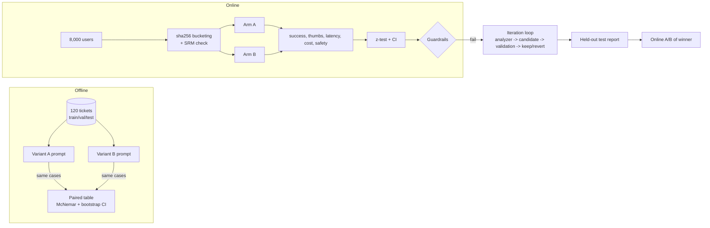

# D4.3 - A/B Testing and Iterative Improvement

> **Exam objective (Domain 4 - Evaluation, Testing & Optimization):** "Conduct A/B testing and iterative improvements"

## Why it matters

Every prompt edit, model swap or effort change is a hypothesis. The architect's job is to decide **with evidence**:
is the new variant really better, by how much, at what cost and latency, and without regressing safety? That needs
two complementary tools - **offline A/B on a fixed eval set** (fast, cheap, paired) and **online A/B on real users**
(ground truth for outcomes) - plus a disciplined **iteration loop** that does not overfit to the cases you read.

## Key concepts

### 1. Offline A/B: paired comparison on the same eval set

Run both variants on the **same cases**. Each case is its own control, so per-case difficulty cancels out and you
need far fewer cases than an unpaired comparison.

| Tool | What it answers | Notes |
|---|---|---|
| **Paired table** (both right / A only / B only / both wrong) | where the variants differ | only the *discordant* cells carry information |
| **McNemar test** | is B's win rate on discordant pairs different from 50/50? | exact binomial for small counts; chi-square with continuity correction for large |
| **Paired bootstrap CI** | 95% interval for accuracy(B) - accuracy(A) | resample **cases** (not individual outputs) so the pairing is kept |

Using an unpaired two-proportion test on paired data throws away power and is a classic mistake.
Because current Claude models do not accept `temperature`, repeat samples (reps) when outputs vary run to run, and
compare at equal rep counts.

### 2. Online A/B: design checklist

| Element | Rule |
|---|---|
| **Unit of randomisation** | the **user** (or account), not the request - a user must get a consistent experience and you avoid contamination |
| **Assignment** | deterministic hash: `hash(experiment_salt + ":" + user_id) % 100 < split` - stateless, identical on every server, independent across experiments |
| **SRM check** | chi-square test that the observed split matches the planned split; a mismatch (p < 0.001) means broken assignment or logging - stop and debug, do not read results |
| **Primary metric** | one pre-registered outcome (task success) decides the test |
| **Secondary metrics** | supporting evidence (thumbs-up, CSAT) |
| **Guardrails** | must-not-regress metrics: p95 latency, cost per successful task, safety incidents, error rate |
| **Power / sample size** | fix the minimum detectable effect (MDE) and compute n per arm *before* starting |
| **Fixed horizon** | test once at the planned n; or use a proper sequential method |
| **Rollout** | canary -> 1% -> 10% -> 50%; shadow traffic for cost/latency before exposing users |

Two-proportion z-test (pooled SE for the test, unpooled for the CI):

```
z = (p_B - p_A) / sqrt(p_pool (1 - p_pool) (1/n_A + 1/n_B))
95% CI = (p_B - p_A) +/- 1.96 sqrt(p_A(1-p_A)/n_A + p_B(1-p_B)/n_B)
n per arm = (z_{1-a/2} sqrt(2 p_bar (1-p_bar)) + z_{1-b} sqrt(p_A(1-p_A) + p_B(1-p_B)))^2 / MDE^2
```

With a 70% baseline and a 4-point MDE at alpha = 0.05 and power = 0.80 you need ~1,977 users per arm.

### 3. Guardrails turn "winner" into "ship / don't ship"

In the demo variant B wins the primary metric decisively (+5.7 points, p < 0.0001) but regresses p95 latency
(+26%) and cost per successful task (+109%) because its longer prompt makes the model write longer explanations.
Decision: **do not ship; iterate.** Statistical significance is not the same as a shippable improvement - read
quality, latency and cost together, as absolute numbers first.

### 4. The peeking problem

Checking the p-value repeatedly and stopping at the first p < 0.05 inflates the false-positive rate. The demo's 200
A/A tests (no real difference) give ~5-7% false positives when tested once at the planned size, but ~21% when
stopping at the first of 10 peeks. Fix: pre-register n and test once, or use sequential testing (alpha spending,
SPRT, always-valid p-values).

### 5. The iteration loop (hill-climbing)

1. Baseline on train + validation; the held-out **test** split is not touched.
2. An analyzer (often a **stronger model** than the one under test) reads **only train failures** and proposes edits.
3. Apply **one change at a time**; evaluate on train and validation.
4. **Keep** only if validation improves by more than the noise floor (and guardrails hold), or quality holds while
   cost/latency drop materially. Otherwise **revert**.
5. Watch for **overfitting**: train up, validation flat = the edit memorised the cases it saw (demo candidate 1).
6. Reject "fluff" edits ("think carefully") that add tokens without a measurable gain.
7. Report the **test-split delta vs baseline with a CI**, then confirm online.

| Signature | Meaning | Action |
|---|---|---|
| train up, validation up | real improvement | keep |
| train up, validation flat | overfit to inspected cases | revert, generalise the fix |
| quality flat, tokens down a lot | efficiency win | keep (if guardrails hold) |
| quality flat, tokens flat/up | no effect | revert (de-fluff) |
| train down, validation up | probably noise at small n | re-run with more reps before keeping |

### 6. A/B testing models and effort

The same harness compares models (Haiku vs Sonnet vs Opus) or `output_config.effort` levels. Two Claude-specific
pitfalls: prompt **caches are model-scoped**, so a newly introduced arm starts cold - compare warm against warm or
exclude cache warm-up; and changing effort or model mid-conversation invalidates caches, so assign per user/session,
not per request. Price variants by **cost per successful task**, not per-token list price.

## Architecture



## What the code demonstrates

| Printed section | Code |
|---|---|
| 1. Dataset (templated, 120 tickets) and stable stratified split | `TICKETS`, `SPLIT` |
| 2. Offline paired A/B: per-difficulty accuracy, paired table, McNemar, bootstrap CI, tokens and cost | `evaluate`, `mcnemar`, `paired_bootstrap` |
| 3. Online design: sha256 bucketing, SRM chi-square, power / sample size, measured per-arm profile | `bucket`, `sample_size_per_arm`, `norm_ppf` |
| 4. Online results: primary/secondary z-tests with CI, guardrails, ship decision | `two_prop_ztest`, guardrail list |
| 5. A/A simulation: fixed horizon vs peeking false-positive rates | section 5 |
| 6. Hill-climb with a Claude analyzer (structured output) and keep/revert rules | `CandidateList`, section 6 |
| 7. Held-out test report for A, B and the hill-climbed C | section 7 |

All statistics (erf, inverse normal, McNemar, bootstrap, z-test, power) are implemented from scratch with the same
seeded PRNG in both languages. The offline mock routes tickets with a probability that depends on difficulty and on
which prompt blocks are present, with shared per-case difficulty (which is what makes paired tests powerful).

## Run it

```bash
.venv/Scripts/python "D4.3 - A-B Testing and Iterative Improvement/python/main.py"
node "D4.3 - A-B Testing and Iterative Improvement/typescript/main.ts"
```

## Exam tips & traps

- **Same eval set -> paired test** (McNemar / paired bootstrap), not an unpaired two-proportion test.
- **Randomise by user, hash deterministically, salt per experiment**; run an **SRM check** before reading results.
- **Pre-register** the primary metric, MDE and sample size; **don't peek** and stop early on a lucky p-value.
- **Guardrails can veto a winner** - latency, cost per successful task and safety must not regress.
- **Statistical significance is not practical significance**: a tiny but significant lift may not pay for a cost increase.
- **Hill-climb on train, select on validation, report on test**; train-up/validation-flat is overfitting.
- **One change per round** so effects are attributable; reject fluff that adds tokens without gain.
- Offline wins usually shrink online (different traffic mix, real users) - always confirm online before full rollout.

### Practice question 1

A new prompt raises task success from 70.1% to 73.9% in an online test with 4,000 users per arm (p = 0.0002).
p95 latency rose 22% and the SLO allows 10%. The product owner wants to ship. What should the architect recommend?

- A. Ship - the primary metric is highly significant
- B. Keep the test running until latency improves by itself
- C. Do not ship as-is; the latency guardrail failed - iterate (e.g. shorten the output) and re-test
- D. Ship to 100% and fix latency later with a smaller model

**Answer: C.** Guardrails are pre-agreed must-not-regress conditions; a primary-metric win does not override them.
B wastes traffic without a change, D swaps the model without evidence (a model change is a new variant to test).

### Practice question 2

Prompt variants A and B were each run once on the same 200 eval cases. A team member compares the two accuracies
with an unpaired two-proportion z-test and finds p = 0.09. What is the best next step?

- A. Conclude there is no difference
- B. Re-analyse with a paired method (McNemar or paired bootstrap) on the per-case results
- C. Rerun with temperature 0 to remove noise
- D. Double the dataset by adding model-generated cases

**Answer: B.** The cases are shared, so a paired test uses the per-case pairing and is more powerful; it may well
show a significant difference. C is invalid on current models (temperature is not supported); D adds unreviewed,
model-written cases.

## Further reading

- Claude docs: *Create strong empirical evaluations*; Claude Console *Evaluation tool* for side-by-side prompt comparison
- Claude docs: *Prompt engineering overview* (iterate against a test set), *Prompt caching* (model-scoped caches)
- Kohavi, Tang & Xu, *Trustworthy Online Controlled Experiments* (SRM, guardrails, peeking)
- Related labs: D4.2 (datasets, splits, judge calibration), D4.5 (cost/latency levers), D3.3 (accuracy-latency sweep), D6.3 (SLA alignment)
