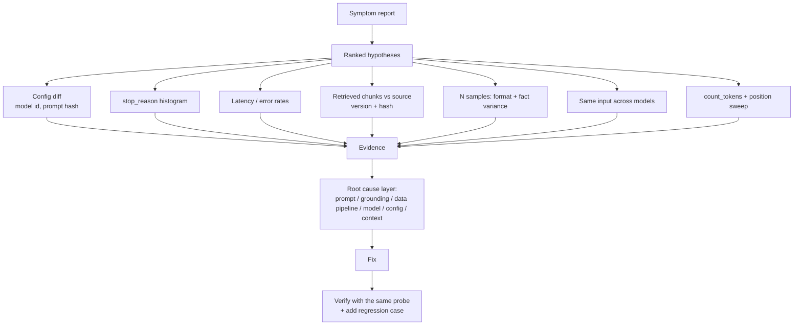

# D4.4 - Diagnosing Prompt Failure, Hallucination, Model Mismatch

> **Exam objective (Domain 4 - Evaluation, Testing & Optimization):** "Diagnose system issues (prompt failure, hallucinations, model mismatch)"

## Why it matters

When an LLM system misbehaves, the model is the most visible component and the least likely to have changed. Most
production incidents are caused by the layers around it: an underspecified prompt, missing or stale context, a
config value such as `max_tokens`, an oversized context window, or a model tier that is wrong for the task. An
architect diagnoses systematically - symptom, ranked hypotheses, cheap probes, evidence - and fixes the **root cause**
instead of rewriting prompts at random.

## Key concepts

### 1. The diagnostic method

1. **State the symptom precisely** (what is wrong, for which inputs, since when, what did *not* change).
2. **Rank hypotheses by likelihood x cheapness to test.** Check what changed (deploys, prompt versions, model ids,
   data refreshes) before suspecting the model.
3. **Probe one layer at a time** and collect evidence: config diff, `stop_reason`, latency/error rates, retrieved
   context, repeated samples, the same input across models.
4. **Fix the root cause**, then **verify** with the same probe and add a regression case to the eval set (D4.2).

### 2. Symptom -> probe -> root cause

| Symptom | First probe | Typical root cause | Fix |
|---|---|---|---|
| Output format varies run to run; parser fails intermittently | sample the same input N times; count formats; parse rate | **underspecified prompt** - no output contract | explicit format + **structured outputs** (`output_config.format`, `messages.parse`, `strict: true` tools) |
| Confident, specific facts with no source; answers change across samples | **self-consistency** (ask N times) + **groundedness** vs supplied context | **missing grounding** | retrieval, "answer only from documents", citations, explicit permission to say "I don't know" |
| Confident wrong answers after a content update; latency, errors, model unchanged | compare **retrieved chunk versions/hashes** with the source of truth | **stale index / failed ingestion** | re-index changed docs, alert on pipeline failures, monitor index freshness |
| Fails on complex/multi-step inputs only, after a model change | run the **same inputs across model tiers** | **model mismatch** (capability) | route by complexity, larger model at lower effort, tools/code for arithmetic |
| Cut-off text, invalid JSON on long outputs | **`stop_reason` histogram**; `output_tokens == max_tokens`? | **truncation** (`max_tokens` too low) | raise `max_tokens` (a backstop), concise-output instructions, streaming, treat `max_tokens` as failure |
| Misses facts that exist; cost per call rising as the KB grows | **count_tokens** + **needle position sweep** | **context overload / lost-in-the-middle** | retrieve top-k, documents first and question last, token budget gate |
| Refuses benign requests | `stop_reason == "refusal"` + `stop_details.category` | over-broad system prompt or genuinely borderline content | adjust instructions; see D4.1 over-refusal metric |

### 3. Hallucination vs stale grounding (exam sample question 3)

> A RAG assistant starts giving confident wrong answers after a document refresh. Latency and the model are
> unchanged. What should you investigate first?

**Retrieval and indexing.** Unchanged latency and model rule out infrastructure and model regressions. The decisive
probe compares two numbers:

| Check | Hallucination | Stale index |
|---|---|---|
| Answer grounded in the **retrieved** chunks? | low | **high** - the model faithfully repeats what it was given |
| Answer correct against the **source of truth**? | low | low |
| Retrieved chunk version/hash == source? | n/a | **no** |

High groundedness + low correctness points **upstream** of the model. Rewriting the prompt or switching models cannot
fix data the model never received. Prevent it with content-hash-based incremental re-indexing, ingestion-job alerts,
index-vs-source freshness monitoring, and regression cases for updated documents.

### 4. Model mismatch

Probe by running the **same prompt and inputs** across tiers (Haiku 5.5, Sonnet 5.5, Opus 5.5). If larger models pass
with the identical prompt, the prompt is not the problem - capability is. Fixes, in order: try the larger model at a
lower `output_config.effort`, route only complex cases to it (a complexity classifier or heuristic), decompose the
task, or move arithmetic into code/tools. Measure **cost per correct answer** and remember that a wrong refund,
diagnosis or contract clause usually costs far more than the tokens saved. Always re-run the eval before downgrading.

### 5. Stop reasons are free diagnostics

| `stop_reason` | Meaning | Diagnostic action |
|---|---|---|
| `end_turn` | finished naturally | - |
| `max_tokens` | hit the cap - output is incomplete | never parse as complete; raise the cap or request shorter output |
| `tool_use` | wants a tool result | continue the agent loop |
| `pause_turn` | server tool paused a long turn | resend to continue |
| `refusal` | declined for policy reasons | read `stop_details.category`; check for over-refusal |
| `stop_sequence` | custom stop sequence hit | expected early exit |

### 6. Long-context failure modes

More context is not more accuracy. Facts buried in the middle of very long prompts are recalled less reliably
(lost-in-the-middle), irrelevant documents distract, and cost and latency grow linearly with input. Anthropic's
long-context guidance: put long documents **at the top** and the **query at the end**, wrap documents in tags with ids,
and retrieve only what is relevant. Use `client.messages.count_tokens` to enforce a per-route token budget before
sending; a request beyond the model's context window fails with a 400 error.

### 7. Nondeterminism is a probe, not just noise

Current models do not accept `temperature` / `top_p`, so you cannot "turn off" variation. Use it: sample the same
input N times. Format variance points to the prompt; factual variance points to missing grounding; consistent wrong
answers point to data or capability.

### 8. What you need logged to diagnose quickly (see D4.6)

`request_id`, model id, prompt version/hash, `stop_reason`, token usage, latency, retrieved chunk ids **with
versions/hashes**, tool calls, and error types. Without retrieved-chunk versions, scenario 3 is guesswork.

## Architecture



## What the code demonstrates

| Printed section | Scenario | Probes used |
|---|---|---|
| Decision tree | symptom -> first probe -> likely cause | - |
| Scenario 1 | vague "Summarize" prompt | 8 samples, format classifier, parse rate, length CV; fix with `messages.parse` + schema |
| Scenario 2 | product bot without documents | self-consistency, groundedness; fix with retrieval + citations + "I don't know" |
| Scenario 3 | RAG after a policy refresh | config diff, latency/errors, groundedness vs retrieved, chunk hash/version vs source; fix with re-index |
| Scenario 4 | Haiku on multi-step proration | same 8 tasks on Haiku/Sonnet/Opus, cost per correct answer, measured routed cost |
| Scenario 5 | incident reports with `max_tokens=150` | stop_reason histogram, parse failures vs `output_tokens == max_tokens` |
| Scenario 6 | 60-document HR prompt | `count_tokens`, needle position sweep (query first vs last), top-3 retrieval |
| Summary | root cause per layer | - |

The offline responder imitates each broken app (format drift, invented facts, faithful extraction from stale
chunks, capability gaps by model tier, real `max_tokens` truncation by the mock, position-dependent recall). The
graders, retrieval, hashing and statistics are real code.

## Run it

```bash
.venv/Scripts/python "D4.4 - Diagnosing Prompt Failure, Hallucination, Model Mismatch/python/main.py"
node "D4.4 - Diagnosing Prompt Failure, Hallucination, Model Mismatch/typescript/main.ts"
```

## Exam tips & traps

- **Unchanged latency and model + wrong answers after a content change -> retrieval/indexing first**, not prompt
  rewrites or model swaps.
- **High groundedness but wrong** means the model faithfully used bad context - the defect is upstream.
- **Intermittent format failures** are a prompt-contract problem; the robust fix is structured outputs, not "please
  respond in JSON" alone.
- **Hallucination fixes**: grounding documents, citations, and explicit permission to say "I don't know" - not a
  bigger model.
- **Truncation**: check `stop_reason == "max_tokens"` before blaming model quality; `max_tokens` is a backstop, not a
  length-tuning knob.
- **Model mismatch is proven by holding the prompt constant and varying the model**; fix with routing or a larger
  model at lower effort.
- **Lost in the middle**: long documents first, question last; retrieve top-k; gate with `count_tokens`.
- Change one variable at a time and confirm the fix with the probe that found the problem.

### Practice question 1

After a nightly document refresh, a RAG assistant answers a returns-policy question with the old 30-day window.
Logs show the same model, unchanged p50 latency and zero errors. The answer quotes the retrieved passage exactly.
What is the most likely root cause and first action?

- A. The model is hallucinating - add "do not make things up" to the system prompt
- B. The index still contains pre-refresh chunks - compare retrieved chunk versions with the source and re-index
- C. The model was silently downgraded - switch to a larger model
- D. Latency is too low, so the model is not thinking enough - raise effort

**Answer: B.** The answer is faithful to the retrieved text (not a hallucination), the model and latency are
unchanged, and the content changed - the retrieval layer is serving stale data.

### Practice question 2

A summariser returns valid JSON for short tickets but about 20% of long tickets fail to parse; the failing responses
end mid-string. Which check gives the fastest diagnosis?

- A. Run the same tickets on a larger model
- B. Inspect `stop_reason` and compare `output_tokens` with `max_tokens` for the failing calls
- C. Add few-shot JSON examples to the prompt
- D. Increase the number of retries on parse failure

**Answer: B.** Responses ending mid-string on long inputs suggest truncation; `stop_reason == "max_tokens"` and
`output_tokens == max_tokens` confirm it in seconds. Retries at the same cap fail the same way.

## Further reading

- Claude docs: *Reduce hallucinations* (grounding, citations, allowing "I don't know")
- Claude docs: *Long context prompting tips* (documents first, query last) and *Token counting*
- Claude docs: *Handling stop reasons*, *Structured outputs*, *Increase output consistency*
- Claude docs: *Citations* (document-grounded answers with source spans)
- Related labs: D3.5 / D3.6 (RAG indexing and retrieval), D2.1 (model selection), D2.4 (context windows), D4.6 (observability), D7.3 (debugging)
