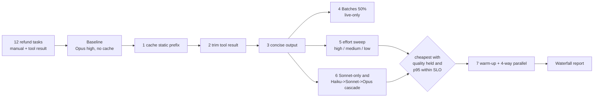

# D4.5 - Token, Latency and Cost-Performance Optimization

> **Exam objective (Domain 4 - Evaluation, Testing & Optimization):** "Optimize token usage, latency, and cost-performance trade-offs"

## Why it matters

LLM spend and latency are dominated by a few structural choices: what you resend on every call, how much the model
writes and thinks, and which model you route to. Architects optimise **cost per completed task** - not cost per
token - and apply levers **in the right order**: free wins that never cost quality first, trade-offs that exchange
capability for cost last, each one measured against the eval and reverted if quality drops.

## Key concepts

### 1. The unit: cost per completed task

```
cost per request = (input x p_in + cache_write x 1.25 p_in + cache_read x ~0.1 p_in + output x p_out) / 1e6
cost per completed task = sum(all attempts: retries, escalations, failed calls, judge calls) / tasks that passed validation
```

`output_tokens` **includes adaptive-thinking tokens** (`usage.output_tokens_details.thinking_tokens`) - they are
billed as output and take generation time. A cheaper model that fails and retries can cost more per completed task
than a stronger model that succeeds first time.

### 2. Lever order (the order is load-bearing)

| # | Lever | Type | What it changes | Watch out |
|---|---|---|---|---|
| 1 | **Prompt caching** of the static prefix | free | static input re-billed at ~0.1x (Opus 5.5: $0.20 vs $4.00/MTok) | first request pays 1.25x write; prefix must be byte-identical; caches are model-scoped |
| 2 | **Trim input** - project verbose tool results, narrow accessors, retrieve instead of inlining | free | uncached input tokens | validate that the dropped fields were not needed |
| 3 | **Right-size output** - specify the exact output shape; `max_tokens` as a backstop | free | visible output tokens and latency | a too-tight `max_tokens` truncates (D4.4) |
| 4 | **Message Batches API** for non-urgent work | free | 50% off every token (cache reads/writes included) | async, up to 24 h; results in any order keyed by `custom_id` |
| 5 | **Effort** (`output_config.effort`: low / medium / high / xhigh / max) | trade-off | thinking depth -> output tokens and latency | sweep it on the eval; Opus 5.5 defaults to medium |
| 6 | **Model routing / cascade** (Haiku -> Sonnet -> Opus) | trade-off | price per token | escalations add cost and latency; each model writes its own cache |
| 7 | **Parallelism** | latency | wall-clock for independent tasks | not cheaper; warm the cache with one request before fanning out |

Free wins first: they lower cost without touching what the model can do. Trade-offs last: each one can cost quality,
so each needs an eval run and a keep/revert decision. Change **one lever at a time** so effects are attributable.

### 3. Prompt caching essentials

- **Prefix match**: render order is `tools -> system -> messages`; any byte change before a breakpoint invalidates
  everything after it. Keep timestamps, user ids and other per-request values out of the system prompt.
- **Breakpoints**: `cache_control: {"type": "ephemeral"}` on the last static block (or top-level automatic caching
  for multi-turn); up to 4 breakpoints.
- **Economics**: 5-minute TTL writes cost 1.25x input, 1-hour TTL writes 2x; reads ~0.1x (0.05x on Opus 5.5).
  Two requests within the TTL already break even on a 5-minute cache.
- **Minimum prefix**: current models need about 512 tokens (older models 1,024-4,096); shorter prefixes silently do not
  cache (the offline mock uses a simplified 1,024).
- **Verify from `usage`**: `cache_read_input_tokens` should dominate after the first request. Measure warm, not cold.
- **Model-scoped**: switching model (including in a cascade) means a new cache entry per model.
- **Concurrency**: an entry becomes readable only after the first response starts streaming - send one request, then
  fan out.

### 4. Effort before model; measure before building a cascade

Effort is the first quality/cost dial after caching. In the demo, high -> medium on Opus 5.5 cuts cost per task by
~55% with quality held, while low effort fails the hard tasks (and their retries are billed). Sonnet at medium also
fails the hard tasks. The Haiku -> Sonnet -> Opus cascade is cheapest per task but stacks three calls on hard cases,
breaking the p95 SLO - and it pays a separate cache write for every model. **Measure the most capable model at a lower
effort before building a cascade**; build routing only when the traffic mix (mostly easy, high volume) and the latency
budget justify it, ideally with a cheap upfront complexity classifier instead of try-and-escalate.

### 5. Latency levers

| Lever | Effect |
|---|---|
| Fewer output tokens (concise format, lower effort) | biggest lever - generation time is per output token |
| Prompt caching | shorter prefill -> lower TTFT on long prompts |
| Streaming | lower *perceived* latency (TTFT); total time unchanged |
| Smaller / faster model | lower TTFT and per-token time, if quality holds |
| Parallel independent calls | lower wall-clock for a batch, same per-request latency and cost |
| Batches API | *higher* latency (async) in exchange for 50% off |

### 6. Reading the waterfall

Report every step as **absolute numbers first** (cost per completed task, p95 ms, quality n/N), then the deltas. A
step that saves money but loses quality is not an optimisation - revert it. Plot the final candidates as cost vs
quality and choose from the Pareto frontier subject to the latency SLO.

## Architecture



## What the code demonstrates

| Printed section | Code |
|---|---|
| 0. Token profile of one baseline request (input, visible output, thinking) | section 0 |
| 1-4. Free-win waterfall with cost per completed task, deltas, p95, quality held | `Config`, `run_config`, `row` |
| Caching detail: one write, then reads; cold first request costs more | `usage.cache_*` fields |
| 4. Batches API request code (submitted only in live mode) | `messages.batches.create` |
| 5-6. Effort sweep, Sonnet-only, cascade with per-tier calls and cache-write cost; selection rule | candidates table |
| 7. Warm-up + parallel fan-out; makespan vs sequential | `schedule`, semaphore / workers |
| Waterfall bar chart | summary |

Each configuration runs on a fresh client (cold cache) with tasks executed sequentially, so cache economics are
measured honestly. Failed validations are retried and billed; cascades escalate on failure. Costs come from real
`usage` objects; offline latency is a deterministic model (TTFT + prefill + per-output-token time), live latency is
wall-clock.

## Run it

```bash
.venv/Scripts/python "D4.5 - Token, Latency and Cost-Performance Optimization/python/main.py"
node "D4.5 - Token, Latency and Cost-Performance Optimization/typescript/main.ts"
```

## Exam tips & traps

- **Optimise cost per completed task**, including retries, escalations and failures - not per-token price.
- **Free wins before trade-offs**: caching -> input trimming -> output shaping -> batching, then effort -> model.
- **Caching is a byte-exact prefix match** across `tools -> system -> messages`; dynamic content in the system prompt
  silently disables it. Caches are **model-scoped** - a cascade pays a write per model.
- **Batches API = 50% off, asynchronous** (up to 24 h): evals, backfills, nightly jobs - never interactive traffic.
- **Thinking tokens are output tokens.** Lowering `effort` is the lever for thinking spend (no `budget_tokens` on
  current models).
- **`max_tokens` is a backstop**, not a length control - shape length with instructions; a tight cap truncates.
- **Sweep effort on the most capable model before building a cascade**; cascades add latency on escalations.
- **Parallelism improves wall-clock, not cost**; warm the cache with one request before fanning out.

### Practice question 1

A support agent sends the same 8,000-token system prompt and tool definitions on every request and runs on Opus 5.5
at high effort. Quality is good but cost is over budget. Which change should be made **first**?

- A. Switch all traffic to Haiku 5.5
- B. Add a cache breakpoint on the static system prompt and verify `cache_read_input_tokens` on repeat requests
- C. Lower `max_tokens` to 256
- D. Build a Haiku -> Sonnet -> Opus cascade

**Answer: B.** Caching the static prefix is a free win that does not change model behaviour. A and D are trade-offs
that need eval validation and come later; C risks truncation and does not address the repeated input.

### Practice question 2

A team builds a Haiku -> Sonnet -> Opus cascade for a document-review workflow. Cost per request falls, but p95
latency rises 40% and the monthly bill barely moves. What is the most likely explanation and next step?

- A. Haiku is slower than Opus; remove Haiku
- B. Many requests escalate, so they pay for two or three calls (plus a cache write per model) and stack latency;
  measure cost per *completed* task and compare with Opus alone at a lower effort
- C. The Batches API was not used; move the workflow to batches
- D. Prompt caching does not work with Haiku

**Answer: B.** Escalations make failed cheap attempts part of the cost and the latency. The right comparison is cost
per completed task and p95 against the strongest model at reduced effort. C is wrong if users wait on results; D is false.

## Further reading

- Claude docs: *Prompt caching* (breakpoints, TTLs, pricing, invalidation), *Pricing*
- Claude docs: *Message Batches API*, *Token counting*, *Reducing latency*
- Claude docs: *Effort* / adaptive thinking (`output_config.effort`) and *Choosing a model*
- Anthropic cookbook: cost optimization on the Claude API
- Related labs: D2.4 (context window and tokens), D2.5 (caching and prompt reuse), D3.3 (accuracy-latency sweep), D4.1 (cost metrics), D4.3 (validating trade-offs with A/B tests)
