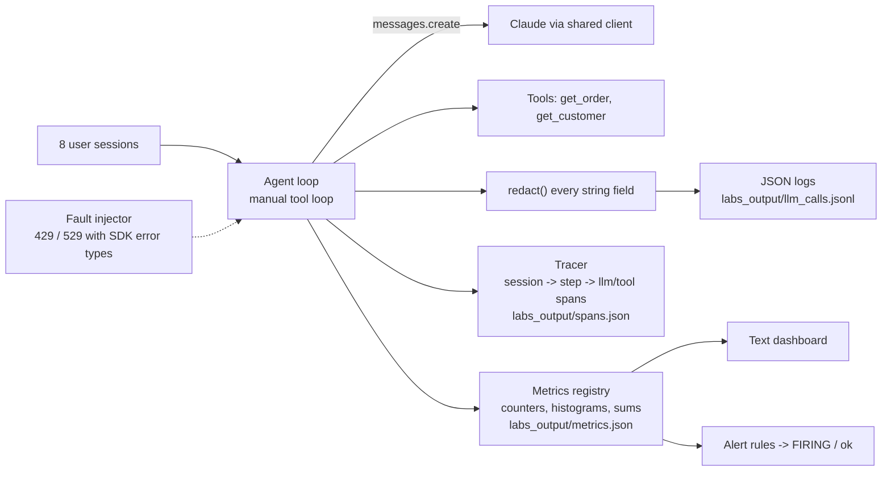

# D4.6 - Logging and Observability Tooling

> **Exam objective (Domain 4 - Evaluation, Testing & Optimization):** "Monitor system performance using logging and observability tools"

## Why it matters

Evals tell you whether a system *was* good before release; observability tells you whether it *is* good right now,
for real users, at what cost. LLM systems fail in ways classic APM does not see: truncation, refusals, silent cache
regressions, runaway agent loops, token-cost spikes, PII flowing into logs. The architect specifies **what every
call must emit** and how it is correlated, aggregated and alerted on. This lab is the concrete instrumentation;
D3.4 covers the strategy at scale.

## Key concepts

### 1. What to log for every Claude call

| Field | Why |
|---|---|
| `ts`, `level`, `event` | ordering, severity, record type (`llm.call`, `tool.call`) |
| `trace_id`, `span_id` | join logs with traces; follow one session end to end |
| `request_id` | from `response._request_id` (Python and TS), `stream.request_id`, or the error's `request_id` / `requestID` - quote it in Anthropic support tickets |
| `session_id` | **pseudonymous** (salted hash), never the raw user id or email |
| `model` | read from the response, not your config - catches silent substitutions |
| `prompt_version` / `prompt_hash` | attribute regressions to prompt changes |
| `input_tokens`, `output_tokens`, `cache_read_tokens`, `cache_write_tokens` | cost model and cache health |
| `cost_usd` | derived from usage x price per model |
| `latency_ms` (and TTFT when streaming) | SLOs |
| `stop_reason` | `max_tokens` truncation, `refusal`, `tool_use`, `end_turn` |
| `tool_names` | what the agent decided to do |
| `error_type`, `status_code`, `retry_after_s`, `attempt` | typed failure analysis and retry visibility |
| redacted previews | debugging context without raw PII |

### 2. PII and prompt content

- **Redact at the logger**, applied to every string field (defence in depth), not at each call site.
- Use **pseudonymous ids** (salted hashes) so you can count and correlate users without storing who they are.
- Do not log full prompts/responses by default. If you need payloads for debugging or evals, write them to a
  restricted store with short retention and access controls.
- SDK debug logs (`ANTHROPIC_LOG=debug`) include request details and can contain prompt text - local debugging only,
  or route them through the same redaction pipeline.

### 3. Traces: agent step -> LLM call -> tool call

Model each session as a trace: `agent.session` -> `agent.step` -> `llm.call` / `tool.call`. Each span has a parent,
start/end time, status and attributes; the OpenTelemetry **GenAI semantic conventions** (experimental) name the LLM
attributes, e.g. `gen_ai.request.model`, `gen_ai.usage.input_tokens`, `gen_ai.usage.output_tokens`,
`gen_ai.response.finish_reasons`. A trace answers questions logs cannot: which step was slow, whether the time went
to the model or to a tool, how many loop iterations an agent took. Put the same `trace_id` on every log record.

### 4. Metrics and the dashboard

| Type | Examples |
|---|---|
| Counter | `llm_requests_total{outcome, error_type}`, `llm_stop_reason_total{reason}`, `tool_calls_total{tool, ok}`, `sessions_total{status}` |
| Histogram | `llm_latency_ms`, `tool_latency_ms{tool}` (bucketed; quantiles are **estimates** - bucket boundaries matter) |
| Sum / gauge | tokens by type, `cost_usd`, cost per hour, cache hit ratio = cache_read / (cache_read + uncached input) |

The demo prints p95 both exactly and from buckets (1148 ms vs ~1680 ms) to show why bucket design matters.

### 5. Alert rules (symptoms, not causes)

| Rule | Why it matters | Typical severity |
|---|---|---|
| Error rate (failed attempts or sessions) | users see failures; retries burn quota | page |
| p95 latency over SLO | UX / timeouts | ticket or page |
| Cost per hour over budget | runaway loops, prompt bloat, model misrouting | ticket |
| Refusal-rate spike | prompt change or abuse wave; over-refusal hurts UX | ticket |
| `max_tokens` truncation rate | silently incomplete answers / broken JSON | ticket |
| **Cache hit ratio drop** | a prompt-assembly change broke caching - the bill rises with no errors | ticket |

### 6. Typed errors and retries

| HTTP | Python (`anthropic.*`) | TypeScript (`Anthropic.*`) | Retry? | Action |
|---|---|---|---|---|
| 400/401/403/404/413 | `BadRequestError`, `AuthenticationError`, ... | same names | **no** | fix the request / credentials |
| 429 | `RateLimitError` | `RateLimitError` | yes | honour the `retry-after` header |
| 500 | `InternalServerError` | `InternalServerError` | yes | exponential backoff + jitter |
| 529 | `OverloadedError` (`type == "overloaded_error"`) | `InternalServerError` with `type == "overloaded_error"` | yes | backoff; consider spreading load |
| network | `APIConnectionError` | `APIConnectionError` (a subclass of `APIError` in TS - check it first) | yes | retry, then fail cleanly |

The SDKs retry 408/409/429/5xx and connection errors automatically (default `max_retries=2`). That is the right
default, but it hides attempts from your logs; the demo sets `max_retries=0` via `with_options` / `withOptions` and
retries itself so every attempt is logged with its error type and backoff. Classify with the typed exception or
`error.type`, never by string-matching messages. Record retry counts so "attempts run vs attempts succeeded" is visible.

### 7. SDK debug logging

`ANTHROPIC_LOG=debug` (or `info`) turns on the SDK's own logging: Python routes it through the standard `logging`
module (logger `anthropic`); TypeScript reads the same variable or accepts `logLevel` and a custom `logger` in the
client options.

### 8. D4.6 vs D3.4

| D4.6 (this lab) - instrumentation | D3.4 - observability at scale |
|---|---|
| what each call emits (fields, spans, metrics) | sampling strategy, cardinality limits, retention |
| PII redaction in the logger | centralised pipelines, data residency, access control |
| alert rule definitions | SLO/error-budget policy, on-call routing |
| typed error handling and retry logging | multi-service correlation, vendor/tool selection |

## Architecture



## What the code demonstrates

| Printed section | Code |
|---|---|
| 1. PII redaction (email, phone, card, SSN) | `redact`, `preview` |
| 2. Eight sessions: normal, PII, 429, 529 x2, connection failure, refusal, truncation, parallel tool calls | `run_session` / `runSession`, `llm_call` / `llmCall` |
| 3. Example structured log records (success and rate-limit error) | `JsonLogger`, `render` |
| 4. Trace tree for one session with span ids | `Tracer` |
| 5. Dashboard: attempts, sessions, stop reasons, exact vs bucket percentiles, tokens, cache ratio, cost/hour, tools | `Metrics.histogram_quantile` |
| 6. Alert rules with thresholds and severity | `rules` |
| 7. Typed error log with retry decisions | exception chain in `llm_call` |
| 8. SDK debug logging switch | `logging.getLogger("anthropic")` / `logLevel` + `logger` |
| 9. Export to `labs_output/` and a PII leak check on the written logs | section 9 |

Timestamps come from a simulated clock offline (sessions every 5 minutes) so traces and logs are reproducible; live
mode uses real time and wall-clock latencies. The 429/529 failures are injected with the SDK's own exception classes;
the connection failure is genuine (the mock transport raises and the SDK surfaces `APIConnectionError`).

## Run it

```bash
.venv/Scripts/python "D4.6 - Logging and Observability Tooling/python/main.py"
node "D4.6 - Logging and Observability Tooling/typescript/main.ts"
```

Outputs are written to `D4.6 - Logging and Observability Tooling/labs_output/` (gitignored).

## Exam tips & traps

- **Log `request_id`** (`response._request_id`, or the error's request id) on every call and failure - it is what
  Anthropic support needs.
- **Log usage including cache fields**, model (from the response), prompt version and `stop_reason` - these explain
  most cost and quality incidents.
- **Redact PII before logs leave the process**; use salted-hash session ids; keep raw prompts out of default logs.
- **A falling cache hit ratio is a cost incident with no errors** - alert on it.
- **Alert on `stop_reason` rates** (`max_tokens` truncation, `refusal` spikes), not just HTTP errors.
- **Retry 429 / 5xx / 529 / connection errors with backoff (honour `retry-after`); never retry 4xx request errors.**
  Use typed exceptions, not string matching.
- **Traces beat logs for agents**: parent/child spans show which step, LLM call or tool consumed the time.
- Histogram percentiles are approximations; choose buckets around your SLO thresholds.

### Practice question 1

After a deploy, a Claude-powered assistant's monthly cost rises 3x. Error rate, latency and output length are
unchanged. Which logged signal most likely explains it?

- A. `stop_reason` distribution
- B. `cache_read_input_tokens` collapsing to near zero while `input_tokens` rises (cache hit ratio drop)
- C. Number of 429 errors
- D. Average TTFT

**Answer: B.** A prompt-assembly change (e.g. a timestamp added to the system prompt) breaks the cached prefix:
requests still succeed, but every call pays full input price. Only cache usage fields reveal it; an alert on cache
hit ratio catches it early.

### Practice question 2

An agent intermittently fails with `overloaded_error` (HTTP 529) and occasional 429s. The team wants each failed
attempt visible in logs with its type and retry delay. What is the best design?

- A. Catch all exceptions and match on the message text "overloaded"
- B. Rely on the SDK's automatic retries and log only final outcomes
- C. Disable SDK auto-retries for this path, catch typed exceptions (RateLimitError first, then status errors by
  `status`/`type`, then connection errors), log every attempt with `error_type`, `request_id` and backoff, honour
  `retry-after`, and cap attempts
- D. Retry immediately in a tight loop until it succeeds

**Answer: C.** Typed exceptions give reliable classification; per-attempt logs make retries and their cost visible.
A is brittle, B hides attempts (acceptable when visibility is not required), D amplifies load and cost.

## Further reading

- Claude docs: *Errors* (HTTP error codes, `request-id`, retry guidance), *Rate limits*
- Anthropic SDK READMEs (Python / TypeScript): *Logging* (`ANTHROPIC_LOG`), *Retries*, *Request IDs*, *Handling errors*
- Claude docs: *Handling stop reasons*, *Prompt caching* (verifying cache hits from usage)
- OpenTelemetry: *Semantic conventions for generative AI systems*
- Related labs: D3.4 (observability at scale), D4.1 (metric definitions), D4.4 (diagnosis using these signals), D5.4 (compliance and data retention), D7.3 (operational debugging)
