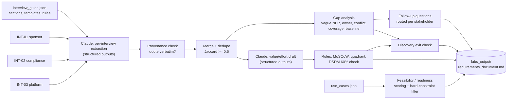

# D6.1 - Structured Discovery and Requirements Gathering

> **Exam objective (Domain 6 - Stakeholder Communication & Lifecycle Management, 14%):**
> "Conduct structured discovery and requirement gathering"

## Why it matters

Most failed LLM projects fail in discovery. They don't fail in the model. "Make letters faster" is not a requirement. "p95 full draft ≤ 10 s, streamed, first token ≤ 2 s" is one.
As the architect, you turn interviews that contradict each other into a requirements baseline that can be tested, owned and prioritized. You also surface the decisions that only stakeholders can make, such as *human review vs auto-send*, before anyone writes a prompt.
Claude can do the reading. You still own the structure, the rules and the judgement.

## Key concepts

### 1. Discovery is a structured instrument, not a chat

Use an **interview guide** whose sections map to the fields you need later. This lab maps each section to a field in the extraction schema, so coverage can be *measured*:

| Guide section | Why an architect needs it | Claude-specific design impact |
|---|---|---|
| Business goals & outcomes | Anchors every trade-off | Defines the eval's success criteria |
| Users & personas | Different UX / latency / review steps | Streaming UI vs batch; who approves |
| Current process & pain points | Baseline for value; source of edge cases | Golden-set examples for evals |
| Volumes & growth | Throughput, cost, rate limits | Model tier, **Message Batches** (≈50% cheaper) for non-urgent work, prompt caching |
| Data sources & sensitivity | Feasibility, residency, guardrails | PII/PHI handling, data residency, retention, ZDR questions |
| Integration points | Read vs write = different risk | Tools with side effects need approval gates and least-privilege scopes |
| Constraints (latency, cost, compliance, timeline) | Non-negotiable inputs | Model choice, `effort`, streaming, region |
| Success metrics | Proves value; drives evals | Baseline + target, or you can't run A/B tests later |
| **Failure handling & escalation** | LLMs are probabilistic | Confidence routing, human fallback, "AI unavailable" mode |
| Risks & assumptions | Unwritten assumptions become surprises | Red-team scope, contract/vendor checks |

Interview technique that works:
- **Ask about the last real instance** ("walk me through the last letter you wrote"), not the ideal process.
- **Probe every adjective.** "Fast", "accurate", "scalable" and "secure" are placeholders. Ask *what metric, what threshold, measured how, and what happens when it's missed?*
- **Interview each stakeholder group separately.** Conflicts that come out in 1:1s get hidden in group meetings.
- **Get the numbers:** volumes, peaks, baselines, budgets (per unit *and* per month).

### 2. Requirement types (and what "good" looks like)

| Type | Definition | Good example | Smell |
|---|---|---|---|
| Functional (FR) | What the system does | "Write each draft back to ClaimCore as *pending* correspondence" | Describes a solution or vendor, not a need |
| Non-functional (NFR) | How well it must do it | "p95 full draft ≤ 10 s; TTFT ≤ 2 s" | Adjectives with no metric ("fast") |
| Constraint | Fixed boundary you can't trade | "Licensed adjuster approves every letter (state regulation)" | Treated as negotiable |
| Assumption | Believed true, not yet verified | "Existing Claude enterprise agreement covers this" | Never validated |
| Open question | Unknown that blocks a decision | "Who owns the templates?" | Silently dropped |

**LLM-specific NFRs to always elicit:** quality as an **eval pass rate** on a labelled set (not "accurate"), tolerance for factual errors per field type (e.g. zero tolerance on amounts means *validate in code*), cost **per task** (not per token), latency as **TTFT + p95 end-to-end**, data residency and retention, auditability (model + prompt version per output), fairness metrics, refusal/escalation behaviour.

### 3. Measurable NFRs: turn adjectives into SLIs

| Stakeholder says | Ask | Measurable form |
|---|---|---|
| "It needs to be fast" | Which moment matters: first words, full draft or batch completion? | TTFT ≤ 2 s; p95 end-to-end ≤ 10 s (streamed) |
| "It must be accurate" | Accurate in which fields? What error is tolerable? | 100% exact match on claim no./dates/amounts (validated against system of record); ≥ 90% of drafts score ≥ 4/5 on the rubric |
| "It should scale" | To what volume, by when? | 3× current volume (27k letters/month) within 12 months without re-architecture |
| "Tone must be fair" | Measured how? | Max rubric-score gap ≤ 0.2 between demographic slices on a paired test set |

### 4. Stakeholder conflicts are deliverables

Conflicts are normal: sponsor vs compliance, ambition vs capacity. The architect's job is to **make them visible and route them to the decision owner**. Don't resolve them quietly in the design.
- Detect: same topic, different positions (the lab normalizes positions into comparable labels).
- Frame: each stance, the evidence behind it, and the **decision owner**. Use RACI: who is Accountable? Regulatory topics usually give Compliance a veto.
- Offer options: e.g. "draft everything, one-click approval for routine letters, revisit auto-send with 3 months of evidence".
- Record the decision in an ADR (see D6.2).

Use a **power/interest grid** to plan engagement. High power + high interest (sponsor, compliance) → manage closely. High power + low interest → keep satisfied.

### 5. Prioritization: MoSCoW + value/effort

- **MoSCoW**: Must / Should / Could / Won't (*this time*). **DSDM guideline: Musts ≤ ~60% of effort**, so Shoulds and Coulds act as contingency. Above that, the plan has no slack and any surprise breaks the date.
- **Value/effort quadrant**: Quick win (high value, low effort), Major project, Fill-in, Money pit.
- A requirement that **contradicts a regulatory constraint cannot be a Must**. A requirement that depends on an **open conflict** is flagged "decision needed", not silently prioritized.
- Claude can *draft* estimates. The delivery team confirms them, and code applies the rules consistently.

### 6. Use-case feasibility / readiness

Score candidates on **value**, **feasibility** (data readiness, technical fit for an LLM, integration complexity) and **risk** (data sensitivity, error impact, regulatory exposure). A human in the loop reduces the *effective* error impact.

| Decision | Typical rule |
|---|---|
| GO (pilot) | High readiness, data ready, measurable success metric, risk acceptable |
| CONDITIONAL | Promising, but has blockers (e.g. no success metric, risk plan needed) |
| NOT NOW | Data not ready / weak fit, so fix the foundations first |
| NO-GO | Violates a hard constraint, whatever the score |

Hard constraints act as **filters, not weights**. A high value score never offsets a regulatory violation.

### 7. Using Claude inside discovery (safely)

- **One structured record per source** (structured outputs, `client.messages.parse`) keeps attribution, so every requirement traces to a stakeholder and quote.
- **Never let the model invent numbers**: nullable fields + an explicit instruction ("null if not stated").
- **Provenance check in code**: verify each `source_quote` is verbatim in the transcript. Paraphrases get flagged for confirmation (the lab catches one).
- **Merge and de-duplicate deterministically** (here: Jaccard similarity on content words). Corroboration by two stakeholders raises confidence.
- **Code owns the rules**: gap detection, routing, MoSCoW validation and scoring are repeatable and auditable.

### 8. Discovery exit criteria (gate to design)

No open high-severity conflicts · every guide section covered · every NFR measurable · every Must has an owner · MoSCoW within the effort guideline · evidence verified. The lab computes these. They feed the lifecycle gate in **D6.5**.

### Anti-patterns

- Solutioning in the first interview ("we'll use RAG") before goals, data and constraints are known.
- Accepting adjectives as NFRs; no baselines, which means you can't prove value later.
- Group-only workshops where the loudest voice wins and conflicts stay hidden.
- No owner for prompts and templates. The lab finds 7 unowned requirements, which is common for AI systems.
- Ignoring the failure path: nobody asked "what happens when the AI is wrong?" (the lab's coverage gap).
- Letting an LLM summary become the requirement of record without provenance or review.

## Architecture



## What the code demonstrates

| Step | Console section | Code |
|---|---|---|
| Interview guide as a measurable instrument | 1 | `data/interview_guide.json`, section → `evidence_fields` |
| Claude extraction into a typed schema (`messages.parse` + Pydantic / Zod) | 2 | `InterviewExtraction`, `EXTRACTION_SYSTEM` |
| Provenance check (quotes verbatim) + cross-stakeholder merge | 3 | `content_tokens`, `jaccard`, `merge_functional` |
| Gap analysis: conflicts, coverage, vague/unmeasured NFRs, owners, baselines | 4 | `detect_conflicts`, `coverage_matrix`, `find_vague_term` |
| Follow-up questions routed to the person who can answer | 5 | `followup_templates`, `Gap.ask` |
| Claude drafts estimates → code applies MoSCoW, quadrants, DSDM 60% rule, demotion advice | 6 | `PrioritizationDraft`, sort + demotion logic |
| Use-case readiness with hard-constraint filter | 7 | `data/use_cases.json`, readiness formula |
| Discovery exit criteria + rendered requirements document | 8 | `render_document` → `labs_output/`, sample in `examples/` |

The offline responder returns canned JSON from `data/mock_responses/`. Python and TypeScript share the same fixtures and produce byte-identical documents.

## Run it

```bash
.venv/Scripts/python "D6.1 - Structured Discovery and Requirements Gathering/python/main.py"
node "D6.1 - Structured Discovery and Requirements Gathering/typescript/main.ts"
```

Output: `labs_output/requirements_document.md` (gitignored). A committed sample is in [`examples/requirements_document.md`](examples/requirements_document.md).
Set `ANTHROPIC_API_KEY` to run the extraction against the live API. The deterministic rules stay the same.

## Exam tips & traps

- **Adjectives aren't NFRs.** If an option accepts "fast/accurate/scalable" without a metric, threshold and measurement method, it's wrong. Prefer TTFT + p95 latency, eval pass rates and cost per task.
- **Stakeholder conflicts go to the decision owner.** The architect frames options and evidence but doesn't pick a side, and doesn't design around a regulatory constraint. Compliance usually holds a veto on regulatory topics.
- **Hard constraints are filters, not weights.** A high value score can't rescue a use case that violates a constraint (e.g. auto-sending regulated letters).
- **MoSCoW without effort balance is theatre.** If Musts are well over ~60% of effort, there's no contingency. Demote contested or low-value Musts first.
- **Ask about failure handling in discovery.** "What happens when the AI is unsure or wrong?" belongs in the requirements, not in post-incident reviews.
- **Baselines before build.** Without today's handling time, error rate or CSAT, you can't prove ROI or set SLOs later (D6.3).
- **LLM-assisted discovery needs provenance.** Structured extraction with verbatim quotes and code-side verification beats free-text summaries. Never let the model fill in unstated numbers.
- **Volumes drive architecture.** Non-urgent bulk work (backlogs) points to batch processing. Interactive work points to streaming and latency-tuned model/effort choices.

### Practice question 1

During discovery for a Claude-based claims-letter assistant, the VP of Operations wants routine status letters sent automatically. The Head of Compliance says state regulations require a licensed adjuster to approve every letter. The go-live date is in 10 weeks. What should the architect do **first**?

A. Design auto-send for status letters only, with a confidence threshold of 0.95, to satisfy the sponsor.
B. Record both positions, identify Compliance as holding a regulatory veto, and bring options (e.g. one-click approval with edit-rate tracking, revisit auto-send with evidence) to a steering decision. Document the outcome.
C. Defer the question to the build phase and decide from prototype accuracy.
D. Use Claude to summarize both interviews and adopt the position the summary rates as more reasonable.

**Answer: B.** Conflicting stakeholder positions on a regulated behaviour are a decision for the accountable owner, not a design detail. A is designing around a regulatory constraint. C pushes a blocking decision past the point where it shapes scope and effort. D hands accountability to a model.

### Practice question 2

A stakeholder states: "The assistant must be accurate and fast." Which rewrite is the best requirement baseline for a Claude solution?

A. "The assistant must use the most capable model so it is as accurate and fast as possible."
B. "≥ 90% of sampled drafts score ≥ 4/5 on the agreed rubric (monthly, n ≥ 400); claim numbers, dates and amounts match the system of record 100% (validated in code); TTFT ≤ 2 s and p95 full draft ≤ 10 s."
C. "Accuracy above 99% and latency under 1 second for all requests."
D. "The assistant must hallucinate less than competing products."

**Answer: B.** It is measurable and testable, it separates zero-tolerance fields (enforced in code) from rubric-scored quality, and it expresses latency as TTFT plus p95. A is a solution, not a requirement. C is unmeasurable as written (accuracy of what?) and unrealistic. D has no metric or baseline.

## Further reading

- Claude API docs: Structured outputs (`output_config.format`, `messages.parse`); Streaming; Message Batches; Prompt caching
- Anthropic: "Building effective agents" (workflow vs agent framing for discovery outcomes)
- Claude API docs: Define success criteria and build evaluations (turning NFRs into evals)
- DSDM / Agile Business Consortium: MoSCoW prioritization
- Requirements engineering: IEEE/ISO/IEC 29148 (characteristics of good requirements)
- Stakeholder analysis: power/interest grid, RACI
- Google SRE Workbook: SLIs and SLOs (for making NFRs measurable; see D6.3)
