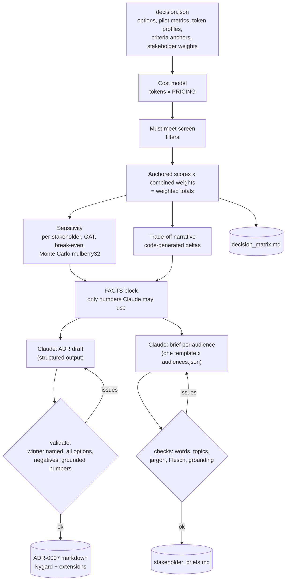

# D6.2 - Communicating Architectural Decisions and Trade-offs

> **Exam objective (Domain 6 - Stakeholder Communication & Lifecycle Management, 14%):**
> "Communicate architectural decisions and trade-offs"

## Why it matters

Every Claude architecture is a bundle of trade-offs, such as quality vs latency vs cost, RAG vs long context vs agents, or Opus vs a Sonnet/Haiku cascade. A decision only counts once the people who fund it, build it and audit it understand it and agree to it. The architect's job:
1. Make the decision **transparent and reproducible** (decision matrix and sensitivity analysis).
2. Make it **durable** (an ADR future maintainers can trust).
3. **Explain it in each audience's language** without changing the facts.

## Key concepts

### 1. Architecture Decision Records (ADRs)

An ADR captures **one** significant decision. Michael Nygard's original format is deliberately short:

| Section | Content | Tip |
|---|---|---|
| **Title** | Short noun phrase, numbered (`ADR-0007: ...`) | Numbers are never reused |
| **Status** | Proposed → Accepted → (Deprecated / Superseded by ADR-00xx) | Status is a governance fact. Set it by approval, not by the author or an LLM |
| **Context** | Forces at play: requirements, constraints, facts | Neutral, factual, cite requirement IDs |
| **Decision** | "We will ..." in active voice | One decision, stated unambiguously |
| **Consequences** | What becomes easier **and harder** | An ADR without negative consequences is a sales pitch |

Common extensions (MADR-style), used in this lab: decision drivers, considered options with pros/cons, quantified trade-offs, sensitivity, risks/mitigations, **review triggers** (observable conditions that reopen the decision).

ADR rules of thumb:
- Write it **when the decision is made**, not months later. Store it with the code (docs-as-code, reviewed via pull requests).
- **Accepted ADRs are immutable.** If a new model, price or requirement changes the answer, write a new ADR that *supersedes* the old one, and link both.
- Record decisions that are costly to reverse: model tier, retrieval strategy, agent vs workflow, MCP vs direct API, data residency, HITL placement.

### 2. Weighted decision matrix: doing it properly

1. **Screen must-meet constraints first.** They're filters, not weights. In the lab, Option D (Opus agentic search) has the best quality but fails *p95 ≤ 10 s*, so it is eliminated. It's still scored for transparency and kept as a candidate for the overnight batch.
2. **Choose criteria from stakeholder concerns** and avoid double counting. "Accuracy" and "citation accuracy" are related, so define each precisely.
3. **Measure, don't guess.** Pilot data on a shared golden set; cost from token profiles × model pricing (the lab uses the shared `PRICING` table).
4. **Score on anchored scales** (e.g. 80% → 0, 100% → 10). Min-max normalization across the options exaggerates small differences and causes **rank reversal**: adding or removing an option can reorder the others.
5. **Elicit weights per stakeholder** (100-point allocation), then combine with explicit influence factors. Showing each stakeholder's *own* winner surfaces disagreement early. In the lab, Compliance's weights pick C.

### 3. Sensitivity analysis: "does the winner change if weights shift?"

| Technique | Question it answers | Lab result |
|---|---|---|
| Per-stakeholder view | Who would disagree, and why? | Sponsor B, Compliance **C**, Platform B |
| One-at-a-time (±50%) | Is any single weight fragile? | Winner never changes |
| Break-even scan | How far must one weight move to flip the result? | Auditability ×2.25 → C wins |
| Monte Carlo (seeded) | How robust is the winner to all-round uncertainty? | B wins 99.5% of 5,000 trials |

Break-even points become **review triggers** and **negotiation levers**. ("If auditability matters 2.25× more than today, we should switch to C, and here is what that costs.") A matrix without sensitivity analysis can't be told apart from a matrix tuned to justify a decision someone already made.

### 4. Claude-specific trade-off levers to quantify

| Lever | Typical effect to quantify | Watch-outs |
|---|---|---|
| Model tier (Opus 5.5 / Sonnet 5.5 / Haiku 5.5) | Quality vs $/MTok and latency; cascades route easy cases to cheaper models | Judge on **cost per completed task**, not per token |
| `effort` (low → max) | Depth of reasoning vs latency/tokens | Re-tune after model upgrades |
| Prompt caching | Cache reads ≈ 0.1× input price, lower TTFT on long stable prefixes | Prefix must be byte-stable; cache writes cost more than plain input |
| Message Batches | ≈50% cheaper, asynchronous | Not for interactive paths |
| RAG vs long context vs agentic search | Ops complexity, freshness, citation quality, latency | Agentic loops multiply turns, so watch latency and cost |
| Streaming | Better perceived latency (TTFT) | Doesn't reduce total latency |
| MCP vs direct API integration | Reuse/standardization vs simplicity | Auth scopes, tool sprawl (D3.x) |

### 5. Audience-tailored communication

Same facts, different framing. Use **BLUF** (bottom line up front) and the **pyramid principle**: recommendation first, then supporting points, then detail.

| Audience | Cares about | Format | Avoid |
|---|---|---|---|
| Executive / steering | Value, cost and headroom, risk, timeline, **the ask** | Headline + ≤5 bullets + one-line decision request | Jargon (tokens, embeddings, p95), implementation detail |
| Engineering lead | Components, interfaces, request flow, caching, failure modes, rollback, evals | Short sections with concrete numbers | Re-selling the business case |
| Security / privacy / legal | Data flows, stores and copies, residency, retention, access, audit trail | Data-flow summary + controls + residual risks + decisions needed | Performance detail unrelated to risk |
| Operations / support | Runbooks, alerts, escalation, what changes for users | Checklists | Architecture theory |
| End users | What it does and doesn't do, how to give feedback | Plain language | Probabilistic hand-waving |

The lab uses **one prompt template parameterized by an audience profile** (`data/audiences.json`), so tone and emphasis vary while the facts block stays identical. It then checks each brief in code: word budget, required topics, jargon blocklist, readability (Flesch) and grounded numbers.

### 6. The quantified trade-off narrative

Template: **"Choosing X over Y gains A at the cost of B. We accept this because C. We will revisit if D."**
State absolute numbers first, then relative ones: "saves $301/month (−39.9%)", "0.5 s faster at p95", "7.0 pp lower citation accuracy".

### 7. Using Claude to draft decision documents, safely

- **Code computes every number.** Claude gets a FACTS block and drafts prose as a structured output.
- **Validate, then repair.** Code checks that the decision names the winner, that every option is considered, that negatives exist, and that every figure with a unit matches the matrix. On failure, send the exact issues back for one repair round. In the lab, the first draft invents "30%" and gets caught and fixed.
- **Render deterministically** (template), and keep **Status** under human control.

### Anti-patterns

- Weights adjusted after scoring to reach the answer someone wanted (sensitivity analysis exposes this).
- False precision ("6.5612") without uncertainty. Report robustness instead.
- ADRs with no negative consequences, written months after the fact, or edited in place after acceptance.
- One deck for everyone, or jargon sent to executives.
- LLM-drafted decision docs with unverified numbers.

## Architecture



## What the code demonstrates

| Step | Console section | Code |
|---|---|---|
| Decision framing and must-meet constraints | 1 | `data/decision.json` |
| Cost per request and per month from token profiles × shared `PRICING` | 2 | cost model loop |
| Must-meet screening (D eliminated) | 3 | `check_constraint` |
| Stakeholder weights × influence → combined weights | 4 | weights loop |
| Anchored scoring, weighted totals, per-stakeholder winners | 5 | `anchored_score`, `weighted_total`, `winner_of` |
| Sensitivity: one-at-a-time, break-even scan, seeded Monte Carlo | 6 | `mulberry32` (identical in Python and TS) |
| Quantified trade-off narrative | 7 | `tradeoff_sentence` |
| ADR via `messages.parse` → grounding validation → repair loop → Nygard rendering | 8 | `ADRDraft`, `validate_adr`, `render_adr` |
| Audience briefs from one template → automated checks → revision | 9 | `BRIEF_TEMPLATE`, `check_brief`, `flesch_reading_ease` |
| Artifacts written | 10 | `labs_output/` (samples in `examples/`) |

## Run it

```bash
.venv/Scripts/python "D6.2 - Communicating Architectural Decisions and Trade-offs/python/main.py"
node "D6.2 - Communicating Architectural Decisions and Trade-offs/typescript/main.ts"
```

Outputs (`labs_output/`, gitignored; committed samples in [`examples/`](examples/)):
[`ADR-0007-policy-grounding-strategy.md`](examples/ADR-0007-policy-grounding-strategy.md), [`decision_matrix.md`](examples/decision_matrix.md), [`stakeholder_briefs.md`](examples/stakeholder_briefs.md), [`decision_facts.txt`](examples/decision_facts.txt).
Try it: change a stakeholder's weights or an option's pilot metrics in `data/decision.json` and watch the sensitivity verdict move.

## Exam tips & traps

- **Constraints filter, criteria rank.** An option that fails a must-meet requirement (latency SLO, residency, budget) is out, however high its weighted score.
- **Present robustness, not just a winner.** The strongest answer shows each stakeholder's own result, the break-even point and a robustness check. "The weighted score says B" alone is weak.
- **ADRs are immutable once accepted.** A model release or price change means a new ADR that supersedes the old one. Never edit history.
- **Negative consequences are mandatory.** If an option claims a decision has no downsides, it's wrong.
- **Tailor the framing, never the facts.** Executives get value, cost, risk and the ask, without jargon. Engineers get interfaces, failure modes and rollback. Security/legal get data flows, residency, retention and audit.
- **LLM-drafted decision docs need grounding checks.** Numbers come from code. Claude explains them. Status is set by approvers.
- **Quantify Claude trade-offs per task:** prompt caching (cache reads ≈ 0.1× input price), batch (≈50% off, async), model tier and effort. Compare cost per completed task, not price per token.
- **Min-max normalization can reverse rankings** when an option is added or removed. Anchored scales avoid this.

### Practice question 1

An architect's weighted decision matrix recommends long-context prompting with caching (B) over agentic search (C) by 0.61 points. The Head of Compliance, whose own weights favour C because of citation accuracy, asks why her concern was "outvoted". What is the **best** response?

A. Raise Compliance's influence factor until the matrix recommends C, so every stakeholder agrees.
B. Show the per-stakeholder results and the break-even analysis (auditability would need ~2.25× its weight to flip the decision), then commit to mitigations (code-side clause validation, monthly citation review) and record the break-even as a review trigger in the ADR.
C. Remove auditability from the criteria because it is already covered by answer quality.
D. Escalate to the executive sponsor and proceed with B without further discussion, because B won the matrix.

**Answer: B.** It makes the disagreement explicit, quantifies how far the weights would have to move, addresses the concern with concrete controls, and turns the sensitivity result into an observable review trigger. A tunes weights to reach an answer, which is the classic anti-pattern. C hides a legitimate criterion. D ignores a stakeholder with a regulatory stake.

### Practice question 2

Six months ago ADR-0004 ("Use Claude Sonnet for drafting") was accepted. A new model release now offers better quality at the same price, and the team has run regression evals showing no regressions. How should the decision be documented?

A. Edit ADR-0004 to name the new model and update its date.
B. Write ADR-0011 describing the migration (context: release, eval evidence; decision; consequences), set ADR-0004's status to "Superseded by ADR-0011", and link both.
C. Add a comment in the code; ADRs are only needed for initial designs.
D. Delete ADR-0004 to avoid confusing new team members.

**Answer: B.** Accepted ADRs are immutable history. Changes are recorded as new ADRs that supersede old ones, which keeps the reasoning and evidence for both decisions auditable.

## Further reading

- Michael Nygard, "Documenting Architecture Decisions" (2011); MADR (Markdown Any Decision Records)
- ThoughtWorks Technology Radar: "Lightweight Architecture Decision Records"
- Multi-criteria decision analysis (MCDA): weighted sum model, sensitivity and robustness analysis
- Barbara Minto, *The Pyramid Principle*; BLUF writing
- Claude API docs: Prompt caching; Message Batches; Structured outputs; Models overview and pricing; Choosing a model
- Anthropic: "Building effective agents" (workflow vs agent trade-offs)
