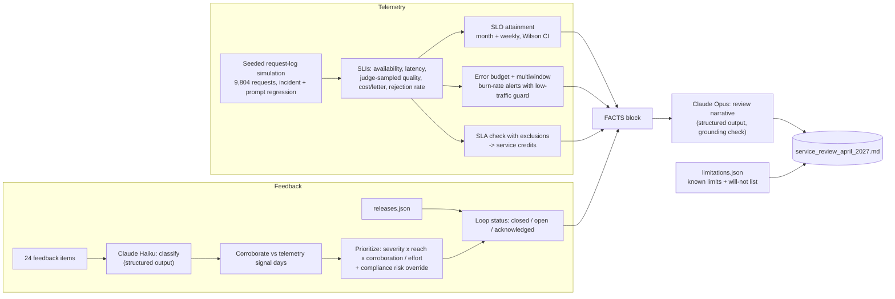

# D6.3 - Stakeholder Feedback Loops and SLA Alignment

> **Exam objective (Domain 6 - Stakeholder Communication & Lifecycle Management, 14%):**
> "Manage stakeholder feedback loops and expectation alignment (including SLAs)"

## Why it matters

After go-live, trust is earned or lost in the monthly service review. Stakeholders need three things:
1. **Commitments that are measurable and honest.** LLM quality is probabilistic, so a promise of "always accurate" is broken on day one.
2. **Evidence that their feedback changes the system.**
3. **A clear statement of what the system will not do.**

The architect designs the SLIs, SLOs and SLAs, the error-budget policy and the feedback loop. Those turn telemetry and complaints into prioritized, closed-out work.

## Key concepts

### 1. SLI → SLO → SLA

| Term | What it is | Owner / audience | Example (this lab) |
|---|---|---|---|
| **SLI** (indicator) | A measured ratio or distribution | Engineering | good / valid requests in business hours |
| **SLO** (objective) | Internal target for an SLI over a window | Product + engineering | ≥ 99.5% over 30 days |
| **SLA** (agreement) | Contractual promise with consequences (credits) | Customer / legal | ≥ 99.0% monthly, 10% credit below, 25% below 98% |
| **Error budget** | 1 − SLO: allowed unreliability | Shared | 0.5% × 9,756 valid = 48.8 failed requests |

Rules:
- **SLA thresholds are looser than SLOs**, so the SLO is your early-warning line. In the lab the SLO was missed (99.48%) while the SLA held (99.83%).
- **SLAs need exclusions** written in advance: invalid (4xx) requests, announced maintenance, and outages of customer-owned dependencies. That's why the ClaimCore outage counts against the SLO (users felt it) but not the SLA.
- **Composite availability:** serial dependencies multiply (model API 99.9% × claims system 99.5% ≈ 99.4%). You can't promise more than your dependency chain without fallbacks (retries, a secondary region/model, template mode).
- Use **percentiles or "share under threshold"** for latency, not averages. For streaming UIs, track **time to first token** separately from full completion.

### 2. SLIs for a Claude-powered service

| Dimension | SLI | How it's measured | Notes |
|---|---|---|---|
| Availability | good / valid requests | Request logs | Count timeouts, 5xx, throttling (429) as bad, and 4xx as invalid |
| Latency | % of drafts ≤ 8 s; p50/p95/p99; TTFT | Request logs | Prompt changes that lengthen output move this (v1.4.0 in the lab) |
| **Quality** | % of sampled outputs scoring ≥ 4/5 on the rubric | **Calibrated LLM judge on a random sample** + periodic human calibration | Report with a confidence interval |
| Groundedness / factual error | % of sampled outputs with a factual error vs source | Judge + human confirmation | Usually a *known limitation* with a measured rate, not a contractual SLO |
| Cost | $ per **completed task** (not per token) | Usage × pricing ÷ completed tasks | Include eval/judge overhead |
| Human effort | rejection + escalation rate, edit rate | Workflow events | Leading indicator of quality and adoption |
| Safety | policy-violation rate, refusal rate | Classifiers, audits | Often a hard guardrail with zero tolerance |

### 3. Why quality SLOs must be eval-based and probabilistic

- An LLM has no single "correct" output, so quality is defined by a **rubric agreed with stakeholders** and measured with an **eval**: a calibrated LLM judge (here Claude Haiku 5.5, not the model under test) scores a **random sample**. The judge is checked against human graders every month.
- A sample gives an **estimate**. Report it with a confidence interval (the lab uses the Wilson score interval) and a status rule:
  - **MET**: the lower bound is ≥ target.
  - **AT RISK**: only the point estimate is ≥ target. (Lab: 91.8% [89.0-93.9%] vs 90%.)
  - **MISSED**: the point estimate is < target.
- Set a **minimum sample size** (≥ 400/month here). Weekly figures with n ≈ 110 are indicative only.
- **Wording template:** "At least 90% of randomly sampled drafts meet the agreed rubric, measured monthly on ≥ 400 drafts by a calibrated evaluator; results are reported with a 95% confidence interval." Never write "the assistant is always accurate".
- Re-baseline the judge after model or prompt changes. A judge can drift too.

### 4. Error budgets, burn rates and alerting

- **Burn rate** = observed error rate ÷ (1 − SLO). A burn of 1 spends exactly the budget over the window. A burn of 14.4 spends 2% of a 30-day budget in an hour.
- **Multiwindow, multi-burn-rate alerts** (Google SRE Workbook pattern): page on fast burn (e.g. 14.4× over 1 h), page on medium burn (6× over 6 h with a short window confirming it is still happening), ticket on slow burn (1× over 3 days).
- **Low-traffic guard:** one failure in a 4-request weekend hour is a "50× burn" but not an incident. Require minimum requests and failures per window, and only evaluate full windows. The lab suppresses 6 such false alarms.
- **Error-budget policy** agreed in advance: budget exhausted → feature freeze (reliability work only); a big incident → blameless postmortem; quality not met → bigger eval sample and stricter release gates.

### 5. Feedback loops that actually close

```
collect (thumbs, tickets, surveys, sponsor emails)
  -> classify (Claude Haiku, structured output: theme, severity, component)
  -> corroborate with telemetry (did latency or quality actually move on those days?)
  -> prioritize (severity x reach x corroboration / effort; compliance risk overrides the score)
  -> ship (release notes linked to feedback IDs)
  -> tell people ("you said, we did")
  -> measure loop closure rate
```

- **Corroboration** separates loud from widespread. Latency complaints on Apr 15-19 match the p95 spike, while "robotic tone" on Apr 28 doesn't match any telemetry signal.
- **Risk override:** a single compliance-risk report (a draft implying coverage) outranks many cosmetic ones.
- **Cadence:** weekly ops review (alerts, budget), monthly service review (this report), quarterly business review (value, roadmap, SLO renegotiation).

### 6. Expectation alignment

A monthly service review should contain:
- an SLO/SLA scorecard;
- error budget and incidents;
- trends;
- how quality is measured;
- top feedback and its status;
- what changed ("you said, we did");
- what's next;
- **known limitations with measured rates** (nondeterministic wording; 2.0% factual-error flags with a CI);
- **"What the system will NOT do"**: no auto-sending, no coverage decisions, no injury claims in phase 1, no non-English letters.

Lead with misses. Candour about a missed SLO builds more trust than a green dashboard nobody believes.

### Anti-patterns

- SLA = SLO (no buffer), or SLAs without exclusions or a measurement method.
- Quality promised as a guarantee, or measured by anecdotes instead of a sampled, calibrated eval.
- Average latency; alerting on every error; no low-traffic guard (pager fatigue).
- Shipping prompt changes without a canary and latency/quality gates (the lab's v1.4.0 regression).
- Feedback black holes: collected, never acknowledged, never linked to releases.
- Cost reported per token instead of per completed task.

## Architecture



## What the code demonstrates

| Step | Console section | Code |
|---|---|---|
| SLI/SLO/SLA catalog and why quality is eval-based | 1 | `data/slo_catalog.json` |
| Seeded month of logs (mulberry32, arithmetic-only latency model so Python and TS match bit for bit) | 2 | `simulate()`, `data/simulation.json` |
| Monthly and weekly SLIs, Wilson CI, quality status rule, sparklines | 3 | `stats()`, `wilson()`, `quality_status()` |
| Error budget, burn rates, multiwindow alerts, low-traffic guard, budget policy | 4 | `window()`, `burn()`, episodes loop |
| SLA with exclusions and credit tiers | 5 | SLA block |
| Feedback classification (Haiku, structured) → telemetry corroboration → backlog scoring with risk override | 6 | `FeedbackClassification`, `signal_days`, backlog |
| Loop closure and "you said, we did" release notes | 7 | `loop_status()` |
| Narrative from FACTS with a grounding check → rendered monthly service review | 8 | `ServiceReviewNarrative`, `render_review()` |

## Run it

```bash
.venv/Scripts/python "D6.3 - Stakeholder Feedback Loops and SLA Alignment/python/main.py"
node "D6.3 - Stakeholder Feedback Loops and SLA Alignment/typescript/main.ts"
```

Outputs: `labs_output/service_review_april_2027.md` and `service_review_facts.txt` (gitignored). Committed samples: [`examples/service_review_april_2027.md`](examples/service_review_april_2027.md).
Experiment: change `incident.error_rate` or `prompt_change.judge_pass` in `data/simulation.json` and watch the SLO statuses, burn alerts and budget policy react.

## Exam tips & traps

- **SLA < SLO < 100%.** The SLO is the internal target with an error budget. The SLA is looser, contractual, and has exclusions and credits. An answer that sets the SLA equal to the SLO, or promises 100%, is a trap.
- **LLM quality goes into an eval-based SLO with probabilistic wording:** a sampled, rubric-based, calibrated judge reported with a confidence interval. It usually belongs in an internal SLO or service review, not a contractual SLA.
- **Know the burn-rate pattern:** fast burn pages (≈14.4× over 1 h), slow burn tickets (≈1× over days). Multiwindow confirmation reduces false pages. Low-traffic services need minimum-volume guards.
- **Error-budget exhaustion triggers the pre-agreed policy** (feature freeze, postmortem). It isn't renegotiated after the fact.
- **SLO vs SLA scope:** user-felt outages caused by customer-owned dependencies still burn the SLO, but are typically excluded from the SLA.
- **Close the loop:** classify feedback, corroborate with telemetry, prioritize (with compliance-risk override), link it to releases, notify submitters, and track the loop-closure rate.
- **Expectation alignment includes the negative space:** publish known limitations with measured rates and a "will NOT do" list.
- **Measure cost per completed task** (including eval overhead), not price per token.

### Practice question 1

A claims director asks to add "the AI drafts will be 99% accurate" to the SLA for a Claude-based drafting service. What should the architect propose?

A. Accept, using Claude Opus at maximum effort to make 99% achievable.
B. Define quality as an internal, eval-based SLO: a pass rate on an agreed rubric over a random monthly sample (e.g. ≥ 90%, n ≥ 400) from a calibrated judge, reported with a confidence interval. Keep contractual SLA terms to objectively measurable items (availability, latency) and publish the measured factual-error rate as a known limitation.
C. Promise 100% accuracy because adjusters review every draft.
D. Remove quality from all reporting because LLM outputs are nondeterministic.

**Answer: B.** "99% accurate" has no definition, no measurement method and no uncertainty, and nondeterministic outputs make it unenforceable as a contract term. A rubric-based sampled eval with a CI is measurable and honest. A buys capability, not a measurable commitment. C conflates the human control with model quality. D abandons expectation management.

### Practice question 2

In April a Claude service shows 99.48% availability against a 99.5% SLO (error budget 105% consumed). The SLA is 99.0% and excludes customer-owned dependency outages; after exclusions it measures 99.83%. Most failures came from a 2-hour outage of the customer's claims system. Which statement is correct?

A. The SLA is breached, so service credits are owed.
B. The SLO is met, because the dependency outage is the customer's fault.
C. The SLO is missed and the error-budget policy (e.g. feature freeze, postmortem) applies. The SLA is met, so no credits are owed. The review should report both candidly, together with the resilience fix (circuit breaker and fallback mode).
D. Neither applies, because LLM services cannot have availability SLOs.

**Answer: C.** The SLO measures what users experienced, so the dependency outage still burns the budget. The SLA applies its pre-agreed exclusions.

## Further reading

- Google SRE Book (Service Level Objectives) and SRE Workbook (Implementing SLOs; Alerting on SLOs: multiwindow, multi-burn-rate)
- Wilson score interval for binomial proportions
- Claude API docs: Define your success criteria; Create strong empirical evaluations
- LLM-as-a-judge evaluation: rubric design and calibrating the grader against human labels
- ITIL service level management (SLA / OLA terminology); quarterly business reviews
- "You said, we did" feedback communication practice
