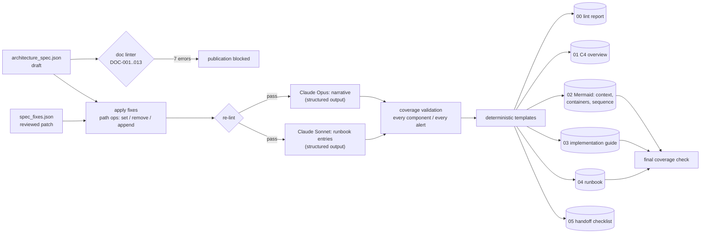

# D6.4 - Architecture Documentation and Implementation Guidance

> **Exam objective (Domain 6 - Stakeholder Communication & Lifecycle Management, 14%):**
> "Document architectures and provide implementation guidance"

## Why it matters

A Claude solution has more moving parts than a typical service: models and effort settings, versioned prompts, tools with side effects, guardrails, eval suites, caching layouts, fallbacks and a model lifecycle.
If these live in slide decks and people's heads, they drift from reality within weeks. The architect's deliverable is documentation that is **generated from a single source of truth, linted like code, and complete enough for another team to build, operate and own the system**.

## Key concepts

### 1. Docs-as-code

- Keep a **machine-readable architecture spec** (here `data/architecture_spec.json`) in the repository next to the code. Change it via pull requests, just like code.
- **Generate** human-readable docs and diagrams from it with deterministic templates. Regenerate on every merge.
- **Lint** it in CI with completeness rules. A failing doc-lint blocks the merge, the same as a failing test.
- Use LLMs for **prose inside slots that code owns**. Claude writes the overview and runbook steps; code renders tables and diagrams and checks that nothing was dropped.

### 2. C4 model: right level for each audience

| Level | Shows | Audience | Generated here as |
|---|---|---|---|
| 1. System context | People, the system, external systems | Executives, security, new joiners | Context table + Mermaid flowchart |
| 2. Containers | Deployable units, data stores, technology, owners, dependencies | Engineers, operations, reviewers | Container table + Mermaid flowchart |
| 3. Components | Internals of one container | Developers of that container | (optional) |
| 4. Code | Classes and functions | Developers | IDE/tools, rarely hand-drawn |

Add a **sequence diagram** for the critical request path. It's the best way to show an agent loop: tool calls, the model call with a cached prefix, guardrail and validator steps, and where human approval happens. Add a **data-flow diagram with trust boundaries** for security and privacy reviews.

### 3. The documentation set for a Claude solution

| Artifact | Contents | Audience | Update trigger |
|---|---|---|---|
| Architecture overview (C4 L1/L2) | Purpose, context, containers, data stores, key decisions | Everyone | Any structural change |
| ADRs | One decision each (see D6.2) | Engineers, auditors | Each significant decision |
| Diagrams | Context, containers, sequence, data flow | Engineers, security | Generated on every spec change |
| Implementation guide | Environments, config and secrets, models and API conventions, tools and scopes, prompt management, error handling, rollout plan, observability | Build team | Spec or convention change |
| Prompt registry | Prompt id, semver, owner, eval suite, change log | Prompt owners, QA | Every prompt change |
| Runbook | Per alert: condition, likely causes, diagnosis, remediation, escalation | On-call | New alert, incident learnings |
| SLO doc / service review | Targets, SLIs, error-budget policy (see D6.3) | Ops, stakeholders | Monthly |
| Handoff checklist | Evidence-backed readiness items | Receiving team | Before each handoff gate (see D6.5) |

### 4. Claude-specific items to always document

- **Models:** exact ids (no date suffixes on current aliases), purpose, `effort`, thinking mode, `max_tokens`, fallback, and deprecation or retirement dates.
- **Prompts:** treat them as versioned artifacts with an owner and an eval suite. Production pins a version, and changes go through shadow and canary stages.
- **Tools:** side effect (read/write), least-privilege auth scope, approval gate. The agent gets read-only tools, and writes go only through a controlled API layer into a *pending* state.
- **Guardrails:** input, output, process and data controls, and where each is implemented.
- **Data flows to the model provider:** residency, retention, what is cached, and PII handling.
- **Caching layout:** which prefix is cached, and what must stay byte-stable (no timestamps or request ids).
- **Current API conventions:**
  - Adaptive thinking plus `output_config.effort`.
  - No `temperature`/`top_p`/`top_k` and no assistant prefill on current models. Use structured outputs instead.
  - `tool_choice` auto with `strict` tool schemas.
  - Stream user-facing output.
  - Use the Message Batches API for bulk and eval work.
- **Error handling:** 429 (back off), 529/5xx (retry with jitter, then fallback), 400 (don't retry), `stop_reason` `max_tokens` (never show truncated output), `refusal` (route to manual), parse failures, guardrail blocks.
- **Rollout:** shadow → canary → ramp → GA, each with entry, exit and rollback criteria.

### 5. Runbooks that work at 3 a.m.

- One section per alert, linked to the SLO it protects and the owning team.
- **Ordered diagnosis steps** ("break down judge pass rate by prompt version"), not "investigate".
- **Safe, reversible remediation first:** re-pin the previous prompt or model, enable fallback mode, pause batch load. Never disable a guardrail to restore throughput.
- **LLM-specific failure modes:**
  - prompt regressions (longer outputs → latency and cost);
  - cache misses after a prefix change;
  - guardrail block spikes;
  - 429/529 from the API;
  - refusal spikes;
  - judge drift;
  - dependency outages.
- Explicit escalation path and time box (e.g. escalate if not mitigated within 30 minutes).

### 6. Doc-lint rules (completeness invariants)

| Rule | Why it matters |
|---|---|
| Every component has an owner | Someone must be paged and approve changes |
| Every dependency resolves | Diagrams that reference phantom components mislead |
| Every tool has an auth scope | Least privilege is reviewable only if declared |
| Write tools write to a *pending* state or require approval | Prevents silent autonomous side effects (the lab removes a `send_letter` tool that violated a discovery constraint) |
| Every SLO has an alert | An SLO without an alert is a wish |
| Every alert has a runbook entry | Pages without guidance prolong incidents |
| Every prompt has semver + an eval suite | Untested prompt changes are the top regression source |
| PII stores declare retention, encryption, residency | Compliance evidence (GDPR/HIPAA-style obligations) |
| Current model ids, used, with fallbacks | Catches legacy ids and unowned model routes |
| Secrets come from a vault | No credentials in config or docs |

### 7. Handoff readiness is evidence, not opinion

The checklist is computed from the spec and lint results: owners, scopes, alerts, runbooks, eval suites, vaulted secrets, on-call, dashboards, rollout criteria, knowledge transfer. In the lab it reports **NOT READY (13/14)** because operations sign-off is still pending. This is exactly the kind of item a handoff gate should block on (D6.5).

### Anti-patterns

- Wiki pages and slide-deck diagrams maintained by hand. They're out of date by the first incident.
- Diagrams without owners, legends or a source of truth; "boxes and arrows" that skip the model, tools and data stores.
- Prompts edited in production without versions or eval suites.
- Runbooks that say "investigate" or recommend disabling safety controls.
- Docs written after go-live, or a "big bang" handoff without evidence-backed readiness.
- Letting an LLM write the whole document unvalidated, so components and alerts silently go missing.

## Architecture



## What the code demonstrates

| Step | Console section | Code |
|---|---|---|
| Spec inventory: components, models, prompts, tools, stores, SLOs, alerts, flow | 1 | `data/architecture_spec.json` |
| Doc lint on the draft: 7 errors block publication | 2 | `lint()`, `RULES` |
| Reviewed patch applied via a tiny path language, re-lint passes | 3 | `apply_fix()`, `data/spec_fixes.json` |
| Claude drafts the narrative (Opus) and runbook (Sonnet) as structured outputs; coverage validated | 4 | `NarrativeDraft`, `RunbookDraft` |
| Deterministic rendering: lint report, C4 overview, Mermaid diagrams, implementation guide, runbook, handoff checklist | 5 | `render_*()` |
| Final coverage check of the generated docs | 6 | coverage list |

## Run it

```bash
.venv/Scripts/python "D6.4 - Architecture Documentation and Implementation Guidance/python/main.py"
node "D6.4 - Architecture Documentation and Implementation Guidance/typescript/main.ts"
```

Outputs go to `labs_output/docs/` (gitignored). Committed samples are in [`examples/docs/`](examples/docs/): [lint report](examples/docs/00-lint-report.md), [overview](examples/docs/01-architecture-overview.md), [diagrams](examples/docs/02-diagrams.md), [implementation guide](examples/docs/03-implementation-guide.md), [runbook](examples/docs/04-runbook.md), [handoff checklist](examples/docs/05-handoff-checklist.md).
Try it: delete an alert's runbook entry from `data/mock_responses/runbook.json`, or a component's `owner` from the spec, and watch the lint and coverage gates catch it.

## Exam tips & traps

- **Single source of truth beats hand-maintained diagrams.** Prefer answers that generate docs from a versioned spec and lint them in CI.
- **Pick the C4 level for the audience.** Executives and security get context; engineers and operations get containers. Use a sequence diagram to explain an agent's request path.
- **Prompts are code:** versioned (semver), owned, pinned in production, gated by an eval suite, rolled out via canary, rolled back by re-pinning.
- **Document tools by side effect and scope.** A write tool needs an approval gate or must write to a pending state. If a tool contradicts a discovery constraint, remove it, don't document it.
- **Every SLO needs an alert, and every alert needs a runbook entry** with concrete diagnosis and safe, reversible remediation. Never "disable the guardrail".
- **Implementation guides must encode current API behaviour:** adaptive thinking + effort, no sampling parameters or prefill on current models, structured outputs, strict tools with `tool_choice` auto, a byte-stable cached prefix, batches for bulk work, and request-id logging.
- **LLM-drafted documentation needs structural validation.** Claude fills prose slots; code checks completeness (every component, every alert).

### Practice question 1

A team's Claude agent documentation lives in a slide deck and a wiki. During an incident, on-call finds no runbook for the "guardrail block spike" alert, the deck shows a component that was never built, and a prompt was edited directly in production last week. Which change addresses all three problems **most effectively**?

A. Schedule a quarterly documentation review meeting with all teams.
B. Create a machine-readable architecture spec in the repository. Generate diagrams and docs from it, and add CI doc-lint rules: dependencies must resolve, every alert needs a runbook entry, and every prompt needs a version and an eval suite and is deployed only via a pinned version.
C. Ask Claude to regenerate the wiki from the codebase each week.
D. Add more detail to the slide deck and restrict edit rights.

**Answer: B.** It makes the spec the source of truth and turns completeness into enforced invariants. Missing runbooks, phantom components and unversioned prompts all fail the build. A and D keep manual drift. C produces unvalidated text with no completeness guarantee.

### Practice question 2

After a release, cost per request for a Claude drafting service triples and time to first token rises, although traffic and output length are unchanged. The diff shows a new engineer added the current timestamp to the top of the system prompt. Which documented implementation convention would have prevented this?

A. "Always set temperature to 0 for deterministic outputs."
B. "Keep the cached prefix (system prompt, policy wording) byte-stable: no timestamps or request ids before the cache breakpoint. Put volatile content after it."
C. "Force tool use with `tool_choice: any` on every request."
D. "Use the largest available model for all routes."

**Answer: B.** Prompt caching is a prefix match, so a changing timestamp invalidates the cache on every request: no cache reads, full input price, slower TTFT. A and C describe parameters that current models reject. D is unrelated to the regression.

## Further reading

- Simon Brown, *The C4 model for visualising software architecture*
- Docs-as-code (Write the Docs community); Mermaid documentation (flowchart and sequence diagrams)
- Google SRE Workbook: on-call, runbooks/playbooks, alerting on SLOs
- Claude API docs: Prompt caching; Structured outputs; Tool use (strict tools, tool choice); Message Batches; Errors; Models overview and deprecations
- Threat modelling with data-flow diagrams (STRIDE) for security reviews
