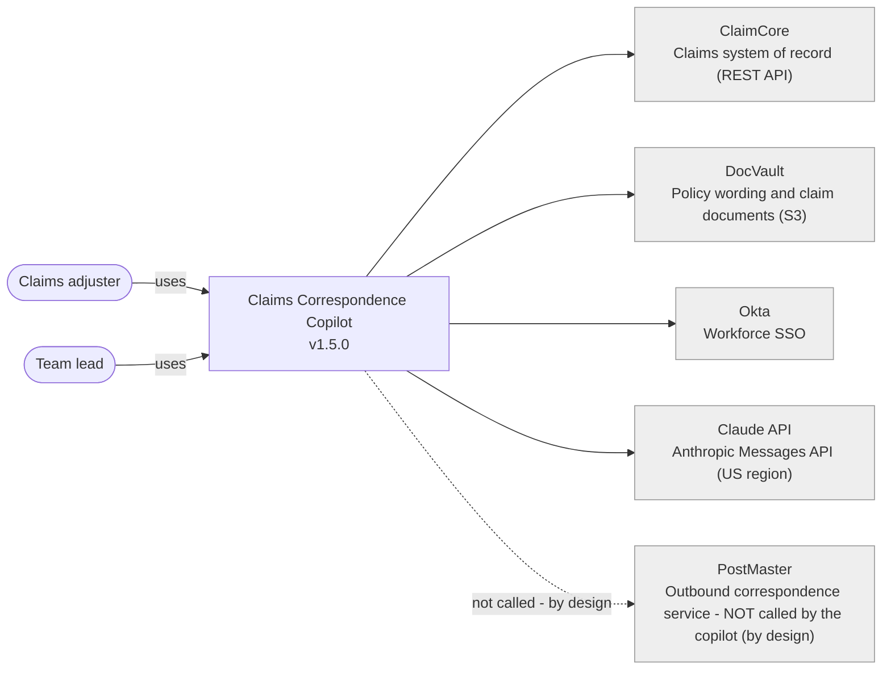
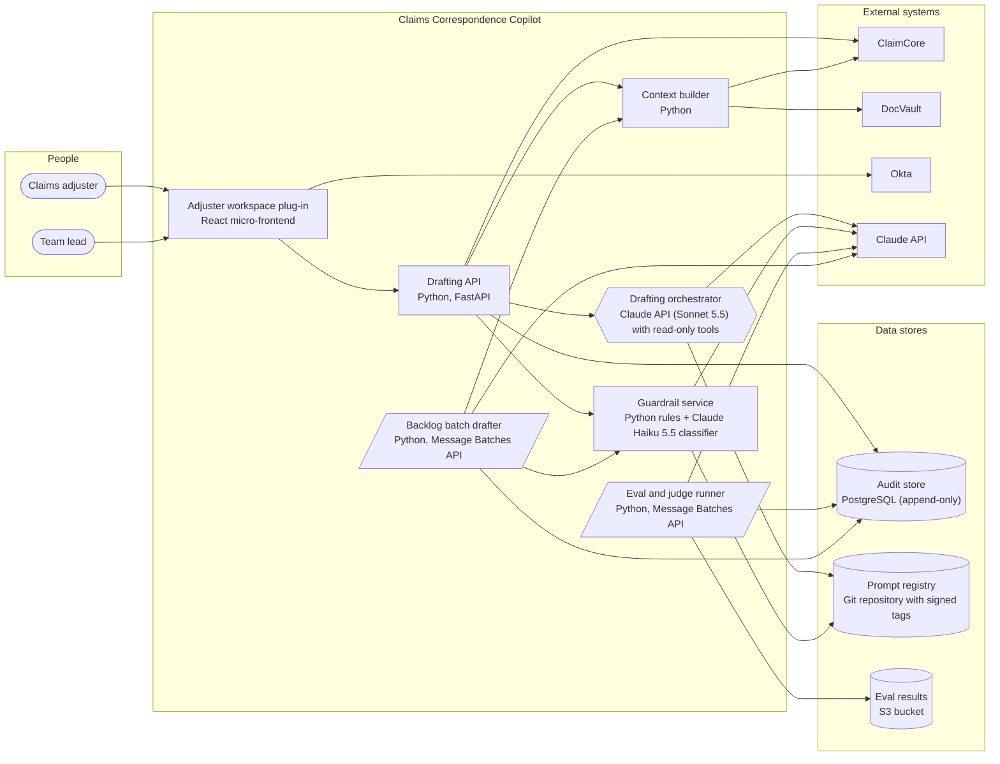
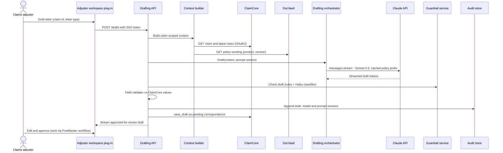

# Diagrams - Claims Correspondence Copilot v1.5.0

Generated from `architecture_spec.json`; paste into any Mermaid renderer (GitHub renders these natively).

## C4 level 1 - system context

## C4 level 2 - containers

## Sequence - one drafting request through the agent

_Components in the container view: 7; request-flow steps: 14._
