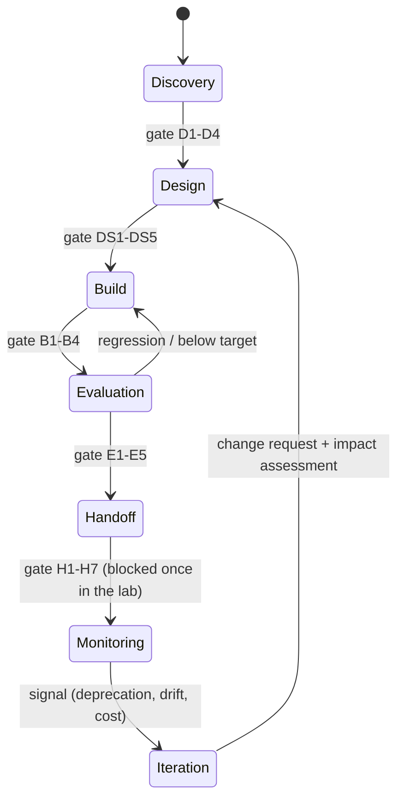

# D6.5 - Lifecycle Phases - Discovery to Iteration

> **Exam objective (Domain 6 - Stakeholder Communication & Lifecycle Management, 14%):**
> "Support lifecycle phases (discovery, design, handoff, monitoring, iteration)"

## Why it matters

A Claude solution is never "done". Prompts drift, costs creep, user needs change, and the **model itself has a lifecycle**: successors ship, older models are deprecated and then retired, after which their API calls fail.
The architect keeps the solution moving through explicit phases with **evidence-based gates**. That way nothing reaches production without an eval, nothing reaches operations without a complete handoff package, and a model deprecation becomes a controlled iteration instead of an outage.

## Key concepts

### 1. The lifecycle of a Claude solution

| Phase | Purpose | Key artifacts | Typical exit criteria |
|---|---|---|---|
| **Discovery** | Problem, measurable requirements, feasible first use case | Requirements baseline, use-case assessment (D6.1) | No open high-severity conflicts; NFRs measurable; ≥ 1 use case GO |
| **Design** | Architecture, decisions, SLOs, controls | Architecture spec, ADRs, SLO doc, DPIA/security review, API-compatibility scan (D6.2, D6.4) | Spec lint-clean; key ADRs accepted; SLOs and privacy review approved |
| **Build / prototype** | Working system in staging | Prototype, eval suite, prompt registry | Eval suite ≥ N cases; prompts versioned and pinned; configs compatible with their models |
| **Evaluation** | Evidence that quality, safety, latency and cost meet targets | Eval report, load test, regression report | Pass rate ≥ target; zero critical safety failures; p95 and cost within SLO; **no regressions vs the frozen baseline** |
| **Handoff** | Operations can run and change it without the build team | Handoff package | Runbook covers every alert; baseline stored; dashboards; named owners (incl. **prompt owner**); model inventory with deprecation watch; ops sign-off |
| **Monitoring** | Run against SLOs; detect change | Dashboards, service reviews (D6.3) | An iteration trigger is raised |
| **Iteration** | Scope and assess a change, then **re-enter design** | Change request, impact assessment | Change approved; impact assessed |

The loop matters: iteration goes back to **design**, not straight to production. Evaluation can send work back to build.

### 2. Gates: computed, not argued

- Each gate checks **exit criteria against an artifact registry** and returns PASSED, or BLOCKED with specific reasons.
- In the lab, the first handoff gate is **BLOCKED (2/7)**: runbook coverage 67%, 2 dashboards, no prompt owner, no deprecation watch, no ops sign-off. It passes two weeks later after fixes.
- Good gates are few, objective and tied to risk. Bad gates are paperwork ("gate theatre") or get skipped under deadline pressure.
- If the sponsor pushes to go live, the architect keeps the gate honest and offers options. For example: fix the items in a sprint, or run a time-boxed canary with the build team on call. The architect doesn't waive the criteria.

### 3. The handoff package for an LLM system

| Item | Why it's LLM-specific |
|---|---|
| Runbook for every alert | Prompt regressions, cache misses, guardrail spikes, 429/529 and judge drift need concrete steps |
| Eval suite **plus stored baseline results** | Every future prompt or model change is compared with it. A retired model can't be re-run |
| Dashboards (SLOs, cost per task, guardrails, canary comparison) | Quality and cost drift silently |
| Named owners: service, on-call **and prompts/content** | Prompts are behaviour. Someone must approve changes |
| Prompt registry with pinned versions | Rollback = re-pin |
| Model inventory with deprecation watch | Retirement dates drive mandatory migrations |
| Ops acceptance sign-off and knowledge transfer | Accountability actually moves |

### 4. Monitoring signals → iteration

| Signal | Example rule | Route |
|---|---|---|
| Quality drift | 2-week judge pass rate < baseline − 3 pp (watch at −1 pp) | Iteration |
| Cost creep | Cost per task > 1.2 × baseline (watch at 1.1×) | Iteration |
| Latency / availability breach | p95 > SLO, burn-rate pages | **Incident process** (rollback), not a lifecycle iteration |
| Model deprecation | Model in use retires within 180 days | **Mandatory migration** |
| New model release | Successor available | Evaluate an upgrade (optional, often bundled) |
| Feedback themes / business change | New letter types, new regulation | Iteration |

Separate **watch** from **trigger** levels, and **incidents** (restore service now) from **iterations** (change the design).

### 5. Model lifecycle and migration (the iteration in this lab)

1. **Inventory.** Which routes use which models and parameters? Keep it in the handoff package.
2. **Impact assessment.**
   - Breaking API changes.
   - Behavioural shifts.
   - Tokenizer changes: same text, more tokens.
   - Price per token.
   - Rate-limit pools.
   - Effort recalibration.
3. **Compatibility scan of route configs against the target model.** Lab findings, taken from the migration guide:
   - **Sonnet 5 → Sonnet 5.5:** `thinking: {type: "disabled"}` returns 400 → adaptive thinking at low effort (or `between_tools` if thinking must stay off). Forced `tool_choice` (`any`/`tool`) returns 400 → `auto` + strict tools + prompt steering + check the call happened. Effort levels are recalibrated → re-run the effort sweep.
   - **Haiku 4.5 → Haiku 5.5:** `budget_tokens` → 400 (adaptive only). Non-default `temperature`/`top_p`/`top_k` → 400. Assistant prefill → 400, so use structured outputs. Same text ≈ 30% more tokens, but at a much lower price ($30.00 → $3.90/month for the guard route in the lab).
4. **Fix the configs, then re-scan** until no blocking issues remain. Tuning tasks stay on the list.
5. **Regression eval against a frozen baseline.**
   - Run the candidate model on the same suite.
   - Classify each case as regression, improvement or same.
   - Fix regressions in the **prompt or config**, never by loosening the check.
   - In the lab, round 1 finds a verbosity regression (C-03, 156 words > 120) and an improvement (C-05 no longer implies coverage). Prompt 2.1.1 adds a length budget, and round 2 passes 6/6.
6. **Re-baseline cost per task and latency.** Canary, then switch, then remove legacy model ids. Write a **superseding ADR** and update the handoff package (model inventory, runbook, prompt registry).

Store baseline *results*, not just the suite. Once a model is retired you can't regenerate its outputs. The lab falls back to recorded baseline results if the legacy model call fails.

### 6. Regression evals for model or prompt changes

- Prefer **programmatic checks** where the output space is constrained (must include the claim number, must not contain "covered", word budget). Use a pairwise judge for subjective quality.
- **Freeze the reference** once. Later rounds compare against the same baseline, otherwise "pass rate" silently changes meaning.
- Report regressions *and* improvements. A new model can fix old failures while breaking others.
- Judge on **cost per completed task** and latency, not per-token price alone.

### Anti-patterns

- "It's just a model id change" → swapping the model in production without a scan, eval or canary.
- Waiting for the retirement date. The calls start failing (404) and the baseline can't be re-run.
- Handoff without a prompt owner, runbook coverage or ops sign-off, so the build team never leaves.
- Treating a latency incident as a redesign, or a structural problem as an incident.
- Lowering eval thresholds to make a migration pass.
- Gates that are signed off without evidence, or skipped under deadline pressure.

## Architecture

```mermaid
flowchart LR
    SIG[SIG-D deprecation notice<br/>+ SIG-R successor released] --> T[Iteration ticket]
    T --> IA[Impact assessment<br/>cost per route, breaking changes]
    IA --> SC[Compat scan vs target rules<br/>7 BLOCKS / 4 TUNE]
    SC --> FX[Apply fixes -> re-scan<br/>0 BLOCKS]
    FX --> R1["Regression eval round 1<br/>(shared Claude client)<br/>1 regression"]
    R1 --> P[Prompt patch 2.1.1]
    P --> R2[Round 2: 0 regressions]
    R2 --> H[Delta handoff<br/>inventory, runbook, registry]
    H --> C[Canary -> switch -> remove legacy ids]
```





## What the code demonstrates

| Step | Console section | Code |
|---|---|---|
| Phase model: exit criteria, transitions, reviewers | 1 | `data/lifecycle.json` |
| Event-driven simulation through every phase; gates computed from the artifact registry | 2 | `Project.gate()`, `Project.check()` |
| Handoff package validation: BLOCKED (2/7), fixed, PASSED | 2 (W12-W15) | `package_metrics()`, `data/handoff_package.json` |
| Monitoring signals with watch/trigger levels; incident vs iteration; deprecation horizon | 2 (W16-W22) | `data/monitoring.json` |
| Impact assessment (cost per route incl. tokenizer factor) | 2 (W23) | `monthly_cost()` |
| API compatibility scan against target-model rules, fixes, re-scan | 2 (W24-W25) | `scan()`, `apply_fixes()`, `data/model_config.json` |
| Regression eval old vs new through the shared client (frozen baseline, regression vs improvement, retired-model fallback) | 2 (W26) | `run_suite()`, `grade()`, `data/regression_suite.json` |
| Gantt timeline, gate summary, report | 3 | `labs_output/lifecycle_timeline.md` |

## Run it

```bash
.venv/Scripts/python "D6.5 - Lifecycle Phases - Discovery to Iteration/python/main.py"
node "D6.5 - Lifecycle Phases - Discovery to Iteration/typescript/main.ts"
```

Output: `labs_output/lifecycle_timeline.md` (gitignored). Committed sample: [`examples/lifecycle_timeline.md`](examples/lifecycle_timeline.md).
Live mode note: the legacy model in the simulation may no longer be callable. In that case the eval uses the recorded baseline results, which is exactly why you store them. Model release and retirement dates in the data are fictional.

## Exam tips & traps

- **Iteration re-enters design**, with a change request and impact assessment, and then goes through build, evaluation and handoff again (lighter "delta" gates are fine). Never go straight from a signal to production.
- **A model deprecation is a mandatory, scheduled migration.** Inventory, assess impact, scan configs for breaking changes, run a regression eval against a frozen baseline, canary, switch, then write a superseding ADR. Start well before the retirement date.
- **Know the current breaking changes.**
  - On Opus 5.5 / Sonnet 5.5 / Fable 5.1, forced `tool_choice` returns 400.
  - On Sonnet 5.5, `thinking: disabled` returns 400.
  - On Haiku 5.5, `budget_tokens`, non-default sampling parameters and assistant prefill all return 400.
  - Use adaptive thinking + `effort`, `auto` + strict tools, and structured outputs.
- **Handoff gates check evidence:** runbook coverage, stored eval baseline, dashboards, named owners including prompts, pinned prompt registry, model inventory with deprecation watch, ops sign-off. Missing any one of them blocks the gate.
- **Incident vs iteration:** a p95 breach from a bad prompt release is rolled back via the incident process. Sustained quality drift, cost creep or a model lifecycle event drives an iteration.
- **Regressions are fixed in the prompt or config, not by loosening thresholds.** Report improvements too.
- **Compare cost per completed task.** Tokenizer changes can raise token counts while the per-token price falls.

### Practice question 1

A Claude-based drafting service runs on a model that has just received a deprecation notice; it retires in five months, and a successor is available. The team proposes changing the model id in production this week "because the successor is better". What should the architect recommend?

A. Change the model id now; successors are backward compatible.
B. Wait until a month before retirement to minimise churn.
C. Open an iteration. Assess impact (breaking API parameters, effort recalibration, tokenizer, pricing, rate limits), scan route configs against the target model, fix them, run the regression suite against the stored baseline, canary the change, then switch and record a superseding ADR.
D. Ask Claude to rewrite the prompts for the new model and deploy them together with the model change.

**Answer: C.** Successor models can reject parameters that worked before, such as disabled thinking or forced tool choice, and they change behaviour and token counts. A controlled iteration with a regression eval and canary is the safe path. A risks 400 errors and silent regressions. B wastes the window and risks the baseline becoming unrunnable. D changes two variables at once without evidence.

### Practice question 2

At the handoff gate for a Claude solution, the eval report meets every target, but the runbook covers 4 of 6 alerts, nobody owns the prompts, and operations hasn't signed acceptance. The sponsor wants to go live tomorrow. What is the **best** action?

A. Pass the gate; evaluation results are what matter for an AI system.
B. Keep the gate blocked and list the specific gaps with owners and dates. Offer a path, such as closing the items in a sprint or a time-boxed canary with the build team remaining on call. Go live when the evidence is complete.
C. Remove the failing criteria from the handoff checklist for this project.
D. Go live and let operations write the missing runbook entries after the first incident.

**Answer: B.** Gates exist to block exactly this kind of operational risk. The architect makes the gaps concrete and offers options without waiving the criteria. A, C and D shift risk onto production and operations.

## Further reading

- Claude API docs: Models overview; Model deprecations; Migrating to newer models (breaking changes per model)
- Claude API docs: Create strong empirical evaluations; prompt versioning and testing practices
- Stage-gate process and Definition of Done; ITIL service transition (handoff/acceptance)
- Google SRE Workbook: canarying releases; incident response vs. change management
- MLOps / LLMOps lifecycle concepts: model registry, monitoring for drift, controlled rollouts
