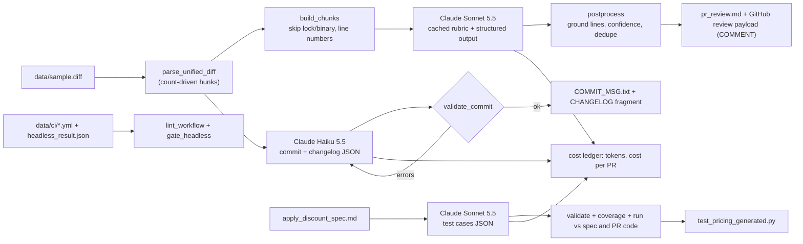

# D7.2 - AI-Assisted Developer Workflows

> **Exam objective:** "Improve developer workflows using AI-assisted tooling"

## Why it matters

The fastest way to lose developers' trust in AI tooling is a bot that posts twenty speculative comments on
every PR, invents line numbers, writes commit messages nobody can parse, or burns the CI budget on draft
PRs. The architect's job is to put the model **inside a deterministic pipeline**: code decides what the model
sees (chunking, line numbers), what shape it must answer in (structured outputs), what survives (grounding,
confidence, dedupe), who decides (humans merge), and what it costs (model per step, caching, CI filters).

## Key concepts

### 1. Where AI fits in the developer loop

| Workflow | Model tier (typical) | Deterministic wrapper | Human gate |
|---|---|---|---|
| PR review comments | Sonnet (volume) or Opus (deep/security) | chunking, line grounding, confidence filter, dedupe | reviewer approves the PR |
| Commit message / changelog | Haiku | Conventional Commits validator + repair loop | author edits before commit |
| Test generation | Sonnet / Opus | schema + semantic validation, run vs spec and code | reviewer accepts the tests |
| Release notes / PR summary | Haiku / Sonnet | budget gate on headless JSON result | release manager |
| Interactive fixes (`@claude` in a PR) | Opus / Sonnet via Claude Code | permissions, `--allowedTools`, `--max-turns` | PR review of the bot's commits |

### 2. Designing an AI PR reviewer

* **Chunk by file, then by hunk**, within a token budget; skip lockfiles, generated and binary files.
* **Annotate new-file line numbers** in the chunk so the model can cite lines your code can verify.
* **Put the stable rubric first and cache it** (`cache_control` on the system block): chunks 2..N pay ~10%
  for the rubric. Volatile content (the chunk) goes last.
* **Structured outputs** (`output_config.format` / `messages.parse` with Pydantic or Zod) guarantee the JSON
  shape. On Opus 5.5 / Sonnet 5.5 / Fable 5.1, forcing a tool with `tool_choice: any|tool` returns 400 - use
  structured outputs or `strict` tools with `auto`.
* **Post-process before posting**: drop findings on files/lines not in the diff (hallucinations), drop
  confidence below a threshold, dedupe by (file, line, category), sort by severity.
* **Post as `COMMENT`**, never `APPROVE`/`REQUEST_CHANGES`: branch protection plus a human reviewer decide.
* Measure: findings by severity, acceptance rate of comments, false-positive rate, cost per PR and per
  accepted finding.

### 3. Commit messages and changelogs

* Conventional Commits: `type(scope)!: subject` - type from a fixed list, kebab-case scope, imperative,
  lowercase, no trailing period, header <= 72 chars; `BREAKING CHANGE:` footer for majors.
* A schema can enforce the type enum but not mood, case or length: **validate in code and repair** by
  sending the model its previous output plus the validator errors (a normal user turn - assistant
  prefill is rejected on current models).
* Changelog entries map to Keep a Changelog sections (Added, Changed, Deprecated, Removed, Fixed, Security).

### 4. Generated tests: trust, but execute

| Spec | Code in PR | Meaning | Action |
|---|---|---|---|
| pass | pass | regression guard | keep |
| pass | fail | **real bug in the PR** | fix the code |
| fail | any | **the generated test is wrong** | human review; never "fix" code to match it |

Structured outputs remove type errors; you still need semantic validation (unique names, exactly one of
expected/raises, coverage of boundaries, rounding and invalid input) and execution against an executable spec.

### 5. Running it in CI

* **`anthropics/claude-code-action`** (GitHub Actions): responds to `@claude` mentions or runs a `prompt`
  automatically on PR events; configure model, turns and tools via its inputs.
* **Headless mode**: `claude -p "<prompt>" --output-format json` prints one JSON result (`result`,
  `is_error`, `subtype`, `num_turns`, `total_cost_usd`, `session_id`, ...); `stream-json` streams events.
  Pair with `--max-turns`, `--allowedTools`, `--model`. The Claude Agent SDK packages the same loop as a
  library when a shell step is not enough.
* Gate on the JSON: fail the job on `is_error`, warn when `total_cost_usd` exceeds the per-PR budget.

### 6. Security and governance in CI

| Control | Why |
|---|---|
| API key only via `${{ secrets.* }}`, scoped to the step | literal keys leak through logs and forks |
| `permissions: contents: read, pull-requests: write` | least-privilege workflow token |
| Never `pull_request_target` + checkout of the PR head | runs attacker-controlled code with secrets ("pwn request") |
| Read-only `--allowedTools`, no `--dangerously-skip-permissions` | PR content is untrusted input (prompt injection) |
| Pin actions to a tag or SHA | `@main` is a moving supply-chain target |
| Bot comments only; human approval required by branch protection | accountability stays with people |

### 7. Cost controls

| Lever | Effect |
|---|---|
| `paths` filters, skip drafts and bots | fewer runs |
| `concurrency` with `cancel-in-progress` | no spend on superseded commits |
| `--max-turns`, `timeout-minutes`, diff-size cap | bounded worst case |
| Model per step (Haiku for commit text, Sonnet for review, Opus only when needed) | 10-40x price spread |
| Prompt caching of the rubric / repo context | ~90% off repeated input |
| Skip lockfiles/generated files; chunk budget | fewer input tokens |

## Architecture



## What the code demonstrates

| Step | Code (`python/main.py`, `typescript/main.ts`) | Logic (`devflow.py` / `devflow.ts`) |
|---|---|---|
| 1. Parse the diff (6 files incl. lockfile and binary) | `step_parse` | `parse_unified_diff` |
| 2. Chunk with a token budget, skip policy, line numbers | `step_chunk` | `build_chunks`, `render_hunk` |
| 3. Review each chunk (structured output, cached rubric) | `step_review` | Pydantic / Zod schemas |
| 4. Ground, filter, dedupe, render PR comments | `step_postprocess` | `postprocess`, `render_pr_markdown`, `review_payload` |
| 5. Commit message + changelog with repair loop | `step_commit` | `validate_commit`, `render_commit_message`, `render_changelog` |
| 6. Test generation, validation, execution, triage | `step_tests` | `validate_cases`, `coverage`, `run_case`, `triage`, `render_pytest` |
| 7. CI: workflow lint + headless JSON gate | `step_ci` | `lint_workflow`, `gate_headless` |
| 8. Tokens/cost per PR, caching savings, model sensitivity, findings by severity | `step_economics` | cost ledger |

TypeScript uses the camelCase equivalents (`stepReview`, `parseUnifiedDiff`, `validateCommit`, ...).

`data/ci/claude-pr-review.yml` is a documented example (requires GitHub Actions and Claude Code; it is linted,
never executed). `data/ci/risky-pr-review.yml` is deliberately unsafe to exercise the linter.

## Run it

```bash
.venv/Scripts/python "D7.2 - AI-Assisted Developer Workflows/python/main.py"
node "D7.2 - AI-Assisted Developer Workflows/typescript/main.ts"
```

Outputs in `labs_output/`: `pr_review.md`, `review_payload.json`, `COMMIT_MSG.txt`,
`CHANGELOG.fragment.md`, `test_pricing_generated.py`. Offline token counts are estimates, so the two
languages can differ by a token or two.

## Exam tips & traps

* **Advisory, not authoritative**: AI review comments never replace the required human approval; post as
  comments, keep branch protection.
* **Hallucinated locations are a pipeline bug, not a model quirk** - give line numbers in the prompt and
  verify every cited file/line against the diff before posting.
* **Structured output != correct output**: schemas fix shape; validators, execution and humans fix meaning.
* **Forced tool choice** (`any`/`tool`) is a 400 on Opus 5.5 / Sonnet 5.5 / Fable 5.1 - pick structured outputs.
* **`pull_request_target` + PR-head checkout** with secrets is the classic CI security trap; prefer
  `pull_request` with a read-only token.
* **Cost questions**: cache the static rubric, right-size the model per step, filter triggers, cap turns -
  before negotiating a bigger budget.
* A generated test that fails against the spec means **the test is suspect** - do not change code to satisfy it.
* Headless `--output-format json` gives machine-readable `is_error` and `total_cost_usd` for CI gating.

### Practice question 1

A team's AI reviewer posts ~25 comments per PR; developers report many reference lines that don't exist and
repeat the same issue. Which change most directly fixes both problems?

A. Switch the reviewer from Sonnet to Opus
B. Annotate chunks with new-file line numbers, then drop findings whose file/line is not in the diff and dedupe by file/line/category before posting
C. Lower `max_tokens` so the model writes fewer findings
D. Ask the model in the prompt to "be careful about line numbers"

**Answer: B.** Grounding and dedupe are deterministic post-processing that removes both failure modes regardless
of model. A may reduce but not eliminate errors and raises cost; C truncates output (and can break JSON);
D is guidance with no guarantee.

### Practice question 2

A workflow uses `claude -p ... --output-format json` to write release notes on every PR. Finance wants spend
bounded, Security wants no write access for the agent. Which combination fits best?

A. `--dangerously-skip-permissions` to avoid prompts, and a monthly invoice review
B. `--max-turns 3`, `--allowedTools "Read"`, a job step that fails on `is_error` and warns when `total_cost_usd` exceeds a budget, `concurrency` cancel-in-progress, and `permissions: contents: read`
C. Run on `pull_request_target` so secrets are available, and use Opus for quality
D. Remove the API key from secrets and hard-code it in the workflow for reliability

**Answer: B.** It bounds turns and tools, gates on the machine-readable result, avoids paying for superseded runs,
and keeps the token read-only. A removes the safety net; C introduces the pwn-request risk; D leaks the key.

## Further reading

Claude Code documentation (code.claude.com): **GitHub Actions** (claude-code-action), **Headless mode** /
CLI reference (`-p`, `--output-format`, `--max-turns`, `--allowedTools`), **Claude Agent SDK**, **Settings
and permissions**, **Security**, **Costs**. Claude API docs: **Structured outputs**, **Prompt caching**,
**Tool use** (`tool_choice`, `strict`). GitHub docs: workflow `permissions`, `concurrency`, security
hardening for GitHub Actions.
