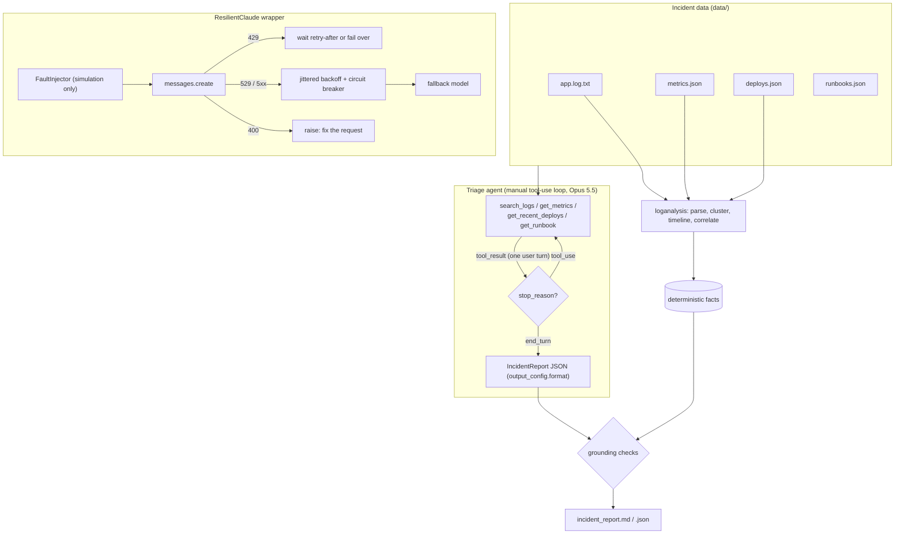

# D7.3 - Debugging and Operational Issue Resolution

> **Exam objective:** "Support debugging and operational issue resolution"

## Why it matters

LLM features fail in ways classic services do not: a harmless-looking prompt edit silently disables
caching and triples token spend, a retry policy turns a rate limit into a retry storm, a model upgrade
rejects parameters that used to work, a truncated response gets parsed as if it were complete. The
architect must (1) make these failures **observable** (request IDs, usage, stop reasons, cache tokens),
(2) handle API errors **by type**, and (3) use AI to **accelerate** triage without letting it become the
only witness - deterministic analysis and grounding checks keep the agent honest.

## Key concepts

### 1. Incident workflow: deterministic first, AI second

| Phase | Deterministic tooling | Where Claude helps |
|---|---|---|
| Detect | alerts on error rate, latency, **cache hit ratio, rate-limit headroom** | - |
| Triage | log parsing, error-signature clustering, timeline, "what changed?" (deploys, config) | agent that queries logs/metrics/deploys/runbooks and drafts a hypothesis |
| Mitigate | runbooks, rollback, feature flags, fallback model | proposes steps from the matching runbook; **humans execute** |
| Root cause | before/after comparison around the change | structured incident report with evidence |
| Prevent | CI checks, alerts, load tests | drafts follow-ups and the postmortem |

### 2. Designing a triage agent

* **Narrow, read-only tools** with typed inputs (`search_logs`, `get_metrics`, `get_recent_deploys`,
  `get_runbook`) - no shell, no write access; remediation is proposed, not executed.
* **Bound tool output** (line limits, summaries) - tool results are context tokens.
* **Manual loop** when you need full control (custom transport, per-turn logging, approval gates):
  append the assistant turn, run every `tool_use`, return **all** `tool_result` blocks in **one** user message,
  repeat until `end_turn`; cap turns; send failures back as `is_error: true` results.
* **Structured final answer**: `output_config.format` (JSON schema) works together with tools. Forcing a
  tool via `tool_choice: any|tool` returns 400 on Opus 5.5 / Sonnet 5.5 / Fable 5.1.
* **Grounding checks**: compare the report's claims (deploy version, timestamps, runbook, numbers) with
  the deterministic facts before anyone acts on it.

### 3. Claude API error taxonomy

| HTTP | `error.type` | Python class | TypeScript class | Retry? | Action |
|---|---|---|---|---|---|
| 400 | `invalid_request_error` | `BadRequestError` | `BadRequestError` | No | fix the request (removed params, prefill, pairing, schema) |
| 401 / 403 | `authentication_error` / `permission_error` | `AuthenticationError` / `PermissionDeniedError` | same | No | credentials / workspace config; page on-call |
| 404 | `not_found_error` | `NotFoundError` | `NotFoundError` | No | wrong model id or not enabled; try the fallback model |
| 413 | `request_too_large` | `RequestTooLargeError` | `APIError` (status 413) | No | shrink the request |
| 429 | `rate_limit_error` | `RateLimitError` | `RateLimitError` | Yes | **honor `retry-after`**, throttle, restore caching |
| 500 | `api_error` | `InternalServerError` | `InternalServerError` | Yes | backoff with jitter |
| 529 | `overloaded_error` | `OverloadedError` (sibling of `InternalServerError`) | `InternalServerError` (check `status === 529`) | Yes | backoff, circuit breaker, fallback model |
| - | network / timeout | `APITimeoutError` < `APIConnectionError` | `APIConnectionTimeoutError` < `APIConnectionError` < `APIError` | Yes | backoff |

Catch **most specific first**. Log `request_id` on every call and error (`message._request_id`, `e.request_id`
in Python; `msg._request_id`, `err.requestID` in TypeScript). `ANTHROPIC_LOG=debug` turns on SDK logging.

### 4. Retry, fallback and circuit breaking

* The SDKs already retry connection errors, 408, 409, 429 and >= 500 (`max_retries` default 2) and respect
  `retry-after`. **Keep one retry layer**: SDK (3 tries) x wrapper (4) x caller (3) = 36 requests per user action.
* **429 is your quota** (requests, input tokens or output tokens per minute): wait as long as `retry-after`
  says; if that exceeds your latency budget, fail over or shed load. On current models cached input tokens
  generally do not count toward the input-tokens-per-minute limit, so losing the cache can *cause* 429s.
* **529 is provider capacity**: exponential backoff with **full jitter** (`uniform(0, min(cap, base*2^n))`),
  a **circuit breaker** (CLOSED -> OPEN after N failures -> HALF_OPEN probe after a cooldown), and a
  **fallback model** for non-critical traffic.
* Never retry 4xx validation errors - the same body fails the same way.

### 5. Operational debugging checklist

| Symptom | Check | Fix |
|---|---|---|
| Output cut off, JSON won't parse | `stop_reason == "max_tokens"` | raise `max_tokens`, stream, split the task; never act on partial output |
| Agent stops mid-task | `stop_reason` `tool_use` / `pause_turn` handled? | run tools and continue / resend |
| 400 about tool results | every `tool_use` id answered in the next user turn, `tool_result` blocks first | fix the history builder (append-only) |
| 400 after model upgrade | `temperature`/`top_p`/`top_k`, `budget_tokens`, `thinking: disabled`, assistant prefill, forced `tool_choice` | adaptive thinking + `output_config.effort`; structured outputs |
| Cost jump, `cache_read_input_tokens = 0` | timestamp/UUID before the breakpoint, unsorted JSON, tool list or model changes, prefix below minimum | freeze the prefix; move volatile data to the end |
| 404 | exact id like `claude-opus-5-5` (no dots, no date suffix) | fix the id, list models |
| Can't reproduce | `request_id` logged? | log it everywhere; include it in support tickets |

## Architecture



## What the code demonstrates

| Step | Code (`python/main.py`, `typescript/main.ts`) | Supporting module |
|---|---|---|
| 1. Parse 69 log lines, cluster WARN/ERROR signatures, per-minute timeline with deploy marker, before/after correlation (cache ratio, uncached tokens, ITPM vs limit, retries ignoring retry-after) | `step_log_analysis` | `loganalysis.py` / `loganalysis.ts` |
| 2. Manual tool-use loop with 4 real tools, parallel tool calls, structured final report, grounding checks (7) | `step_triage`, `TriageTools`, `grounding_checks` | `data/incident_report.schema.json` |
| 3. Eight resilience scenarios: retry-after, jittered backoff, breaker open / fail-fast / half-open, 400 no-retry, retry-after over budget, timeout | `step_resilience` | `resilience.py` / `resilience.ts` |
| 4. Checklist as code: live max_tokens truncation, live cache_read=0 diagnosis (v7 timestamp-in-system bug vs v6 fix), request linter on 8 requests, checklist table | `step_checklist` | `diagnostics.py` / `diagnostics.ts` |
| 5. Incident report printed and saved | `render_report` | - |

TypeScript uses the camelCase equivalents (`stepTriage`, `groundingChecks`, `lintRequest`, ...).

**Simulation note:** the shared offline mock only returns 200/404, so `FaultInjector` raises the SDK's own
exception classes, constructed the way the SDK builds them from an HTTP error (status, `retry-after` and
`request-id` headers, JSON error body): `anthropic.RateLimitError(..., response=httpx2.Response(429, ...))`
in Python, `Anthropic.APIError.generate(429, body, undefined, headers)` in TypeScript. Waits use a virtual
clock and a seeded PRNG (identical in both languages), so the demo is fast and deterministic. The
offline `req_offline_*` request IDs on successful calls are random.

## Run it

```bash
.venv/Scripts/python "D7.3 - Debugging and Operational Issue Resolution/python/main.py"
node "D7.3 - Debugging and Operational Issue Resolution/typescript/main.ts"
```

Outputs: `labs_output/incident_report.md` and `labs_output/incident_report.json`. (The log fixture is named
`app.log.txt` because the repository ignores `*.log` files.)

## Exam tips & traps

* **429 vs 529**: 429 = your rate limit (honor `retry-after`, throttle, restore caching); 529 = provider
  overloaded (jittered backoff, circuit breaker, fallback model). Neither is fixed by "retry faster".
* **Never retry 400s.** A removed parameter (`temperature`, `budget_tokens`), an assistant prefill or a
  forced `tool_choice` on current models fails identically every time - fix the request.
* **Stacked retries multiply**: SDK retries x wrapper retries x caller retries. Pick one layer.
* **`cache_read_input_tokens = 0` with a write on every call** means the prefix changes per request -
  look for timestamps/IDs before the cache breakpoint. It costs *more* than not caching (1.25x writes).
* **`stop_reason: "max_tokens"`** means the output is incomplete; do not parse or act on it.
* **Tool loops**: each `tool_use` needs a matching `tool_result` in the next user message, results first.
* **Ground the agent**: a triage report is a hypothesis; verify it against deterministic facts and keep
  remediation human-approved.
* Python's `OverloadedError` (529) is a sibling of `InternalServerError`; TypeScript reports 529 as
  `InternalServerError` with `status === 529`. Always log `request_id`.

### Practice question 1

After a deploy, a summarization service's Claude costs rise sharply and 429 errors appear. Logs show
`cache_creation_input_tokens` > 0 and `cache_read_input_tokens` = 0 on every request, and concurrency was
raised in the same release. What is the most likely root cause to fix first?

A. The new release uses a model with a smaller context window
B. A per-request value (for example a timestamp) was placed before the cache breakpoint, so every call writes a new cache entry and sends uncached input tokens, pushing the service over its input-token rate limit
C. `max_tokens` is set too low, causing truncation
D. The provider is overloaded; wait for the status page to clear

**Answer: B.** Writes without reads on every call is the signature of a changing prefix; the lost cache
inflates uncached input tokens (cost and rate-limit pressure), and higher concurrency tips it over the
limit. C would show `stop_reason: max_tokens`; D would show 529s, not 429s with cache anomalies.

### Practice question 2

During peak hours an agent platform receives intermittent 529 errors from Opus 5.5. The current client
retries every 500 ms up to 5 times, and the SDK's default retries are also enabled. Which change is best?

A. Increase retries to 10 and lower the delay to 100 ms
B. Use exponential backoff with full jitter in a single retry layer, add a per-model circuit breaker, and fail over non-critical traffic to Sonnet 5.5
C. Set `tool_choice: {"type": "any"}` so the model answers faster
D. Retry 400 errors as well, in case they are transient

**Answer: B.** It reduces load on an overloaded provider, avoids multiplicative retries, stops hammering a
failing dependency, and keeps service available via a fallback. A worsens the storm; C returns 400 on
Opus 5.5; D retries requests that can never succeed.

## Further reading

Claude API docs (platform.claude.com): **Errors** (HTTP codes, error types, `request-id`), **Rate limits**
(RPM/ITPM/OTPM, `retry-after`, cache-aware limits), **Prompt caching** (usage fields, invalidation),
**Handling stop reasons**, **Tool use** (manual loop, `tool_result` formatting, `is_error`), **Structured
outputs**, **Extended / adaptive thinking**, model migration guides; SDK READMEs (retries, timeouts,
logging with `ANTHROPIC_LOG`). Claude Code docs: **Troubleshooting**, **Monitoring usage**. Status page:
status.anthropic.com.
